# Recursive generalization in Pythia's training checkpoints

Nick Cammarata's essay [Neural Networks Are Already Clean](https://already-clean.goodfire.com/) (Goodfire, 2026-10-15) argues that most neurons which look polysemantic were never packing unrelated concepts together (superposition). Instead they grew by **recursive generalization**: a neuron starts on one pattern and sprouts locally related branches, and those branches sprout their own, so the finished neuron can end up covering things that look unrelated ("iy" → "diy" → "do it yourself").

The essay checks this by watching neurons grow in vision models it trained itself. It says the same can't be done for large language models because their training checkpoints aren't public. [Pythia](https://github.com/EleutherAI/pythia) publishes 154 checkpoints per model, so this repo runs the test on a language model.

## Setup

| | |
|---|---|
| Model | `EleutherAI/pythia-410m` (24 layers, 4,096 MLP neurons per layer, GeLU) |
| Layer | 12 (middle of the network) |
| Corpus | 4,096 random windows of 512 tokens from [`NeelNanda/pile-10k`](https://huggingface.co/datasets/NeelNanda/pile-10k), 2.1M tokens, from the Pile (Pythia's training data) |
| Checkpoints | steps 0, 128, 256, 512, 1k, 2k, 3k, 5k, 8k, 13k, 21k, 34k, 55k, 89k, 143k (final), log-spaced so early training is sampled densely |
| Compute | One M1 Pro laptop. About 5 minutes per checkpoint. |

I used Pythia-410m rather than OLMo-2 1B. Its checkpoints are 0.9 GB instead of 6 GB, and it has log-spaced checkpoints in early training, while OLMo's first is at step 10,000. The cost is that Pythia uses GeLU while Qwen (the essay's main language model) uses SwiGLU.

## Method

1. **Record.** For each checkpoint, run the corpus through layers 0 to 12. Store every neuron's maximum activation in each window, and every activation of the traced neurons. The first 32 positions of each window are ignored, so every example has at least 32 tokens of context.
2. **Select mixed-looking neurons, using the final checkpoint only.** Take each neuron's 50 strongest windows (one example per window). Embed 32 tokens of context up to the activating token with an independent sentence model (`all-MiniLM-L6-v2`), and cluster them (average linkage, cosine distance 0.75). Clusters with 5 or more examples are the neuron's **facets**. Near-dead neurons (peak at or below 1.0) and dense ones (half their peak in over 50% of windows) are skipped. I first tried "30% of peak in over 25% of windows", but at this layer most neurons reach 30% of peak somewhere in 80% of 512-token windows, so only 71 of 4,096 survived. I loosened it after looking at the final checkpoint and before recording any trajectory. The 40 neurons whose two least-related facets are furthest apart are traced. I also read the candidates and hand-picked the ones that look mixed to a human reader, before seeing any trajectory.
3. **Trace.** At every checkpoint, measure each facet's response: the median activation on that facet's exact final-checkpoint examples, divided by the median of the neuron's 50 strongest windows at that checkpoint.

## Rubric

Fixed in [`recgen/rubric.py`](recgen/rubric.py) and committed before any trajectory was recorded.

- A facet is **present** at a checkpoint when its response is at least 0.5.
- A facet **emerges** at the first checkpoint after which it stays present, allowing one dip. It must be present at the final checkpoint.
- Two facets are **adjacent** if either holds:
  - their embedding centroids are more similar than the 75th percentile of similarities between facets of *different* traced neurons, or
  - their most common activating tokens (lowercased, stripped) are equal, or one contains the other (2+ characters).

Each traced neuron gets one label, checked in this order:

| Label | Rule | Reading |
|---|---|---|
| unstable | some facet never emerges | can't say |
| mixed from the start | the earliest-emerging facets aren't connected by a chain of adjacent facets | against a single origin |
| packing-like | some later facet isn't adjacent to any facet that emerged before it | against recursive generalization |
| recursive generalization | every later facet is adjacent to an earlier one | consistent with the essay |
| one origin, timing unresolved | all facets emerge together and are connected | consistent, but the checkpoint grid can't show the order |

**Known bias.** Adjacency only sees relations that a sentence model or a shared token can detect. Relations the network itself might use (the essay's cat/car neuron turned out to be a "V shape" detector) are invisible here. So the rubric leans toward "packing-like" and "mixed from the start." I inspect those cases by hand afterwards, and any links found that way are reported separately; they never change a label.

## Results

### Pre-registered rubric: no recursive generalization, but the test couldn't have found it

| Label | All 40 traced | 23 hand-picked |
|---|---|---|
| recursive generalization | 0 | 0 |
| one origin, timing unresolved | 0 | 0 |
| packing-like | 35 | 19 |
| mixed from the start | 5 | 4 |
| unstable | 0 | 0 |

**Read this as a failed test, not as evidence against the essay.** Selection picked neurons whose two least-related facets have centroid similarity between -0.17 and -0.05 in the sentence model's space. The rubric then counts facets as adjacent only above 0.141 in that same space (or with a shared activating token). In a neuron whose facets are just that unrelated pair, the later facet can't be adjacent to the earlier one, so timing alone decides the label: staggered means "packing-like", simultaneous means "mixed from the start". Recursive generalization was reachable only through a bridging facet in the final top 50 or a shared token, and none turned up. Adjacency should have been judged with a different signal from the one used for selection (see [Next](#next)).

### What the trajectories show (exploratory, not pre-registered)

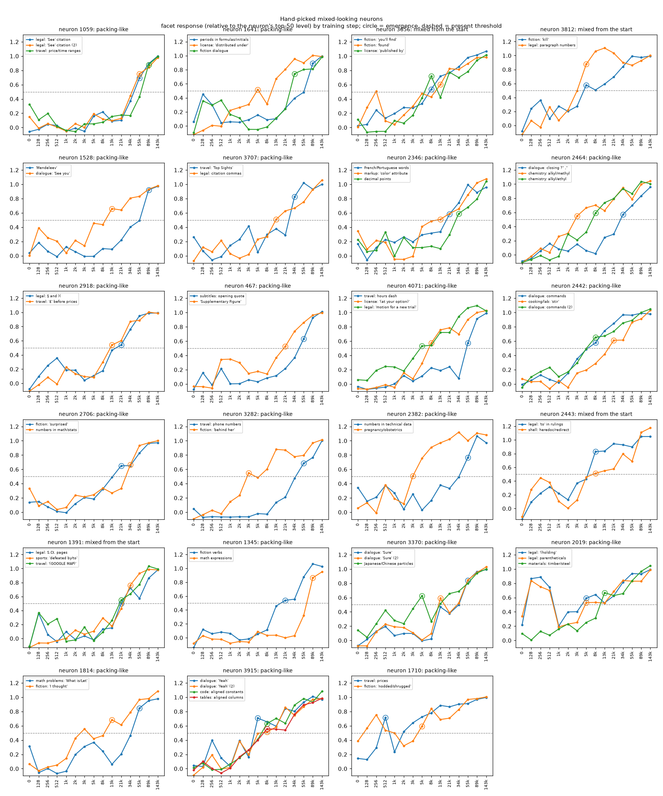

1. **Facets grow gradually.** None appears in a single jump. At initialization every facet response is below 0.39 (median 0.00), and 95 of the 101 facets emerge between steps 3,000 and 55,000, climbing across several checkpoints.
2. **A neuron's main job drifts in small steps.** From the strongest examples at each checkpoint ([results/trajectories.md](results/trajectories.md)):
   - 3915: "respectively" (step 512) → "though / however" (3k to 8k) → "of course / I admit" (13k) → "Yeah / Sure" (21k on)
   - 2464: "-yl" in chemical names (3k) → "volatile / variability" (8k to 13k) → "tri*ethyl* / tri*alkyl*" (21k on)
   - 1528: "want *that*" (2k to 5k) → "liked / seen" (8k) → "try / see" (13k) → "thought / want" (89k on)

   Each move is to something close by, which fits the essay's picture of local growth.
3. **Unrelated facets arrive separately, with no visible bridge.** In 33 of 40 neurons the two least-related facets emerge at different checkpoints (median gap: 2 checkpoints). Several arrive late: "Mendeleev" in 1528 at 89k, math operators in 1345 at 89k, periods in formulas in 1641 at 89k, closing quotes in dialogue in 2464 at 34k. In the 8 neurons I read checkpoint by checkpoint, none of these late facets showed up among the neuron's strongest examples on the way in, and I found no intermediate step linking them to the main job.
4. **Some neurons are repurposed rather than extended.** Neuron 3282's strongest examples go "bone" → "There / Most" → object nouns ("slows the whole *browser*", "wake up the *device*") → digits inside codes (DOIs, hex, phone numbers). Its "behind her" facet looks like a leftover from the object-noun phase. Neurons 2918 and 2382 show the same kind of replacement. The essay's own InceptionV1 example (5a:178: dome → fire engine → station wagon → dome and arch) has a similar shape.
5. **The largest facet usually doesn't come first.** If unrelated facets were offshoots of a main job, the largest facet should tend to emerge first. It did in 10 of 40 neurons (about 17 expected by chance), tied for first in 9, and came later in 21. One confound: the facet that grew most recently may dominate the final top 50, so "largest" may just mean "newest".

## What this does and doesn't show

- **It doesn't refute recursive generalization.** The pre-registered test was unable to find it. Point 3 is the closest thing here to evidence against it: in this small model, unrelated facets mostly don't arrive through a visible bridge. But that check is me reading the top 4 examples at 15 checkpoints, which can easily miss a branch growing below the top.
- **It supports one part of the essay.** A neuron's main job moves in small, readable steps (point 2).
- **It adds something the essay doesn't discuss.** Repurposing (point 4), where a neuron's main job is replaced and an old job survives as a facet, is a third way to get a mixed-looking neuron besides branching and packing.
- **Weakest part:** facets come from a sentence model. It splits one concept by genre (legal "See" became two facets of neuron 1059) and can't see relations the network might use (the essay's V shape). Both the selection and the adjacency test inherit that.
- **Scope:** one layer of one 410M-parameter model, 40 neurons, 2.1M tokens, 15 checkpoints, GeLU rather than SwiGLU.

## Next

- Judge adjacency with the network's own signal rather than the one used for selection. For example, check whether two facets share upstream neurons (attribution from layer 11), like the essay grouping a neuron's firings "by the circuits that feed them".
- Look for bridges directly. Between a facet's first rise and its emergence, measure the neuron's response to examples near both facets, not just its top examples. Pythia has a checkpoint every 1,000 steps, so the grid can be much denser.
- Repeat on more layers and on OLMo (SwiGLU), to see how common repurposing is.

## v2 results

v2 does the first two items under [Next](#next). It keeps v1's neurons, facets, emergence times and labels, and changes two things: facet adjacency is judged by the network's own upstream drivers instead of the sentence model that selected the neurons, and a bridge search looks for intermediate text at denser checkpoints. Both rules are in [`recgen/rubric_v2.py`](recgen/rubric_v2.py), committed (`76b88ed`) before either was computed on real data. No v1 file or result changed.

### v2 method

1. **Upstream drivers.** Pythia's blocks are parallel, so a layer-12 neuron's pre-activation is an exact sum of direct terms from the token embedding, each earlier attention layer, and each of the 49,152 MLP neurons in layers 0 to 11, once the LayerNorm scale is frozen at its value on each example. On the real model the terms add back up to the pre-activation within 5e-5. For each facet I average every upstream MLP neuron's term over the facet's final-checkpoint examples, subtract its average on 1,024 random text positions, and keep the 100 largest positive ones. Those are the facet's drivers.
2. **Adjacency.** Two facets are adjacent if their drivers overlap more than the 95th percentile of the neuron's null. The null is this neuron's facets against the facets of the other 39 traced neurons, all read through this neuron's weights, so sharing the neuron's own input weights can't by itself make two facets look adjacent.
3. **Bridge search.** For each later facet B and each facet A that emerged before it (69 pairs), the bridge is the 50 texts most similar to both, out of a pool of 491,520 random positions (sentence model, one text per window). I recorded pre-activations at 29 checkpoints from step 512 to 89k: v1's plus up to 3 more between each pair on Pythia's 1,000-step grid. The bridge's B-ward gain is its median pre-activation minus that of text matched on similarity to A but unlike B. A bridge **leads** if its gain passes half its level at B's emergence at least 2 checkpoints before B's own gain does, and that level is at least 20% of B's own gain then. A placebo (text matched on similarity to B but unlike A) gets the same test and should rise with B either way.

### What changed

| Label | v1, all 40 | v2, all 40 | v1, 23 hand-picked | v2, 23 hand-picked |
|---|---|---|---|---|
| recursive generalization | 0 | 2 | 0 | 0 |
| one origin, timing unresolved | 0 | 0 | 0 | 0 |
| packing-like | 35 | 32 | 19 | 19 |
| mixed from the start | 5 | 6 | 4 | 4 |
| unstable | 0 | 0 | 0 | 0 |

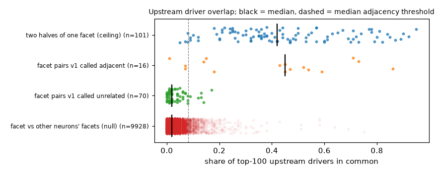

1. **The network's own drivers mostly agree with the sentence model.** Two random halves of one facet share a median 42% of their drivers, so the signature is stable enough to test. A facet and another neuron's facet share 2%. Facet pairs that v1 called unrelated also share 2%, while pairs v1 called related (such as neuron 3370's two "Sure" facets, 86%) share a median 45%. The two versions agree on 78 of 86 facet pairs. Fixing v1's circularity didn't uncover hidden adjacency: facets that look unrelated to a reader are also driven by different upstream neurons.
2. **Two neurons become recursive generalization, about what chance predicts.** If facet pairs were adjacent only at the null's false-positive rate (median 4.5% per pair), 0.9 such labels would be expected. Neuron 2976 is the interesting one: its facets are mid-word pieces of unusual words in three scripts (CJK byte fragments, "T*iss*ington" in British place names, Turkish "ç"), which looks like a single job that a sentence model can't see. Neuron 4010 (scientific vs legal citations) is weaker: two random halves of its facet 0 share only 8% of their drivers, so that facet's signature is mostly noise. Neuron 1228 moves from packing-like to mixed from the start.
3. **Sensitivity.** With top 25, 50 or 200 drivers instead of 100, 1 to 3 neurons are labeled recursive generalization. With v1's 75th percentile instead of the 95th, it's 5 to 10, but that cutoff counts a quarter of unrelated pairs as adjacent by construction.
4. **The bridge search found no leading bridge, but it had little chance to.** None of the 51 later facets has one, and 67 of 69 pairs show no bridge response at all. The placebo didn't pass either: text as similar to B as the bridge is, but unlike A, reached a median 4.8% of B's own gain (bridge: 3.7%, and above the placebo in 33 of 69 pairs, a coin flip). Text that a sentence model puts near a facet barely drives these neurons compared with the facet's own examples, so a 20% floor was out of reach for any matched text. What the search does show is that in these 29 checkpoints, nothing a sentence model sees as between two unrelated facets drove the neuron on the way. ([all pairs](results/figures/v2_bridges_all.png), [hand-picked](results/figures/v2_bridges_hand_picked.png), [gain shares](results/figures/v2_bridge_gain_shares.png))
5. **Facets arrive earlier in pre-activation than v1's threshold shows** (exploratory). When the earlier facet of a pair emerges, the later facet's examples already have a median 72% of the pre-activation gain they have at their own emergence. Timing each facet by where its gain passes half its step-89k value, v1's order holds in 49 of the 69 staggered pairs, ties in 10 and reverses in 10. Late arrivals from v1 point 3 were building for most of training: "Mendeleev" in 1528 emerges at 89k under v1 but is half-way by 17k, and 2976's facets (8k, 21k, 34k under v1) are half-way by 2k, 4k and 4k. GELU and the 0.5 cutoff make arrivals look later and more separate than the drive behind them. That weakens the timing half of both versions' labels, which decides between packing-like and mixed from the start.

### What's still shaky

- **Drivers cover a minority of the input.** Upstream MLP neurons carry a median 25% of a facet's rise over random text. The rest comes through attention and the token embedding, which v2 doesn't compare, and indirect paths (an early neuron acting through later ones) are left out.
- **Adjacency is judged at the final checkpoint.** Two facets that branched from a shared circuit and later separated would look unrelated now. Comparing drivers at the later facet's emergence checkpoint would test that directly.
- **The bridge test is underpowered** (point 4), and its texts are only weakly between facets: a median similarity of 0.24 to each, against 0.68 for a facet's own examples to its centroid. When two facets are unrelated, the 491,520-text pool holds little that is close to both.
- **The null is strict for same-genre facets.** Many traced facets come from the same few genres (legal, fiction, travel guides), so the null's upper tail includes same-genre pairs and the 95th-percentile threshold ranges from 0.05 to 0.15 by neuron.
- **Scope is unchanged:** one layer of one model, 40 neurons selected with the sentence model.

### v2 files and reproduce

| Path | What it is |
|---|---|
| [`recgen/rubric_v2.py`](recgen/rubric_v2.py) | Pre-registered adjacency and bridge rules |
| [`results/classification_v2.json`](results/classification_v2.json) | v1 and v2 labels, driver overlaps, nulls, sensitivity, bridge gains, exploratory stats |
| [`results/v2_neurons.md`](results/v2_neurons.md) | Per neuron: overlaps against the threshold, bridge outcomes, example bridge texts |
| [`results/bridges.json`](results/bridges.json) | Bridge and control sets for each facet pair |
| [`results/figures/`](results/figures/) `v2_*.png` | Driver overlaps, bridge gains, label counts |

```bash
./run_v2.sh
```

`run_v2.sh` needs v1's `results/` and `data/corpus.npy`. From scratch it takes about 2 hours on an M1 Pro: it downloads the final checkpoint once and 29 more one at a time, deleting each after use, and caches 1.6 GB in `data/`. With that cache, it reruns in a few minutes.

## v3 results

v1 and v2 looked only at the input side: what makes each neuron fire. The essay's core argument is about the output side: the cat/car neuron is one "V-shape" distinction, and the rest of the network reads it the same way whichever object set it off. v3 checks the output side of the same 40 neurons at the final checkpoint. On each facet, does the neuron's firing help predict the next token, and does the network do the same thing with it on each facet? The rules are in [`recgen/rubric_v3.py`](recgen/rubric_v3.py), committed (`815a088`) before any output was computed on facet data. No v1 or v2 file or result changed.

| Picture | What the output side should show |
|---|---|
| **one job**, unrelated triggers (the essay's V shape) | the neuron helps on both facets, and the network does the same thing with it on each |
| **one use + interference** (superposition's interference) | it helps on one facet; on the other, removing it changes nothing (harmless) or helps (harmful) |
| **two uses** sharing a neuron | it helps on both, but the network does different things with it on each |

### v3 method

1. **Bigger facets.** v1's facets have 5 to 26 examples, too few to test one at a time. Each facet keeps its examples (690 of v1's 703; the other 13 sit too near the end of a window to score) and takes more from the neuron's strongest windows at the final checkpoint (one example per window, down to half the neuron's top-50 level, at most 2,000 windows). A window joins the facet whose v1 centroid it is most similar to in the sentence model's space, if that similarity is at least 0.4, most similar first, up to 40 per facet. I set 0.4 after looking at the facet sizes it gives and reading some borderline additions (input side only), before computing any output. The 101 facets now have 7 to 40 examples (median 40), 3,127 in all.
2. **Help.** At each example, zero-ablate the neuron at that position only and compare the log-prob of the actual next token. Help is "as is" minus "ablated", in nats. A facet **helps** if its median help is at least 0.01 and a Wilcoxon signed-rank test gives p < 0.05, **harms** if the median is at most -0.01 with p < 0.05, and is **harmless** otherwise.
3. **What the network does with it.** A facet's signature is the change in next-token log-probs over the whole vocabulary, centered (so it's the change in logits), averaged over the facet's examples. All facets share the neuron's output weights, so their signatures look alike by construction. The control: patch the neuron to a typical activation (the median over all its facet examples) at 1,024 random positions in windows without v1 facet examples. The mean change there is its **generic push**. A facet's **specific signature** is its signature with the generic push projected out: what the network does with the neuron on that facet beyond what it does anywhere. Its **reliability** is how well two random halves of the facet agree on it (stepped up to the full facet with Spearman-Brown), the split-half ceiling. The **shared-job score** of two facets is the cosine of their specific signatures divided by the square root of the product of their reliabilities, the usual correction for noise: about 1 if they share one job, about 0 if their jobs are unrelated. On simulated facets with unrelated jobs, raw signatures have cosine 0.87 to 0.90, while this score stays within 0.03 of zero ([`tests/test_rubric_v3.py`](tests/test_rubric_v3.py)).
4. **Labels**, per facet pair: **too few examples** if either facet has fewer than 10. Otherwise, by each facet's help: both help gives **one job** (score 0.5 or more), **two uses** (below 0.5), or **no reliable specific signature** (either reliability below 0.5); one helps gives **one use + harmless** or **+ harmful interference**; neither helps gives **no use found**. A neuron's label is that of its two least-related facets, the pair that got it selected.

Reported next to the labels: mean-ablation instead of zero, a help floor of 0 or 0.03, and a 0.5 similarity cutoff for added examples. Exploratory: help on the 4 predictions after the next one, a positive control (facet pairs v1 and v2 both call related, such as one concept split in two), and a negative control (each neuron patched into the other neurons' facets, contexts it shouldn't share a job with).

### What v3 found

| v3 label (least-related pair) | All 40 | 23 hand-picked |
|---|---|---|
| one job | 0 | 0 |
| both help, no reliable specific signature | 0 | 0 |
| two uses | 0 | 0 |
| one use + harmless interference | 0 | 0 |
| one use + harmful interference | 0 | 0 |
| no use found | 37 | 22 |
| too few examples | 3 | 1 |

Side by side with v1 and v2 ([per neuron](results/v3_neurons.md)): all 40 are "no use found" except 3068, 138 and 2346 (packing-like in v1 and v2), whose least-related pair has a facet with under 10 examples. That covers all of v1's labels (35 packing-like, 5 mixed from the start) and both neurons v2 called recursive generalization (2976, 4010).

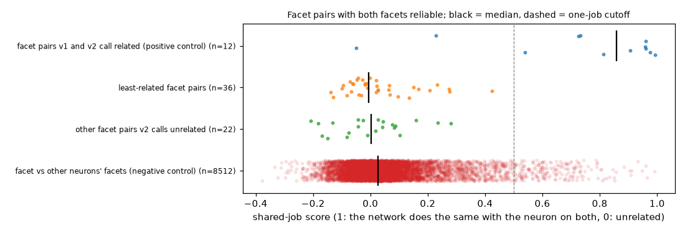

1. **The pre-registered labels can't tell the three pictures apart, for two reasons.**
   - **On their strongest examples, these neurons don't measurably help predict the next token.** No facet helps; 99 of 101 are harmless and 2 harm. On the next 4 predictions, the 93 harmless facets with 10 or more examples stay harmless. Mean-ablation and a 0.03 floor give identical labels. With no floor, 5 neurons get an interference label on helps of 0.0001 to 0.007 nats, and none gets one job or two uses. Per example (exploratory), ablation moves the actual next token's log-prob by a median 0.011 nats, up or down: 49% of examples go up, the mean is 0.0001 nats, and the direction is unrelated to whether the model was right (Spearman -0.004 with its log-prob). A quarter of examples already give the next token over 90% probability, where ablation barely moves it (median 0.0002 nats, against 0.019 for the rest). ([help per neuron](results/figures/v3_primary_help.png), [labels](results/figures/v3_labels.png))
   - **Even with large help, the split between one job and two uses couldn't have caught the essay's case.** It compares final output effects. In the essay's picture, a V shape read by cat features in cat images and by car features in car images changes the output differently in each, so the rubric would have called it two uses. This is a flaw in the pre-registered design, not a finding.
2. **Where a neuron fires most, it barely changes the prediction, and no more than in random text** (exploratory, added after seeing point 1). On a facet, ablation moves a median 1.0% of next-token probability (KL 0.0004 nats). Patched to the same activation in random text, the neuron moves 1.0% (KL 0.0004). Of the 95 facets with 10 or more examples, about half are above their random-text level: 49 in KL, 46 in probability moved.
3. **What the network does with a neuron at the logits is consistent within a facet and unrelated across unrelated facets** (exploratory: the score is pre-registered, but it enters a label only when both facets help, which never happened, and both controls were declared exploratory). The raw signatures of a neuron's two least-related facets have cosine 0.39 (median): the shared-weights effect. Beyond the generic push (a median 39% of a signature's squared norm), a facet's reliability has median 0.81 (two halves agree at 0.68, stepped up to the full facet). Facet pairs v1 and v2 both call related, like 1059's two legal "See" facets, score a median 0.86, and 10 of 12 pass 0.5. The 36 least-related pairs whose facets are both reliable score a median -0.006, and none passes 0.5. That is where unrelated contexts sit: a neuron's facets against other neurons' facets, with the neuron patched in there, score a median 0.03 (95th percentile 0.36), and 2.4% of those pairs pass 0.5. The highest least-related pair, 2976 at 0.42, is about what the best of 36 such control pairs scores anyway (the maximum of 36 random control scores beats it 3 times in 4). Two limits: the least-related pairs were picked for having the least similar contexts, so a score near 0 partly follows from selection; and the positive control covers only near-identical contexts (one concept split in two), so nothing checks that the score can find one job across different contexts.

### Reading cases by hand

These readings are separate from the labels. They use the tokens whose probability the neuron raises and lowers most on each facet (listed for every neuron in [results/v3_neurons.md](results/v3_neurons.md)).

- **1059, legal "See" vs price and time ranges.** After "See" it raises the start of a cited case ("People", "United", "id", "Id") and lowers "Rule", "also", "supra" and commas: cite a case, not a rule or statute. In ranges like "5-10pm" it reshuffles which number or day comes next ("4", "9", "10", "Tue" up; "5", "6", "8", "Mon" down) with no clear direction. Two different effects on the prediction, both small (1.5% and 1.1% of probability moved).
- **3282, phone numbers vs "behind her".** In phone numbers it raises single digits and lowers "00", "0" and "-": how the number continues. After "behind her" or "in front of her" it raises ".", "," and "and" and lowers "mood", "face" and "bed": it reads "her" as an object that ends the phrase, not a possessive ("her mood"). Two readable, unrelated effects on the prediction. Its median help on "her" (+0.004 nats, p = 0.51) is indistinguishable from zero.
- **1528, "Mendeleev" vs "See you".** On "M|ende" it raises "ley", "'s" and "," and lowers "le" and "lev", the correct next piece: median help -0.03 nats, KL ten times its random-text level, the clearest harmful effect in the set. But all 21 examples come from one long text (consecutive corpus windows 1432 to 1482, no document break), so its p < 0.001 treats one book's repeated "Mendeleev" as independent examples. In dialogue it does almost nothing. This facet fits the interference picture, but v3 can't say what the neuron's main job is, since no facet helps. It isn't labeled harmful interference for the same reason.
- **2976, mid-word pieces in Chinese and Japanese, British place names, and Turkish and other languages.** On all three facets it raises plausible continuations of a word split into rare pieces ("った" and "ア" in Japanese; "inia" and "ichen" in place names; "men", "inc" and "en" in Turkish). That reads like one effect, and v2 called this neuron recursive generalization from its upstream drivers. But its least-related score (0.42) is within what unrelated pairs reach (point 3), so the output side doesn't confirm it. The "Turkish" facet is half one election table (consecutive windows 302 to 311, "Toplam Se|ç|men"), plus four other Turkish texts and Finnish, Hindi, Hungarian, Croatian and C code. Its help (median +0.05 nats, p = 0.07, 19 examples) is the largest among facets with 10 or more examples.
- Two of the next-highest scores belong to the hand-picked neurons I had flagged for a possible shared pattern, both below the negative control's 95th percentile. 2442 (commands in dialogue vs "stir" in recipes; least-related pair 1-2, score 0.28) raises what follows an imperative verb: prepositions after "stir" ("for", "until", "into") and objects or prepositions after spoken commands ("this", "for", "on"). 2918 (section signs vs pound signs, 0.23) raises digits on both facets; its pound-sign facet harms, pushing prices like "25", "45" and "15".

### What this does and doesn't show

- **It doesn't decide between the three pictures**, for the two reasons in point 1: no facet passes the help test, and the split between one job and two uses at the logits couldn't have caught the essay's case anyway. It's no evidence for or against any of the three.
- **At the logits, the network's response to a neuron follows the context.** Unrelated facets get unrelated output signatures, as unrelated contexts do. That isn't evidence against the essay, which expects the same of a V shape read by cat features in one image and car features in another. Telling "one distinction read downstream" from "two uses" needs a test one level down: whether the neuron's write feeds the same downstream components on both facets (by weights or a linearized attribution, as v2 did upstream), with the context deciding which of them act, or disjoint components on each.
- **Two cases stand out, neither decisively.** 1528 harms on "Mendeleev", but in one book. 2976 raises word continuations on all three facets, but its score is within the negative control.

### What's still shaky

- **Single-neuron ablation is a weak probe here.** One neuron moves about 1% of next-token probability. If other neurons carry the same signal, removing one can hide a real use. Ablating a facet's co-firing neurons together, or patching paths to specific later components, would be stronger.
- **Logit-space signatures are dominated by improbable tokens.** The top tokens of a specific signature are fragments like "EVER" and "osis" that barely matter for prediction, so point 3 is mostly about how the network moves tokens it wasn't going to predict. The probability view (point 2 and the hand readings) fixes that, but it was added after seeing the results and isn't calibrated against a negative control.
- **Probable next tokens cap help.** A quarter of examples already give the next token over 90% probability, so removing any one neuron can barely change it. That pulls facet medians toward 0.
- **Examples cluster by document.** 1528's "Mendeleev" facet is one book, and half of 2976's "Turkish" facet is one table. Clustered examples make p-values too small and reliabilities too high. Resampling by document would fix that.
- **Only the next 5 predictions are measured.** A neuron's write at one position can be read much later.
- **Bigger facets drift a little.** 2976's Turkish facet picks up Hindi and code, and 1059's price facet picks up street names. With a 0.5 cutoff instead of 0.4, 13 more neurons drop to too few examples (16 in all) and the other 24 stay "no use found".
- **The controls are limited.** The positive control covers only near-identical contexts. The negative control patches the neuron where it doesn't fire, while facet pairs use its natural activations, and it splits other neurons' facets once (even and odd examples) for their reliability, instead of 50 random splits.
- **Two harmful facets out of 101 is no more than chance gives** at p < 0.05. 1528's p is far smaller, but it comes from one book.
- **Scope is unchanged:** one layer of one model, 40 neurons selected with the sentence model, final checkpoint only.

### v3 files and reproduce

| Path | What it is |
|---|---|
| [`recgen/rubric_v3.py`](recgen/rubric_v3.py) | Pre-registered facet enlargement, measures and labels |
| [`results/facets_v3.json`](results/facets_v3.json) | The enlarged facets: window, position, activation, similarity, whether v1 had it |
| [`results/classification_v3.json`](results/classification_v3.json) | v1, v2 and v3 labels; per-facet help, reliability, top tokens; per-pair scores; sensitivity; controls |
| [`results/v3_neurons.md`](results/v3_neurons.md) | Per neuron: a summary table, then each facet's help, top tokens and examples, and each pair's score |
| [`results/figures/`](results/figures/) `v3_*.png` | Shared-job scores against the controls, help on each least-related pair, label counts |

```bash
./run_v3.sh
```

`run_v3.sh` needs v1's `results/` and `data/` and v2's `results/classification_v2.json`. From scratch it takes about an hour on an M1 Pro: it downloads the final checkpoint once, deletes it after use, and caches 0.9 GB in `data/`. With that cache, it reruns in 30 seconds and gives identical results.

## v4 results

v2 judged adjacency at the final checkpoint, which can't see two facets that grew out of shared circuitry and separated afterwards. v4 measures v2's driver overlaps at all 14 checkpoints after initialization and asks whether two facets shared drivers *while they formed*. It also splits attention into its 192 heads, because v2's MLP-neuron drivers covered only about a quarter of a facet's rise. The rules are in [`recgen/rubric_v4.py`](recgen/rubric_v4.py), committed (`7b4f2ce`) before any checkpoint was recorded. No v1, v2 or v3 file or result changed.

### v4 method

1. **Recording.** At each checkpoint from step 128 to 143k, the same facet examples and background text as v2, run through layer 12. With the LayerNorm scale frozen at its value on each example (as in v2), each pre-activation splits exactly into direct terms: upstream MLP neurons, the 192 attention heads, the token embedding, and biases. The terms add back up within 5e-5 at every checkpoint, and at the final checkpoint v4's MLP driver overlaps match v2's exactly.
2. **Formation window.** A facet's gain is the neuron's median pre-activation on its examples minus its median on background text. The facet forms from the checkpoint after which its gain stays above 25% of its final value to the one after which it stays above 75%. A pair's window spans both facets' windows; for the least-related pairs it runs a median of step 512 to 13k.
3. **Adjacency at formation.** A pair is adjacent at formation if its largest driver overlap inside its window beats the 95th percentile of the same statistic for null pairs (each of the two facets against every other traced neuron's facets, read through this neuron's weights, over the same window). Taking the window's maximum on both sides keeps the false-positive rate near 5% however long the window is. MLP-neuron drivers (top 100, as in v2) are the primary measure; head drivers (top 5 of 192) are reported beside them.
4. **Branched then separated:** adjacent at formation but not at the end (v2). That's the recursive-generalization signature v2 couldn't see.

### What v4 found

| Label (all 40) | v1 | v2 | v4, MLP drivers | v4, head drivers | Expected by chance (v4, MLP) |
|---|---|---|---|---|---|
| recursive generalization | 0 | 2 | 1 | 1 | 0.9 |
| one origin, timing unresolved | 0 | 0 | 0 | 0 | 0.1 |
| packing-like | 35 | 32 | 33 | 32 | 30.3 |
| mixed from the start | 5 | 6 | 6 | 7 | 8.6 |

The 23 hand-picked neurons are 19 packing-like and 4 mixed from the start by MLP drivers, as in v2 (18 and 5 by head drivers).

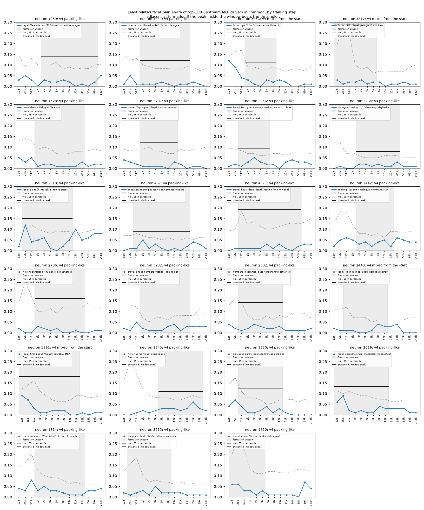

Below, "unrelated" means not adjacent at the end by v2's driver test, and "related" means adjacent.

1. **No unrelated pair branched then separated.** By MLP drivers, 0 of 68 unrelated pairs were adjacent at formation, where the null's false-positive rate predicts 3.1. By head drivers it's 0 against 1.4. The least-related pair's overlap peaks at a median 0.05 inside its window, against a median threshold of 0.14. For the hand-picked neurons it stays mostly between 0.00 and 0.05 all through training, and their largest single-checkpoint values are 0.12: 2918 at step 256 (below its threshold of 0.15) and 3656 at step 128 (before its window opens). Across all 40 neurons, the largest are 4010 (0.18) and 2976 (0.13); see point 4.
2. **Zero is below chance, which says more about the pairs than the method** (exploratory, as are points 4 to 6). 0 against 3.1 has a Poisson probability of about 0.05, and an uncorrected check per checkpoint finds 13 of 475 in-window tests (2.7%) above that checkpoint's null 95th percentile, against 5% nominal. These pairs were chosen as each neuron's least alike, while the null includes same-genre facets from other neurons, so they share even fewer drivers than the null. The 68 pairs also aren't independent: they share facets and null sets.
3. **The test catches sharing that persists; brief sharing is less certain.** 17 of 18 related pairs are adjacent at formation by MLP drivers (head drivers: 9 of 18). But these pairs were picked for sharing drivers at the end, so this control covers sharing that lasts, not the brief shared phase v4 is looking for; only the synthetic unit test covers that. Real overlaps of 0.11 to 0.14 sit near the thresholds, and a brief shared phase of about 0.1 in a window that opens before step 1k would face thresholds of 0.12 to 0.29.
4. **Two neurons share drivers between their least-related facets, but steadily, not by branching.** Neuron 4010 (scientific vs legal citations) is labeled recursive generalization by both measures, as in v2: its facets overlap 0.08 to 0.18 at every checkpoint, above that checkpoint's null 95th percentile at 10 of 14. That's the most consistent sharing in the set, and its two facets may be one job (citations). Neuron 2976 (mid-word pieces of rare words) drops from v2's recursive generalization to packing-like, but only because noisy early checkpoints set its window's threshold at 0.143. Its overlap reaches 0.11 by step 8k (where the window closes, against that checkpoint's null 95th percentile of 0.05) and 0.13 at the end, above the per-checkpoint null at 7 of 14 checkpoints. Its head drivers overlap completely at step 2k. Both look like persistent sharing, which is the essay's "one job" picture more than either branching or packing.
5. **v4's formation timing doesn't back v1's emergence order.** The labels still use v1's emergence order, as pre-registered. But for 38 of 40 least-related pairs the two formation windows overlap, and of the 33 pairs v1 calls staggered, the v1-later facet starts forming first in 12 and at the same checkpoint in 8. So the split between "packing-like" and "mixed from the start" mostly reflects v1's 0.5 cutoff: most facet pairs formed over the same stretch of training.
6. **Head drivers judged by heads at the end too.** The pre-registered "branched then separated" compares head adjacency at formation with v2's MLP adjacency at the end. Judging the end by heads as well (the pair's final overlap above its null's final 95th percentile), 3 pairs are head-adjacent at formation but not at the end: 3656 0-1, 2976 0-1 and 2442 0-2. All three share MLP drivers at the end, so none is an unrelated pair, and the count in point 1 stands.
7. **A facet's support moves from MLP neurons to attention during training** (exploratory). Pooling every facet's rise over background, upstream MLP neurons carry 84% at step 128 and 67% at 1k. Attention heads overtake them between 1k and 2k, and by the end heads carry 80% and MLP neurons 20%. (Median per-facet shares put the crossover between 2k and 3k; early per-facet shares are noisy because 22 of 101 facets have no positive rise yet at step 128.) The token embedding stays near zero. These are direct terms only: a head's term can include attention to the current token, and attention patterns weren't analyzed.

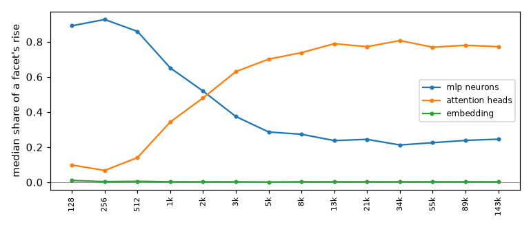

### What this does and doesn't show

- **v4 found no sign that unrelated facets shared upstream drivers while they formed, but the test has limited power.** MLP drivers carry a minority of the rise over most of the formation windows, head drivers are a blunt probe, and the positive control covers lasting sharing, not brief sharing (point 3). So this is absence of evidence for branching, not evidence that facets were attached separately. v1's timing doesn't add much either (point 5), and v3's output test couldn't decide.
- **The clearest sharing is steady, not branching.** 4010 and 2976 share drivers between their least-related facets through most of training (point 4). Neither shows the branch-then-separate pattern.
- **It doesn't show why unrelated facets share a neuron.** v4 doesn't test the packing mechanism (unrelated things placed together because they rarely collide), and there are other possibilities; for example, v1 point 4's repurposed neurons keep an old job as a leftover facet.
- **It doesn't contradict the essay's main claim.** The essay is about most neurons, and these are the 40 most mixed-looking of 4,096 in one layer of a small model. The essay itself says smaller models "have broader neurons", so it expects more mixing here. What this tests is its explanation for the mixed ones, and in this sample it found no evidence for that explanation.

### What's still shaky

- **The rules weren't written blind.** They were committed before any v4 data, but chosen knowing v2's final-checkpoint overlaps and v2's dense pre-activation gain curves. The readings of 4010 and 2976 (point 4) are post hoc.
- **Top-100 overlap is coarse.** Sharing below a facet's top 100 MLP drivers, or through indirect paths (an early neuron acting through later ones), is invisible.
- **Head drivers are a weak probe,** and they carry most of the rise after step 1k to 2k. Top 5 of 192 heads catches only 9 of 18 related pairs, so shared circuitry that lives in attention could be missed. Comparing what the heads attend to and which features they move would be finer.
- **Early training is hard to read.** At steps 128 to 512 the null's 95th percentile reaches 0.28 (step 256), and window thresholds reach 0.29, so brief sharing very early would need a large overlap to show.
- **The grid is log-spaced.** Formation windows span several checkpoints, but a short shared phase between two of them could be missed. Pythia has a checkpoint every 1,000 steps.
- **Facets are defined by their final examples.** A branch whose early form fired on different text than its final examples wouldn't show up in these overlaps.
- **Scope is unchanged:** one layer of one model, 40 neurons selected with the sentence model.

### v4 files and reproduce

| Path | What it is |
|---|---|
| [`recgen/rubric_v4.py`](recgen/rubric_v4.py) | Pre-registered formation windows and adjacency at formation |
| [`recgen/formation.py`](recgen/formation.py) | Attribution at each checkpoint, with attention split by head |
| [`results/classification_v4.json`](results/classification_v4.json) | v1, v2 and v4 labels; per pair: windows, overlap series, null thresholds, branched-then-separated; source shares by step |
| [`results/v4_neurons.md`](results/v4_neurons.md) | Per neuron: formation windows and each pair's test |
| [`results/figures/`](results/figures/) `v4_*.png` | Least-related pair overlap over training, label counts, source shares |

```bash
./run_v4.sh
```

`run_v4.sh` needs v1's and v2's `results/` and `data/corpus.npy`. From scratch it takes about an hour on an M1 Pro: it downloads 14 checkpoints one at a time, deletes each after use, and caches 3.0 GB in `data/v4/`. With that cache, it reruns in about 5 minutes.

## v5 results

v1 to v4 studied 40 neurons in one layer of one small model. The essay expects bigger models to have narrower neurons, so fewer mixed-looking ones. v5 asks whether that holds: it runs v1's facet detector, unchanged, on six Pythia sizes trained on the same data in the same order. The rules are in [`recgen/rubric_v5.py`](recgen/rubric_v5.py), committed (`58fefef`) before any model was recorded. No earlier result changed (scipy is now a declared dependency).

### v5 method

1. **Models and layers.** Pythia 70M, 160M, 410M, 1B, 1.4B and 2.8B, all in float16. 6.9B doesn't fit in this laptop's 16 GB. At each size, three layers: a quarter, half and three quarters of the way through (layer `int(depth * layers)`). The middle layer is primary.
2. **Neurons.** In each layer, near-dead neurons (peak below half the layer's median peak) and dense ones (v1's rule) are dropped, and 2,048 of the rest are sampled with a fixed seed, all of them in 70M.
3. **Measure.** v1's facet detector on the same 2.1M-token corpus: each neuron's 50 strongest windows, embedded with the sentence model and clustered. The primary measure is the share of sampled neurons that are **unrelated mixed**: 2 or more facets whose least-related pair has centroid similarity below 0.1. The secondary measure is the share with 2 or more facets of any kind, v1's selection criterion. Each share gets a 95% bootstrap interval over neurons.
4. **Verdict** on the primary measure at the middle layer: "fits the essay" if the share falls with size (Spearman correlation with size rank at most -0.8) and 2.8B's interval lies entirely below 70M's; "against the essay" for the mirror image; otherwise "no clear trend". The other depths and the secondary measure get the same test, reported beside it.

As a check, the 410M middle layer is v1's layer 12: v5 finds 2+ facets in 25.3% of its neurons, against v1's 24.9% with float32 and v1's eligibility rule.

### What v5 found

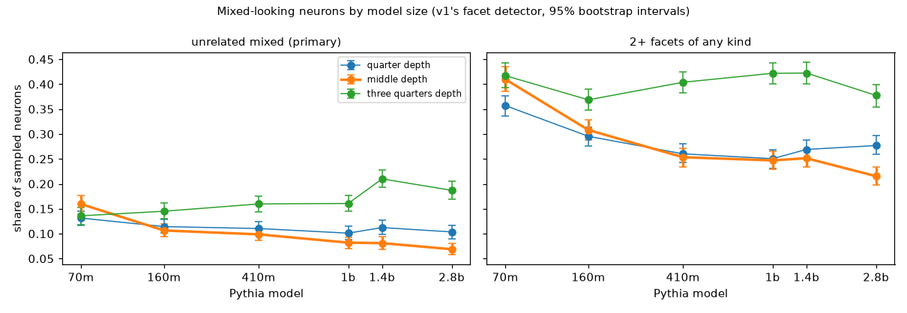

| Unrelated mixed | 70M | 160M | 410M | 1B | 1.4B | 2.8B | Spearman | Verdict |
|---|---|---|---|---|---|---|---|---|
| **middle (primary)** | **16.0%** | **10.6%** | **9.9%** | **8.2%** | **8.1%** | **6.9%** | **-1.00** | **fits the essay** |
| quarter | 13.1% | 11.4% | 11.0% | 10.1% | 11.2% | 10.4% | -0.71 | no clear trend |
| three quarters | 13.6% | 14.5% | 16.0% | 16.1% | 21.0% | 18.7% | +0.94 | against the essay |

Exact intervals and the secondary measure are in [`results/v5_models.md`](results/v5_models.md) and [`results/classification_v5.json`](results/classification_v5.json). Points 2 to 7 are exploratory, added after an independent review of the first results.

1. **At the middle layer, mixed-looking neurons get rarer with size, as the essay predicts.** The unrelated-mixed share falls from 16.0% (14.0 to 17.7%) in 70M to 6.9% (5.8 to 8.1%) in 2.8B, and the share with 2+ facets of any kind falls from 41.0% to 21.5% (also "fits the essay"). More than half of the drop is between 70M and 160M, and 1B to 1.4B is flat (8.2% vs 8.1%). Without 70M the primary measure still fits: 160M's interval (9.4 to 12.0%) sits above 2.8B's.
2. **Part of that decline is the detector finding fewer groups at all.** At the middle layer, neurons whose top 50 contexts form no facet rise from 20.7% to 36.8%. A neuron's strongest contexts are also less alike in bigger models (median pairwise similarity 0.076 to 0.055), and the share of them that land in any facet halves (27% to 14%). So to the sentence model, bigger models' neurons look more varied, not narrower. Conditioning shows where the trend lives. Among neurons with at least one facet, the unrelated-mixed share still falls (20.1% to 10.9%, "fits the essay", with or without 70M). Among neurons with 2+ facets, the share whose facets are unrelated barely moves (38.9% to 32.0%, no clear trend).
3. **After the first step, detector settings matter.** Re-clustering the middle layer at a cosine distance of 0.7, or a minimum facet size of 6, still fits, with or without 70M. A distance of 0.8 fits over all six sizes but not without 70M. A minimum facet size of 4 gives no clear trend (Spearman -0.77).
4. **Other depths don't follow the middle.** A quarter of the way in, the share drifts down only slightly (13.1% to 10.4%). Three quarters of the way in, it rises (13.6% to 18.7%, peaking at 21.0% at 1.4B), which the pre-registered test calls "against the essay". It rises under every other detector setting too (Spearman +0.37 to +0.89), though not all of them pass the full test.
5. **Shared next tokens don't explain the deep-layer rise, but this check is crude.** At three-quarters depth, an unrelated-mixed neuron's two least-related facets share their most common next token 0.5 to 2% of the time, against 0.2 to 0.8% for facets of different neurons (averaged over 200 shuffles). That's above chance but rare, and no higher than at the middle layer (0.9 to 5.7%). The check only catches identical tokens, so a neuron that promotes a class of tokens, like the article neuron in point 6, slips through. A real test would read the neuron's output weights through the unembedding.
6. **Some "unrelated mixed" neurons look like one pattern that the detector splits** (from reading the three random examples per model and depth in [`results/v5_models.md`](results/v5_models.md)).
   - 2.8B middle neuron 3791 fires on spelling pieces: "rag|azzi" and "rig|uarda" in Italian, "Rag|lan" in an English place name, "flag|stone" in a description.
   - 2.8B deep neuron 4166 fires on articles: "the" in English legal and news text, "un" and "des" in French fiction.
   - Others look genuinely mixed, such as 2.8B middle neuron 9176 ("stepped" in fiction vs numbers in math problems) and 1.4B deep neuron 6657 (legal text vs "b|end" in TikZ diagrams).
   - v5 has no checkpoints, so these are relations between facets, not evidence of how they grew.
7. **The dense-neuron filter treats 70M differently.** It drops 24 to 25% of 70M's neurons at the middle and three-quarters layers, against 0.3 to 7% in every other layer. Point 1's result without 70M doesn't depend on it.

### What this does and doesn't show

- **The middle-layer result fits the essay, but it's thinner than the headline.** Mixed-looking neurons get rarer with size, most clearly from 70M to 160M. Beyond that the decline is small and depends on detector settings (point 3). Part of it is the detector finding no groups at all in more of the bigger models' neurons, whose strongest contexts look more varied rather than narrower. Among neurons that do split into groups, the unrelated share barely changes (point 2).
- **The trend depends on depth.** Deep layers go the other way, and nothing here explains why. The detector's blind spots may differ by depth: if deep neurons in bigger models track features that cut across genres and languages, like the article neuron, the detector would count more of them as mixed. That's a guess, not something v5 tested.
- **It measures how mixed neurons look, not why.** v5 counts neurons whose strongest examples split into unrelated groups. It doesn't say whether they got that way by packing, branching or anything else.

### What's still shaky

- **One detector, which behaves differently with size.** The sentence model splits a concept by genre or language and can't see relations the network uses (point 6), and the share of neurons it finds no groups in grows with size (point 2). So the absolute shares overstate real mixing, and comparisons across sizes aren't free of detector effects either.
- **Six sizes, one family, one corpus.** A Spearman correlation over six points is coarse, and the largest model is 2.8B, far below the trillion-parameter models the essay discusses. The 2.1M-token corpus is the same Pile sample for every size.
- **Relative depth has a size-related offset.** `int(depth * layers)` picks the middle layer, but an MLP sits halfway through its block, so its actual relative position is (layer + 0.5) / layers: 0.58 for 70M's middle layer, 0.54 for 160M's and 0.52 to 0.53 for the rest. Shares rise steeply from the middle to the three-quarters layer, so this could inflate 70M's middle share somewhat. Recording neighboring layers would settle it.
- **Sampling.** 2,048 neurons per layer (70M: all 1,546 to 2,002 eligible). Intervals cover neuron sampling, not the choice of corpus or detector settings.
- **Precision.** v5 runs every size in float16, v1 to v4 ran 410M in float32. The 410M check above agrees to within 0.4 points.

### v5 files and reproduce

| Path | What it is |
|---|---|
| [`recgen/rubric_v5.py`](recgen/rubric_v5.py) | Pre-registered models, depths, eligibility, measures and verdict |
| [`recgen/sweep.py`](recgen/sweep.py) | Window maxima at three depths of each Pythia size |
| [`recgen/analyze_v5.py`](recgen/analyze_v5.py), [`recgen/plots_v5.py`](recgen/plots_v5.py) | Detector, shares, verdicts and exploratory checks; the figure |
| `tests/test_rubric_v5.py`, `tests/test_sweep.py`, `tests/test_analyze_v5.py` | Tests for the rules, the recorder and the analysis |
| [`results/classification_v5.json`](results/classification_v5.json) | Verdicts, per-layer shares and intervals, facet counts, per-neuron facet counts and similarities, exploratory checks |
| [`results/v5_models.md`](results/v5_models.md) | Per model: shares by depth, and three random unrelated-mixed neurons per depth with examples |
| [`results/figures/v5_scale.png`](results/figures/v5_scale.png) | Shares by model size and depth |

```bash
./run_v5.sh
```

`run_v5.sh` needs only `data/corpus.npy`. From scratch it takes about 2 hours on an M1 Pro: it downloads the six models one at a time (about 12 GB in all), deletes each after use, and caches 2.3 GB in `data/v5/`, including sentence embeddings of 918,218 example contexts. With that cache, it reruns in a few minutes.

## v6 results

Every result so far groups a neuron's strongest examples with a sentence model (MiniLM). v5's review found that this detector behaves differently with model size, splits one pattern by genre or language, and that v5's middle-layer decline beyond 70M depends on its settings. The essay's argument is that a neuron should be read the way the network reads it. v6 reruns v5's sweep, on the same neurons and the same examples, with a detector that groups examples by the network's own representation of them. The rules are in [`recgen/rubric_v6.py`](recgen/rubric_v6.py), committed (`e1b34cc`) before any v6 data was recorded. No earlier file or result changed.

### v6 method

1. **Embedding.** An example is represented by the residual stream entering the neuron's layer at that position, which is what the layer's MLP reads through its LayerNorm. The vector is LayerNorm-normalized, the mean over 1,024 random corpus positions is removed, and the neuron's own input direction (its input weights times the LayerNorm gain) is projected out. Without that last step the examples would look alike by construction, since the neuron's pre-activation is exactly that direction's dot product with the vector.
2. **Calibration.** A cosine similarity means different things in MiniLM's space and in each model's residual stream, so the thresholds come from a null: the similarities between all pairs of the 1,024 random positions, embedded the way the neuron's examples are. The percentiles are where v1's thresholds sit in MiniLM's own null on the same positions. Groups merge while their average similarity is above the 98.2nd percentile (MiniLM's 0.25), and two facets are unrelated if their centroids are less similar than the 81.0th percentile (MiniLM's 0.1). So both detectors merge groups at the same level relative to random text.
3. **Unchanged from v5:** the six sizes, the three depths, the sampled neurons (the recorder checks they are v5's), their 50 strongest windows, the minimum facet size of 5, both measures, the bootstrap and the verdict rule. Recording reuses v5's positions. As a check, each neuron's activations rebuilt from the stored residuals match v5's within 0.035 (median top activation 2 to 3).
4. **Comparison with v5,** pre-registered: per-neuron agreement (Cohen's kappa on the unrelated-mixed flags, and the adjusted Rand index between the two detectors' groupings of each neuron's 50 examples), and whether each of v5's verdicts holds. Verdicts without 70M are secondary.
5. **Detector checks,** reported for both detectors: the share of neurons with no facet, how alike a neuron's top examples are relative to the null, token purity (the share of a facet's examples on its most common activating token), and power. For power, 500 synthetic neurons per layer each pool the 25 strongest examples of two sampled neurons, and the check is the share called unrelated mixed. If a detector's power falls with size, a falling share can't be told apart from lost sensitivity.

Before committing the rules, I tried the recorder and detector on Pythia 14M and 31M, which aren't in the sweep. They showed the detector wasn't degenerate, and that it splits mostly by activating token in those small models, so token purity was added as a check. No threshold or rule changed.

### What v6 found

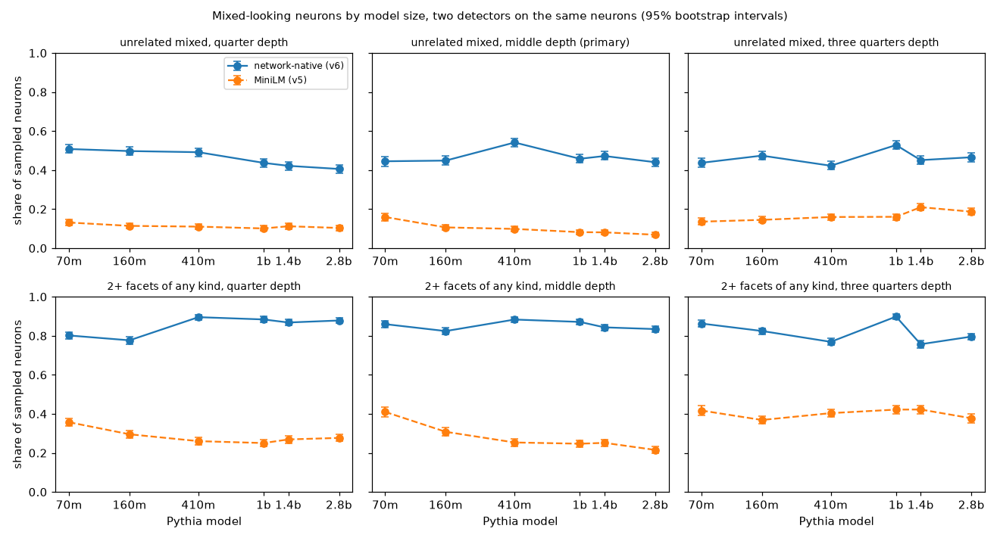

| Unrelated mixed | 70M | 160M | 410M | 1B | 1.4B | 2.8B | Spearman | v6 verdict | v5's verdict |
|---|---|---|---|---|---|---|---|---|---|
| **middle (primary)** | **44.5%** | **44.9%** | **54.2%** | **45.8%** | **47.2%** | **44.0%** | **-0.03** | **no clear trend** | fits the essay |
| quarter | 50.8% | 49.8% | 49.2% | 43.7% | 42.2% | 40.6% | -1.00 | fits the essay | no clear trend |
| three quarters | 43.7% | 47.4% | 42.2% | 52.8% | 45.1% | 46.6% | +0.26 | no clear trend | against the essay |

Intervals, the secondary measure and per-layer agreement are in [`results/v6_models.md`](results/v6_models.md) and [`results/classification_v6.json`](results/classification_v6.json). Points 2 to 6 include exploratory checks: the anisotropy figure in point 6 was added after seeing the results, and the flag rates and grouping overlap (point 3), the excess power (point 4) and the pair-level cutoff (points 2 and 6) after an independent review.

1. **v5's middle-layer decline doesn't survive the change of detector.** Under the network-native detector, the unrelated-mixed share at the middle layer stays near 45% from 70M (42.0 to 47.0%) to 2.8B (41.9 to 46.1%), peaking at 54.2% in 410M. Without 70M there's still no clear trend (Spearman -0.30), and the share with 2+ facets stays at 82 to 88%. So v5's primary verdict doesn't hold, with or without 70M.
2. **No other depth gives a trend that holds across settings.**
   - At three quarters, v5's rise isn't clear under v6's pre-registered settings (no clear trend). But two of the four other settings give "against the essay" over all six sizes (distance 0.8, Spearman +0.83; minimum facet size 4, +0.93), though neither does without 70M.
   - At a quarter, v6 finds a steady fall from 50.8% to 40.6% ("fits the essay", also without 70M), where MiniLM drifted down without passing the test (13.1% to 10.4%). That fall holds under every other setting and without the projection, but not with the LayerNorm gain applied or with the pair-level cutoff in point 6.
3. **The two detectors disagree about which neurons are mixed, though their groupings overlap.** v6 flags 2 to 6 times as many neurons as v5 does, and Cohen's kappa on the flags is 0.03 to 0.15 per layer. v6 flags 48 to 70% of the neurons v5 calls unrelated mixed, and 40 to 52% of the rest. Their groupings of a neuron's examples agree more: of the example pairs MiniLM puts in one facet, v6 also puts 49 to 83% together, against 14 to 33% of all pairs. The median adjusted Rand index between the two groupings is low (0.01 to 0.13), mostly because MiniLM leaves most examples out of any facet.
4. **MiniLM barely tells a pooled pair of neurons from a single neuron, at any size.** Pooling the 25 strongest examples of two random neurons should make a synthetic neuron look mixed.
   - **MiniLM** calls 9 to 23% of these pools unrelated mixed. That's 0 to 10 points more than single neurons, and at most 6 points beyond 70M; at 410M's middle layer it's 9.8% against 9.9%.
   - The pre-registered check reads MiniLM's power as falling with size at the quarter and middle depths (middle: 22.2% to 9.6%). But the pre-registered measure counts the single-neuron share as power, and that share falls too. So MiniLM isn't losing sensitivity with size; it had little to begin with.
   - **v6** calls 55 to 86% of the pools unrelated mixed, 9 to 41 points more than single neurons. At the middle depth that excess is flat after 70M (41 points at 70M, 22 to 25 after), which supports reading v6's flat middle-layer share as real rather than lost power. At a quarter it stays between 18 and 32 points. At three quarters it falls unevenly, from 40 points at 70M to 9 at 2.8B, so v6 loses power there in bigger models.
5. **v6 finds groups in almost every neuron, at every size.** It finds no facet in 0 to 3% of neurons, where MiniLM finds none in 18.5 to 36.8%, rising with size at the quarter and middle depths. Both detectors see a neuron's top examples as less alike, relative to random text, in bigger models. At the middle layer, the median similarity between top examples falls from the 91st to the 79th percentile of the null under v6, and from the 65th to the 57th under MiniLM. Under MiniLM that showed up as more neurons with no facet. Under v6 it doesn't change the number of facets ([checks](results/figures/v6_checks.png)).
6. **Settings don't produce a middle-layer trend, except one.** At the middle depth there's no clear trend under any of these: the other v5 detector settings mapped through the null (shares from 30% to 66%), the LayerNorm gain applied, no projection, or the unrelated cutoff applied to the mean similarity between two facets' examples instead of their centroids (53 to 64%). Only the uncentered variant falls with size (38% to 11%). A likely reason, not tested directly: the mean that every position shares makes up a growing part of the residual vector. It's 26% of the squared norm in 70M's middle layer and 55% in 2.8B's (73% at 2.8B's three-quarters layer). Without centering, a big model's examples would then look more alike whatever they are, which is why the rubric removes the mean.
7. **What the network-native detector groups by** (from the three random neurons per model and depth in [`results/v6_models.md`](results/v6_models.md)). It finds coherent groups that MiniLM misses, for example:
   - 2.8B middle neuron 3663 has math operators ("128\*v *-* 130\*v") and "imm" in "immortality".
   - 2.8B middle neuron 9147 has word pieces ("linuxbrew.b*int*ray", "Bar*th*olomew") and contrast words ("while", "whereas").

   MiniLM found one facet in 3663 and none in 9147. But v6 also splits what reads as one pattern, by token and syntactic role.
   - 2.8B quarter-depth neuron 3737 gets six facets that read to me as one broad pattern of quantities and measurement: time units, delays and intervals, counts and iterations, degrees and distances, and integer types and a math package in code.
   - 2.8B quarter-depth neuron 6726 gets four facets of argumentative prose, split mostly by the activating word ("credibility *of*", "but *that*", "nothing more *than*", "our valued *concepts*"), where MiniLM saw one genre.

   In small models and early layers its facets are mostly single tokens (median token purity 1.0 at 70M's quarter layer). At 1B and up they mix tokens about as much as MiniLM's do (0.33 to 0.5 against 0.29 to 0.5). Token purity also depends on facet size, which differs between the detectors, so this is a rough comparison.

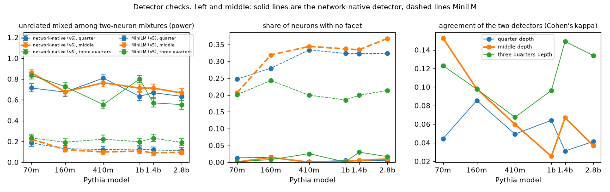

### What this does and doesn't show

- **v5's scale result depends on the detector.** At v1's merge level, a detector that reads the layer's own representation finds the middle layer's share of mixed-looking neurons flat from 70M to 2.8B, near 45%. That holds under every setting tried except the uncentered one. MiniLM barely tells a pooled pair of neurons from a single one (point 4), so v5's shares say little about pooling. Its decline mostly reflects how often MiniLM finds groups at all (v5 point 2). Under v6, no depth gives a trend that holds across settings (point 2). So the repo no longer has a robust scale result for or against the essay's expectation that bigger models have narrower neurons.
- **It doesn't say which detector is right.** Their groupings overlap well above chance, but they disagree about which neurons are mixed (point 3). In the examples I read, MiniLM tends to group by topic and genre, and the residual stream more by the token and its role in the sentence. "Mixed-looking" depends on who reads the examples, and neither reader is ground truth.
- **It measures how varied a neuron's strongest contexts are, not why.** v6 asks how alike the contexts are in the network's representation apart from the neuron's own input direction. A neuron with one job in varied contexts (the essay's V shape) counts as mixed here too. Like v5, it doesn't say whether neurons got that way by packing, branching or anything else.

### What's still shaky

- **The operating point is matched on random text, not on the neurons' examples.** Matching percentiles of a random-text null puts the two detectors' merge levels on the same footing. But a neuron's top examples sit much higher in v6's null than in MiniLM's (a median 72nd to 91st percentile against 57th to 66th), which is why v6 finds groups in nearly every neuron. The absolute shares (about 45%) depend on these choices. Other settings move the middle-layer share between 30% and 66%, though none gives a trend there.
- **The unrelated cutoff compares centroids against a null of single pairs.** How much averaging raises a centroid's similarity depends on facet size and coherence, which differ between the detectors and with model size. So the matched percentile isn't an exact match for the centroid cutoff. Applying the cutoff to the mean similarity between two facets' examples instead raises v6's shares by 5 to 16 points. That gives no clear trend at any depth, so it removes the quarter-depth fall.
- **One view of the network.** v6 reads the residual stream entering the neuron's layer. It doesn't use what downstream components do with the neuron (v3's output side) or other layers' views. Projecting out one direction removes the neuron's linear read, not everything correlated with it (without the projection, results are similar: point 6).
- **v6 loses power in the deep layers of bigger models** (point 4). At three quarters, its excess over single neurons falls from 40 points at 70M to 9 at 2.8B, so a trend at that depth would be hard to read in either direction.
- **The rules weren't written blind.** They were committed before any v6 data, but chosen knowing v5's results and its review, and after a pilot on 14M and 31M. Point 6's anisotropy figure, the post-review checks and the hand readings are post hoc.
- **Scope is unchanged:** six sizes of one family up to 2.8B, one 2.1M-token corpus, float16, 2,048 sampled neurons per layer.

### v6 files and reproduce

| Path | What it is |
|---|---|
| [`recgen/rubric_v6.py`](recgen/rubric_v6.py) | Pre-registered embedding, calibration, comparison with v5 and detector checks |
| [`recgen/sweep_v6.py`](recgen/sweep_v6.py) | Normalized residuals at v5's example positions and at random positions, and the neurons' input weights |
| [`recgen/analyze_v6.py`](recgen/analyze_v6.py), [`recgen/plots_v6.py`](recgen/plots_v6.py) | Both detectors on the same neurons, verdicts, agreement, checks and sensitivity; the figures |
| `tests/test_rubric_v6.py`, `tests/test_sweep_v6.py`, `tests/test_analyze_v6.py` | Tests for the rules, the recorder and the analysis |
| [`results/classification_v6.json`](results/classification_v6.json) | Verdicts beside v5's, per-layer shares, intervals, agreement, checks and sensitivity, per-neuron results under both detectors |
| [`results/v6_models.md`](results/v6_models.md) | Per model: both detectors' shares and agreement by depth, and three random v6 unrelated-mixed neurons per depth with examples |
| [`results/figures/`](results/figures/) `v6_*.png` | Shares by size under both detectors, and the detector checks |

```bash
./run_v6.sh
```

`run_v6.sh` needs `data/corpus.npy`, v5's `data/v5/` cache (window maxima and sentence embeddings) and `results/classification_v5.json`. From scratch it takes about 2 hours on an M1 Pro: it downloads the six models one at a time (about 12 GB in all), deletes each after use, and caches 4.9 GB in `data/v6/`. With that cache, it reruns in about 15 minutes.

## v7 results

v5 and v6 found that how mixed a neuron looks depends on who reads its strongest examples. The essay's own numbers ("about 90% of neurons have one main job") come from a third kind of reader: language models reading the examples. v7 puts three readers on the same units, including synthetic units with known answers, at the middle layer of all six sizes:

- **MiniLM:** v5's sentence-model detector.
- **network:** v6's detector, using the model's own representation.
- **Haiku:** `claude-haiku-5-5` through the `claude` CLI, with no tools and a fixed system prompt. It sees a unit's 50 examples in a seeded random order, with the firing token marked and no activation values, and answers A (one job), B (related jobs) or C (unrelated jobs). C counts as "unrelated mixed".

The rules are in [`recgen/rubric_v7.py`](recgen/rubric_v7.py), committed (`c17b9eb`) before any language-model call on repo data. Three format-check readings came next, with the prompt unchanged, and they count toward the run. No earlier file or result changed.

### v7 method

1. **Units, per model (300):**
   - **Real:** 100 of v5/v6's sampled neurons.
   - **Pooled:** 150 pools of two random neurons' strongest examples, 50 at each mix (50/50, 70/30 and 90/10). These have a known answer: they mix two neurons.
   - **Related:** 50 pools of two neurons whose input directions are the most alike (picked greedily, no neuron twice). These are a check on false alarms.
2. **Pre-registered tests, per reader:**
   - **Power:** 50/50 pools flagged at least 20 points more than real neurons, with separated 95% intervals, in at least 5 of 6 models.
   - **Specificity:** related pools flagged at least 20 points less than 50/50 pools, in at least 5 of 6 models.
   - **Agreement:** Cohen's kappa between readers on real neurons.
   - **Scale:** v5's verdict rule on each reader's real-neuron flag rate.
3. **Retest:** 60 units (10 per model) were read by Haiku a second time, to measure its consistency.

All 1,860 readings returned a valid label: 6.8M input tokens, which the CLI reported as $2.08 of quota. Every answer, with Haiku's stated patterns, is in [`results/v7_llm_answers.json`](results/v7_llm_answers.json).

### What v7 found

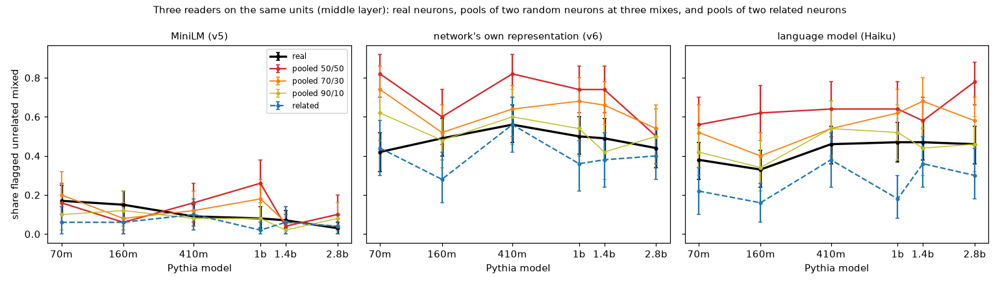

| Reader | Power (models of 6) | 50/50 pools over real, per model | Over all models (95% interval) | Real flagged, 70M → 2.8B | Scale verdict |
|---|---|---|---|---|---|
| MiniLM | **0** | -9 to +18 points | +3 (-1 to +8) | 17% → 3% | fits the essay (Spearman -1.00) |
| network | **4** | +6 to +40 | +22 (+16 to +28) | 42% → 44% (peak 56%) | no clear trend (+0.12) |
| Haiku | **2** | +11 to +32 | +21 (+14 to +27) | 38% → 46% | no clear trend (+0.68) |

Points 1 to 3 and 5 include exploratory checks (the over-all-models effect, the power simulation, the kappa ceilings, shared windows, the retest interval), added after an independent review of the first results.

1. **No reader passes the pre-registered power test, but the test was nearly impossible to pass.** With 50 pools and 100 real neurons per model, a reader whose 50/50 pools are truly 21 points above real neurons passes the test in a given model 42% of the time, and in 5 of 6 models 5% of the time (simulated with the test itself). The fair comparison is the effect over all models:
   - The network reader and Haiku detect pooling about equally: +22 and +21 points. v6's larger check of the network reader (500 pools per layer) gave +22 to +41 at the middle layer of every size, so its misses at 160M (+11) and 2.8B (+6) here are mostly small samples.
   - MiniLM barely detects it: +3 points (-1 to +8). It separates pools from real neurons only at 1B (+18, with separated intervals), and never by the 20-point margin.
2. **The related control was easier than intended, so specificity says little.** All three readers flag related pools less than random 50/50 pools: Haiku in all six models (22 to 48 points less), the network reader in five, MiniLM in one. But related pools often contain two examples from the same text window (38% of them, against 17% of random 50/50 pools and none of the real units, which take one example per window). Haiku flags related pools with a shared window 17% of the time, against 32% without. So the related control is easier than an average real neuron, and Haiku's 6 of 6 mostly reflects that. Judged against real neurons instead, it would pass in 2 of 6 and the network reader in 4.
3. **MiniLM's flags are a conservative subset, not a disagreement.** On real neurons, kappa is 0.20 to 0.38 between Haiku and the network reader, and lower with MiniLM (-0.01 to 0.22 with Haiku, 0.03 to 0.17 with the network reader). But MiniLM flags so few neurons that its kappa with Haiku can be at most 0.07 to 0.53, depending on the model, and at 410M and 2.8B it reaches that ceiling: every real neuron MiniLM flags, Haiku flags too. Over all models, Haiku flags 61% of the neurons MiniLM flags and 41% of the rest, and the network reader 66% and 46%. So MiniLM picks out a small, more mixed subset.
4. **MiniLM's scale decline isn't corroborated.** On these 100 real neurons per model, MiniLM's flag rate falls from 17% to 3%, in the same direction as v5's full sample (16.0% to 6.9%). The network reader is flat, and Haiku drifts up (38% to 46%). Neither passes the trend test. They also have only about 21 points of power and 100 neurons per model, so a decline of MiniLM's size would be near the limit of what they could show.
5. **Haiku is a noisy reader.** Read a second time, 60% of units get the same label and 68% the same flag (kappa 0.37, interval 0.12 to 0.60, from 60 units of which 20 are real neurons). Its agreement with the network reader (kappa 0.20 to 0.38) is about as high as its agreement with itself, so that agreement may be near Haiku's ceiling. Label noise is part of the intervals above; mainly, it pulls kappas down.
6. **Haiku calls 42 to 57% of real neurons one job and 33 to 47% unrelated jobs.** That's far from the essay's "about 90% one job", but the setups differ. Haiku is a small model reading 50 snippets once, without activations, tools or experiments. The essay's agents investigate each neuron and work on larger models. Its stated patterns ([`results/v7_models.md`](results/v7_models.md)) are specific and often checkable:
   - On 70M, "a relative pronoun right after a head noun" and "a word fragment the next token completes (*were*|wolf, *is*|omer, *can*|oe)".
   - Its "unrelated" calls can be reasonable. For 2.8B MLP neuron 560, it lists HTML markup, plain prose tokens like "declined" and articles, word fragments, non-Latin text, and numeric and URL fragments, and most of the 50 snippets are indeed ordinary prose.
   - It rarely uses "related jobs" (8 to 12% of real neurons).

### What this does and doesn't show

- **The scale result has no support beyond MiniLM.** MiniLM barely detects two neurons pooled together, and the two readers that partly do (+21 and +22 points) don't show its decline. That doesn't prove MiniLM's decline wrong: its flags pick out a small subset that the other readers also tend to flag, and they could barely detect a decline of that size. But "bigger models have fewer mixed-looking neurons" now rests on the one reader that can't see known mixing.
- **It strengthens the methods finding.** Cleanliness numbers from clustering top examples with a sentence model shouldn't be trusted without a positive control like the pooled neurons. And a reader's power, measured on known mixtures, matters more than its flag rate.
- **It doesn't test the essay's method.** The essay's agents are larger models that run experiments on each neuron. v7's Haiku reads a fixed set of snippets once. What it shows is that a simple language-model reader is noisy (point 5) and detects pooling about as well as the network reader, which is only moderately well (point 1). An investigating agent may do much better. Running the same positive control on that kind of agent is the obvious next test.
- **No reader here is a gold standard.** None separates pools from real neurons by more than about 22 points on average, and they disagree on many individual neurons. "What share of neurons are mixed?" has no reader-independent answer in this repo.

### What's still shaky

- **Small samples per model.** 50 pools and 100 real neurons per model make per-model tests weak (point 1). The over-all-models effects are the more reliable numbers.
- **The related control is easier than intended** (point 2): pools can contain two examples from the same window, while real units can't. Pooled units also use only each neuron's strongest 25 to 45 examples, while real units include ranks 26 to 50.
- **The readers see different inputs.** MiniLM embeds the context before the token, Haiku sees about 30 tokens around it (24 before, 4 after), and the network reader sees the whole preceding window. Haiku also sees no activation values, which makes its task harder than a real audit.
- **The CLI adds about 500 tokens of its own to each call.** Its length is the same for every kind of unit, so it can't tell Haiku which units are pooled, but its content isn't documented.
- **One small model, one prompt, one reading per unit** (plus 60 retests). Another model or prompt could change the rates. The prompt was fixed before any reading, and none was tuned.
- **Pooled units mix two neurons' strongest examples.** Real polysemantic neurons may mix less cleanly, with weaker second jobs or shared contexts, so the pools test the easiest kind of mixing to detect.
- **Scope:** the middle layer only, Pythia 70M to 2.8B, 300 units per model.

### v7 files and reproduce

| Path | What it is |
|---|---|
| [`recgen/rubric_v7.py`](recgen/rubric_v7.py) | Pre-registered units, prompt, labels and tests |
| [`recgen/units_v7.py`](recgen/units_v7.py), [`recgen/llm_reader.py`](recgen/llm_reader.py) | Real, pooled and related units; the cached language-model reader |
| [`recgen/analyze_v7.py`](recgen/analyze_v7.py), [`recgen/plots_v7.py`](recgen/plots_v7.py) | Three readers' flags, rates, power, specificity, agreement, retest; the figure |
| [`results/v7_llm_answers.json`](results/v7_llm_answers.json) | Every Haiku reading: label, stated patterns, tokens, and the prompt's SHA-256 so its integrity can be checked |
| [`results/classification_v7.json`](results/classification_v7.json) | Per-model rates with intervals, verdicts, kappas, retest, per-unit flags |
| [`results/v7_models.md`](results/v7_models.md) | Per model: rates by reader and unit type, and units where the readers disagree, with Haiku's patterns |
| `tests/test_rubric_v7.py`, `tests/test_llm_reader.py`, `tests/test_analyze_v7.py` | Tests for the rules, the reader and the analysis |

```bash
./run_v7.sh
```

`run_v7.sh` needs v6's `data/v6/` recordings, v5's MiniLM embeddings, and the `claude` CLI signed in. Haiku's answers are cached in `data/v7/` (not committed) and collected in `results/v7_llm_answers.json`. With the cache, it makes no model calls and reruns in about a minute. From scratch, the 1,860 readings take about 45 minutes, six at a time. Their labels will differ somewhat, because Haiku isn't deterministic (point 5).

## v8 results

v7's one-shot reader (Haiku reading a unit's 50 snippets once) detects two pooled neurons only about 21 points more often than real neurons, and calls 42 to 57% of real neurons one job. The essay's "about 90% one main job" comes from preliminary audits of Qwen3-32B whose method it doesn't describe; investigating each neuron is one plausible reading. v8 gives a language-model agent tools to investigate and puts it on v7's units, including the pools with a known answer, to ask whether investigating separates real neurons from pooled ones much better.

The rules are in [`recgen/rubric_v8.py`](recgen/rubric_v8.py), committed (`ca0fc51`) before any agent run. A pilot on six pythia-160m units, which aren't in v8's sample, came next. It led to two amendments, both committed before any v8 unit was read: the prompt now asks the agent to test each pattern and use at least 4 of its 8 tool calls, because the pilot's agents used 0 to 2 (`5d3f546`); and a second agent arm was added (`f2c89af`). The second arm was chosen after its pilot readings: on those six units the Haiku agent called everything one job, both pools included, and the Sonnet agent called both pools unrelated jobs. No earlier file or result changed.

### v8 method

1. **Agents.** Two models through the `claude` CLI, each with no built-in tools and two tools of its own (a small MCP server):
   - **Haiku agent:** `claude-haiku-5-5`, the model v7 used, so the comparison with v7's reader holds the model fixed. This is the primary arm.
   - **Sonnet agent:** `claude-sonnet-5-5`, a larger model closer to the essay's auditors.
2. **What the agent sees and can do.** It starts from v7's prompt (the same 50 snippets in the same order, the same A/B/C definitions), now with each snippet's activation on a 0-10 scale, where 10 is the unit's strongest window. Then it can:
   - **examples:** read any ranks of the unit's ranked list of 4,096 corpus windows (one example per window), with activations, including weak ones far down the list.
   - **activation:** measure the unit at every token of text it writes (up to 5 texts of 64 tokens per call). Pythia runs locally for this, in float16 on the M1 Pro, with an end-of-text token in front of the text.

   It has 8 tool calls, then answers A, B or C as in v7, with its patterns and a confidence.
3. **Pools act like neurons with two jobs.** Each neuron's activation is divided by its 25th-strongest window maximum, and a pool's activation is the larger of its two neurons' normalized activations, at every token of the corpus or of the agent's text. With rank 25, a 50/50 pool's 50 strongest windows are exactly v7's 25 + 25 examples, and a real neuron's scale is its activation over its peak. There's no steering or ablation tool: a pool's two neurons write different output directions, which no single neuron can, so an output-side tool would give pooling away.
4. **Units:** the middle layer of 70M, 410M and 2.8B (v7's smallest, middle and largest). Per size, 40 real neurons, 40 50/50 pools of random neurons and 20 pools of related neurons, drawn with fixed seeds from v7's units, so v7's three readers are compared on exactly the same units. Each agent reads 30 of them (10 per size) a second time.
5. **Pre-registered tests:**
   - **Pooling detection:** for each reader, the 50/50 pools' flag rate minus the real neurons', averaged over the three sizes, with a bootstrap interval. The flag is C (unrelated jobs), as in v7; B or C is the secondary measure.
   - **Gain from investigation (primary):** the Haiku agent's detection minus one-shot Haiku's on the same units, with a paired bootstrap interval: "much better" if it's at least 15 points and the interval is above 0, "better" if only the interval is above 0. The Sonnet agent is compared with both.
   - **The one-job share of real neurons**, retest agreement, agreement with the other readers (Cohen's kappa), related pools as a check on false alarms, and rates by size (descriptive only: three sizes are too few for a trend test).

All 660 readings returned a valid label after at most one retry (4 readings, all 50/50 pools, needed one; the replies of their failed first attempts weren't kept). The CLI reported $0.65 of quota for the Haiku agent and $10.27 for the Sonnet agent, plus $0.23 for the kept pilot readings and a few cents for the pilot readings that were overwritten. Every tool call, its answer and each agent's messages are in [`results/v8_agent_answers.json`](results/v8_agent_answers.json).

### What v8 found

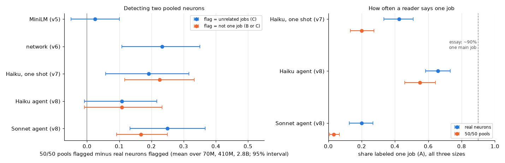

| Reader (same 240 real and pooled units) | 50/50 pools flagged over real neurons, points (95% interval) | Label AUC, pools over real | Real neurons called one job | 50/50 pools called one job | Retest kappa |
|---|---|---|---|---|---|
| MiniLM (v5) | +2.5 (-5 to +10) | 0.51 | | | |
| network (v6) | +23 (+11 to +35) | 0.62 | | | |
| Haiku, one shot (v7) | +19 (+6 to +32) | 0.62 | 42% | 20% | 0.37 (v7's 60 units) |
| **Haiku agent** | **+11 (-1 to +22)** | 0.56 | 66% | 55% | 0.56 |
| **Sonnet agent** | **+25 (+13 to +37)** | 0.64 | 20% | 3% | 0.77 |

| Pre-registered gain (C flag) | Points (95% interval) | Verdict |
|---|---|---|
| **Haiku agent over one-shot Haiku (primary)** | **-8 (-21 to +5)** | **no clear difference** |
| Sonnet agent over one-shot Haiku | +6 (-7 to +18) | no clear difference |
| Sonnet agent over Haiku agent | +14 (+2 to +27) | better |

The label AUC (point 3) and the catch-all count (point 1) were added after seeing the results. Three numbers weren't in the rubric but were added to the analysis during the run, before the full results: the share of pools called one job, the share of readings past rank 50 (point 7) and the agreement between the two agents (point 5). The analysis code was committed after I had seen the label counts of the first 90 Haiku-agent readings at 70M. The other numbers are pre-registered or were listed in the rubric before the run. Details are in [`results/classification_v8.json`](results/classification_v8.json), and examples of what each agent did, with its test texts, are in [`results/v8_models.md`](results/v8_models.md).

1. **Investigating didn't make Haiku a better detector.** On the same units, the Haiku agent separates pools from real neurons by 11 points, against one-shot Haiku's 19 (gain -8, interval -21 to +5). With B or C as the flag, the gain is -12 (-25 to +2). Investigating made it say "one job" much more often: for 66% of real neurons against 42%, and for 55% of the known pools against 20%.
   - Its one-job answers often name a broad catch-all pattern that can absorb two unrelated jobs, such as "a token inside a highly predictable continuation" or "a formulaic phrase" (examples in `v8_models.md`). Counting answers with such a word ("predictable", "formulaic", "fixed", "template", "boilerplate", "continuation"), one-shot Haiku shows it more than the agent: 54% of its 24 one-job answers on pools against 24% of 51 on real neurons, where the Haiku agent's 41% of 66 against 32% of 79 is within noise. So catch-alls go with calling a pool one job, but aren't specific to investigating. It's a crude count. The A definition, written for v7, allows a pattern to be "broad or abstract", which leaves room for them.
2. **The Sonnet agent catches pools but calls most real neurons mixed too.** It calls only 4 of 120 pools one job, and flags 85% of them at 410M and 2.8B. But it also flags 52.5 to 57.5% of real neurons and calls only 20% of them one job. Its detection (+25 points) is about the network reader's (+23), and its gain over one-shot Haiku isn't clear (+6, interval -7 to +18). It beats the Haiku agent with C as the flag (+14, interval +2 to +27), but not on the pre-registered secondary measure, B or C (+6, -7 to +19). On that measure its own detection (+17) is below one-shot Haiku's (+22.5).
3. **No reader separates pools from real neurons well, whatever its threshold.** The readers differ a lot in how often they say "mixed", so a flag-rate difference partly reflects where each draws the line. The AUC of each reader's labels (A < B < C) for ranking pools above real neurons doesn't depend on that. It's 0.64 for the Sonnet agent (0.58 to 0.69), 0.62 for one-shot Haiku and the network reader, 0.56 for the Haiku agent and 0.51 for MiniLM (0.5 is chance).
4. **The one-job share depends on the auditor.** On the same real neurons, with the same prompt and tools, the Haiku agent calls 66% one job (60 to 72.5% by size) and the Sonnet agent 20% (15 to 22.5%). One-shot Haiku is in between at 42%. None is near the essay's ~90%.
5. **The agents may be more consistent than one-shot Haiku.** Read a second time, 30 units get the same label from the Haiku agent 83% of the time (flag kappa 0.56, interval 0.17 to 0.87), and from the Sonnet agent 70% of the time (the same flag 90%; kappa 0.77, 0.48 to 1.0). v7's one-shot Haiku had 0.37 on a different 60 units, and only the Sonnet agent's interval clears it. On real neurons, the Sonnet agent agrees with the network reader (kappa 0.44), one-shot Haiku (0.41) and the Haiku agent (0.40) more than the Haiku agent agrees with MiniLM, the network reader or one-shot Haiku (0.14 to 0.29).
6. **The related control again says little.** Both agents flag related pools much less than random 50/50 pools (Sonnet agent 44 points less, Haiku agent 23). They flag related pools less than real neurons too (19 and 12 points), but among related pools without a shared window, that difference is within noise (-6 and -10 points). As in v7, two neurons with alike input directions look at least as clean as an average real neuron.
7. **The agents investigated, but lightly.** They used 2.7 to 3.0 of their 8 tool calls on average, though asked for at least 4, and never more than 6, so the budget never bound. The Haiku agent met that minimum in 18 to 23% of readings and the Sonnet agent in 43 to 51%. All but one reading tested the unit on text the agent wrote (5.6 to 7.9 texts on average), and 65 to 95% read examples past rank 50.
8. **By size (descriptive):** the share of real neurons flagged is flat for both agents (Haiku agent 22.5%, 20%, 30% from 70M to 2.8B; Sonnet agent 57.5%, 52.5%, 57.5%). On these units MiniLM's share falls again (20%, 5%, 2.5%), as in v5 and v7.

### What this does and doesn't show

- **Light investigation didn't measurably improve pooling detection.** With about 3 tool calls per unit, a large gain is ruled out for the Haiku agent (its upper bound is +5 points over Haiku reading the snippets once) but not for the Sonnet agent (-7 to +18). The best reader, the Sonnet agent, is at +25 points and an AUC of 0.64, about the network reader's level. So the methods point from v6 and v7 extends to investigating auditors: an auditor's power should be measured on known mixtures before its cleanliness numbers are read.
- **The one-job share measures the auditor as much as the network.** Under this rubric and budget, two agents with identical tools and instructions give 66% and 20% on the same neurons, and the one that says "one job" more says it about known pools almost as often (55%). A high one-job share therefore isn't evidence of clean neurons unless the same auditor, run the same way, rarely calls known mixtures one job.
- **It doesn't refute the essay's ~90%.** The essay audits Qwen3-32B, not Pythia. Its auditors likely investigate much more than 3 tool calls, and it counts "one main job, often with small related offshoots", which isn't v7's A/B/C rubric. A stricter rubric, one that asks whether a stated job predicts activations on new text, might separate pools better. What v8 shows is that the kind of number the essay reports needs a positive control to be interpretable, and that, under v7's rubric with light investigation, two reasonable auditors can disagree by a factor of three.

### What's still shaky

- **The agents investigated lightly** (point 7). Deeper investigation, a larger model or a different rubric could change the result. The pilot's agents used even fewer calls before the prompt was changed. Their readings were overwritten when the prompt changed; only the amended pilot's are kept.
- **Three things changed at once from v7's reader:** activation values in the prompt, the tools, and the instruction to test patterns. So "investigation" here means all three. v7's readings were also made on a different day, and the Haiku model isn't deterministic (v7's retest kappa was 0.37).
- **Pools aren't perfectly disguised.** A pool's 50 shown examples sit a little higher on its scale than a real neuron's (median lowest value 7.4 to 8.0 against 7.2 to 7.8), and taking the larger of two neurons gives pools fatter tails further down the list. An agent sees one unit at a time, so it has nothing to compare these against. The values of the first 50 examples are rebuilt from v6's stored residuals; for real neurons they're within 0.01 of v5's recorded activations on the 0-10 scale.
- **The agents' test texts are short** (up to 64 tokens, with an end-of-text token first), while corpus examples have at least 32 tokens of context in 512-token windows. Some neurons may respond less to short texts. The tool also reports the first tokens of a text, which the corpus examples never include: the first token was marked in 11% of the 4,396 test texts across all readings (14% for pools, 9% for real neurons) and was the strongest token in 2%.
- **Two leaks were found and fixed after the run, neither used.** A pool that shows two examples from one window had a ranked list a few ranks longer than 4,096, which an agent could have seen by asking for the last ranks; no agent asked for a rank beyond 1,019, and the list is now cut at 4,096. And the CLI ran in a folder inside the repo, so it told the agent its folder was a git repository (checked afterwards: no branch name or commits); it now runs outside the repo.
- **Small samples.** 40 real neurons and 40 pools per size give gain intervals of about ±13 points, so a smaller gain from investigating couldn't be seen.
- **Scope:** one prompt and rubric, two models of one family, the middle layer of three Pythia sizes, and pools that mix two neurons' strongest examples, the easiest kind of mixing to detect (v7). The CLI adds its own text to each call, nearly the same for every unit.

### v8 files and reproduce

| Path | What it is |
|---|---|
| [`recgen/rubric_v8.py`](recgen/rubric_v8.py) | Pre-registered agent, prompt, tools, activation scale, units and tests, with the two amendments |
| [`recgen/probe_v8.py`](recgen/probe_v8.py), [`recgen/mcp_v8.py`](recgen/mcp_v8.py) | The tool backend (ranked examples, activations on new text through Pythia, a log of every call) and the MCP server each agent talks to |
| [`recgen/agent_v8.py`](recgen/agent_v8.py) | Runs both agents through the `claude` CLI, with retries, a spend guard and a cache |
| [`recgen/analyze_v8.py`](recgen/analyze_v8.py), [`recgen/plots_v8.py`](recgen/plots_v8.py) | Gains, detection, one-job shares, retest, agreement, specificity, tool use, post-hoc checks; the figure |
| [`results/v8_agent_answers.json`](results/v8_agent_answers.json) | Every agent reading: label, patterns, confidence, tool calls with their answers, messages, tokens and cost |
| [`results/classification_v8.json`](results/classification_v8.json) | All statistics, and every unit's labels and flags from all five readers |
| [`results/v8_models.md`](results/v8_models.md) | Per size: rates by reader and unit type, and pools the agents called one job and real neurons they disagree on, with patterns and test texts |
| `results/v8_pilot_*_answers.json` | The amended pilot's readings on pythia-160m |
| `tests/test_rubric_v8.py`, `tests/test_probe_v8.py`, `tests/test_agent_v8.py`, `tests/test_analyze_v8.py` | Tests for the rules, the tools, the runner and the analysis |

```bash
./run_v8.sh
```

`run_v8.sh` needs v5's `data/v5/` window maxima, v6's `data/v6/` recordings, `results/classification_v7.json`, and the `claude` CLI signed in. The readings are cached in `data/v8/` (not committed). With the cache, it loads no model, makes no CLI calls and reruns in about a minute. From scratch, the 660 readings took about 30 minutes, six at a time, with each Pythia model downloaded, kept in memory while its units are read, and deleted. Labels will differ somewhat, because the agents aren't deterministic (point 5).

## v9 results

v7's positive control pooled two neurons' strongest examples by fixed counts (25 + 25, 35 + 15, 45 + 5). That is the easiest mixing to detect: both halves are at full strength, and pools can repeat a text window, which real neurons can't. v9 builds a more natural synthetic two-job neuron. The **union** of two real neurons fires, in each window, at the larger of the two neurons' raw activations, and its 50 strongest examples come from its own ranking, one per window. How many examples each neuron contributes is then set by their activations, as it would be for a real neuron with two jobs. The rules are in [`recgen/rubric_v9.py`](recgen/rubric_v9.py), committed (`bace9af`) before any reading and amended once (`76bd70d`), also before any reading (see below). No earlier file or result changed.

### v9 method

1. **Units.** 150 unions of two random sampled neurons per model, at the middle layer of the six sizes. Because a union takes a maximum, its top 50 windows always come from the two neurons' own top 50s, so every example was already embedded for MiniLM (v5) and recorded for the network reader (v6). Only Haiku needed new readings. Real neurons are v7's 100 per model, with v7's Haiku readings reused (same units, same prompt).
2. **Amendment.** The first rules scaled each neuron by its top-50 level. Building the units showed that this makes the two neurons cross at about their 25th example, so 829 of 900 unions came out exactly 25/25, which defeats the point. Raw activations give minority shares from 0 to 25 of 50 (a median of 2 to 7 by model), so raw became primary. The two scalings are reported as sensitivity checks for MiniLM and the network reader. This was decided before any reader ran.
3. **Pre-registered tests, per reader:**
   - detection: union minus real flag rate, averaged over models, with a bootstrap interval;
   - the same for v7's 50/50 pools minus unions;
   - dose-response: flag rate by how many examples come from the minority neuron (0 to 4, 5 to 14, 15 to 25), top bin minus bottom bin;
   - a Haiku retest of 10 unions per model.

900 union readings and 60 retests all returned a valid label.

### What v9 found

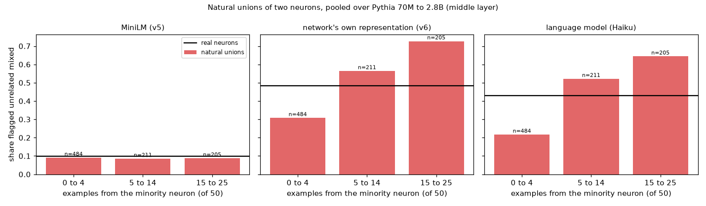

| Reader | Unions minus real | Flag rate by minority share: 0-4 / 5-14 / 15-25 | Top minus bottom | v7 pools minus unions |
|---|---|---|---|---|
| MiniLM | -1 (-4 to +2) | 9% / 9% / 9% | **0** (-5 to +4) | +4 (0 to +8) |
| network | -2 (-7 to +3) | 31% / 56% / 73% | **+42** (+35 to +50) | +24 (+18 to +30) |
| Haiku | -4 (-9 to +1) | 22% / 52% / 64% | **+43** (+35 to +50) | +25 (+19 to +31) |

Points 1, 2 and 6 and the scaling checks in point 3 are pre-registered; the rest is exploratory. The comparison of balanced unions with real neurons (point 3), point 4 and the partial correlations in point 5 were added after an independent review of the first write-up; their numbers are in `exploratory_after_review` in the results.

1. **The network reader and Haiku respond strongly to how mixed a union is; MiniLM doesn't respond at all.** Both readers' flag rates climb by more than 40 points from unions dominated by one neuron to balanced ones. MiniLM stays near 9% whatever the mix.
2. **No reader flags natural unions more than random real neurons overall** (the pre-registered detection test). Most raw unions are dominated by one neuron: 484 of 900 take fewer than 5 of their 50 examples from the minority neuron, and 279 take none, so they are exactly one real neuron's top 50.
3. **Balanced unions are detected about as well as v7's pools.** Unions with 15 to 25 minority examples are flagged more than real neurons by 24 points (17 to 32) by the network reader and 22 (14 to 29) by Haiku, close to v7's 50/50 pool margins (+22 and +21). MiniLM: -1 (-5 to +4). So the gap between natural unions and v7's pools in the table comes from dominated unions, not from natural mixing being harder to see. The scaling sensitivity checks agree for the network reader: with each neuron scaled to its top-50 level (829 of 900 unions come out exactly 25/25), it flags unions 23 points (18 to 28) more than real neurons, and 16 (11 to 21) with peak scaling.
4. **Part of the 42-point climb is which neuron a union is made of, not mixing.** A union dominated by one neuron is mostly that neuron's own top examples, and raw activations pick the neuron with the larger activations, which look cleaner (point 5). Comparing each union with its own two neurons' flags, weighted by how many examples each contributes:

   | Minority share | Network reader: unions flagged | Their own neurons, weighted | Excess |
   |---|---|---|---|
   | 0-4 | 31% | 32% | -1 |
   | 5-14 | 56% | 52% | +5 |
   | 15-25 | 73% | 47% | **+26** |

   So mixing adds about 26 points for balanced unions, and dominated unions look like their own neurons. MiniLM's excess is within 2 points of 0 in every bin. Haiku has readings of only 100 real neurons per model, too few of the unions' source neurons for the same check; point 3 is its closest comparison.
5. **Neurons with larger peak activations look cleaner, and most of that is how alike their strongest examples are.** By quartile of a neuron's peak activation (its largest window maximum), from weakest to strongest:

   | Reader | Flagged unrelated mixed, by peak quartile | Spearman by model |
   |---|---|---|
   | network (all sampled neurons: 2,048 per model, 1,561 in 70M; v6's flags) | 46-66% / 50-61% / 41-56% / **24-34%** | -0.15 to -0.30 |
   | Haiku (v7's 100 real neurons per model) | pooled 62% / 51% / 40% / **19%** | -0.25 to -0.39 |
   | MiniLM (v5's flags) | 7-19% / 9-17% / 7-18% / 5-9% | 0.00 to -0.09 |

   Strong neurons' 50 strongest examples are more alike in the network's own representation (v6's top-pair percentile, the median similarity of the 50 examples ranked against random positions). Holding that coherence fixed (partial Spearman), the link between peak and the flag disappears: from -0.15 to -0.30 to between 0.00 and +0.21 for the network reader, and from -0.32 to -0.06 for Haiku, pooled over 600 neurons. For the network reader this is partly circular, since its flag is computed in that representation; Haiku never sees it. Token purity (the share of the 50 examples on the most common activating token) explains almost none of it: holding it fixed leaves -0.15 to -0.29, and -0.31 for Haiku. This was found after looking at the data, so v12 tests it on held-out depths and fresh neurons.
6. **Haiku may be more consistent on unions than on v7's units:** a second reading of 60 unions gives the same label 80% of the time and the same flag 85% (kappa 0.69, against 0.37 on v7's 60 retest units). The units differ, and 60 retests give wide intervals, so this is only suggestive.

### What this does and doesn't show

- **This MiniLM detector can't see mixing.** With the mix varied naturally from 0 to 25 examples, its flag rate doesn't move (point 1), and balanced unions look like real neurons to it (point 3). Together with v7, that's strong evidence that clustering top-50 examples with this sentence model and v1's settings doesn't measure polysemanticity. Other sentence models or settings weren't tested.
- **The network reader and Haiku can, in proportion to how mixed a unit is,** once the union's own neurons are accounted for (points 3 and 4). But they flag about 45% of real neurons, and flag a neuron less the more alike its strongest examples are (point 5). So their absolute rates mix polysemanticity with how coherent a neuron's top examples are.
- **The magnitude effect is real in these data but mostly a coherence effect.** Strong neurons have more coherent top examples, and coherence is what both readers respond to. Whether weak neurons are more often doing two jobs, or just have more diffuse top examples, v9 can't say.

### What's still shaky

- **Unions aren't real polysemantic neurons.** A union takes the larger of two neurons' activations. A real neuron with two jobs computes them together, and its jobs may share contexts or differ in strength in ways a union doesn't.
- **Raw activations select the stronger neuron,** so the pre-registered detection test (point 2) compares unions dominated by strong neurons with random real neurons. Points 3 and 4 correct for that, but they're exploratory.
- **25 drawn pairs were replaced** (10 in 70M, 0 in 2.8B) because tied activations put a union example outside both neurons' recorded top 50s.
- **The magnitude analysis reuses data** that earlier versions already looked at, and uses only the middle layer.
- **Haiku runs through the `claude` CLI,** which adds a little hidden context to each call: the working directory, the platform, the date and an account notice. It includes no git branch, commit or file contents, so it doesn't reveal which units are unions.
- **Scope:** the middle layer, Pythia 70M to 2.8B, 150 unions per model.

### v9 files and reproduce

| Path | What it is |
|---|---|
| [`recgen/rubric_v9.py`](recgen/rubric_v9.py) | Pre-registered unions, scaling (with the amendment), bins and tests |
| [`recgen/units_v9.py`](recgen/units_v9.py), [`recgen/read_v9.py`](recgen/read_v9.py) | Union units; Haiku readings through v7's cached reader |
| [`recgen/analyze_v9.py`](recgen/analyze_v9.py), [`recgen/plots_v9.py`](recgen/plots_v9.py) | Three readers' flags, the tests, sensitivity, the magnitude check; the figure |
| [`results/classification_v9.json`](results/classification_v9.json), [`results/v9_llm_answers.json`](results/v9_llm_answers.json), [`results/v9_models.md`](results/v9_models.md) | Results, every Haiku reading with its prompt hash, and per-model examples |

```bash
./run_v9.sh
```

`run_v9.sh` needs v5's and v6's caches and v7's results. With v9's cached Haiku answers in `data/v9/`, it makes no model calls and reruns in a few minutes. From scratch, the 960 readings take about 30 minutes.

## v10 results

v7 found that Haiku, reading a unit's 50 snippets once, detects two pooled neurons about as well as the network reader (+21 and +22 points over real neurons), but noisily (retest kappa 0.37). The essay's language-model readers are larger models. v10 asks whether stronger one-shot readers detect pooling better. (v8 and v9 are separate experiments on their own branches.) Sonnet (`claude-sonnet-5-5`) and Opus (`claude-opus-5-5`) read v7's 1,800 units with v7's prompt, the same blind snippets in the same order, and v7's CLI flags. All 3,720 prompts hash the same as the ones Haiku saw. The reader is the intended change; two unintended ones, in how much the readers think and in the CLI's hidden context, are under "What's still shaky". The rules are in [`recgen/rubric_v10.py`](recgen/rubric_v10.py), committed (`eb1dfa2`) before any v10 model call. No earlier file or result changed.

### v10 method

1. **Readers.** `claude -p --model sonnet` and `--model opus` with v7's other flags and no effort setting, as v7 had, so each runs at the CLI's default effort. Each also re-reads v7's 60 retest units (10 per model). Real neurons and 50/50 pools were read first, so a usage limit couldn't cut the main comparison short. The pre-registered budget stop was checked by hand between runs of 100 to 360 readings, and never reached.
2. **Per reader:** v7's four tests (power, specificity, agreement, scale); the over-all-models 50/50 excess with a bootstrap interval; retest consistency; and kappa with Haiku and the network reader on real neurons.
3. **Main question:** does each stronger reader's over-all-models 50/50 excess beat Haiku's? The difference is bootstrapped paired, resampling the same units for both readers. "Better" needs the whole 95% interval above zero. A planning estimate put the smallest reliably detectable gain at about 10 to 14 points.
4. **Retest noise, decided before reading:** each unit is read once, so a reader's label noise widens its excess interval without biasing it, and consistency earns no credit as sensitivity. Noise also pulls agreement down, so each kappa is shown beside the ceiling the two readers' retests allow. Higher agreement counts as more than lower noise only if kappa divided by that ceiling rises too.
5. **Secondary:** the same comparison with "two or more jobs" (B or C) as the flag.

All 3,720 readings returned a valid label on the first run. Sonnet read 7.2M input and 0.46M output tokens ($32.74 by the CLI's count) and Opus 7.2M and 0.44M ($65.09). Every answer is in [`results/v10_sonnet_answers.json`](results/v10_sonnet_answers.json) and [`results/v10_opus_answers.json`](results/v10_opus_answers.json).

### What v10 found

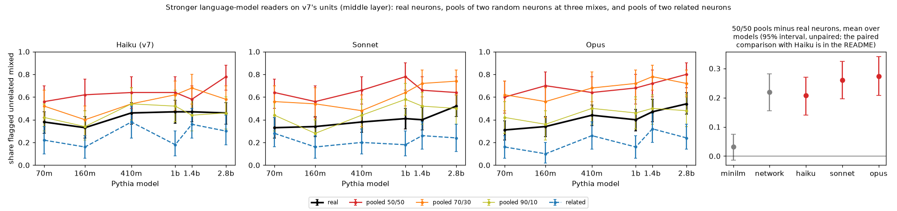

| Reader | Power (models of 6) | 50/50 over real, per model | Over all models (95% interval) | Real flagged, 70M → 2.8B | Scale verdict | Retest kappa | Real called one job |
|---|---|---|---|---|---|---|---|
| MiniLM (v7) | 0 | -9 to +18 points | +3 (-1 to +8) | 17% → 3% | fits the essay (-1.00) | deterministic | n/a |
| network (v7) | 4 | +6 to +40 | +22 (+16 to +28) | 42% → 44% | no clear trend (+0.12) | deterministic | n/a |
| Haiku (v7) | 2 | +11 to +32 | +21 (+14 to +27) | 38% → 46% | no clear trend (+0.68) | 0.37 (0.12 to 0.60) | 47% |
| Sonnet | 4 | +12 to +37 | +26 (+20 to +33) | 33% → 52% | against the essay (+0.94), fragile | 0.70 (0.50 to 0.87) | 6% |
| Opus | **5** | +20 to +36 | +27 (+21 to +34) | 31% → 54% | against the essay (+0.94) | 0.80 (0.63 to 0.93) | 34% |

Point 3 is exploratory, added after seeing the main results. Also not pre-registered: the seed and ratio checks, the kappa between Sonnet and Opus, the reasoning about pools by size in point 6, and the thinking-token comparison. The seed and ratio checks and the corrected intervals in point 3 were added after an independent review.

1. **Neither stronger reader clearly beats Haiku at detecting pooling (the pre-registered question).** Paired on the same units, Sonnet's over-all-models 50/50 excess is 5.2 points above Haiku's (-1.8 to +12.2) and Opus's 6.5 points above (-0.7 to +13.3). Both are "no clear difference". The comparison could reliably detect gains of about 10 to 14 points, so gains of 5 to 7 may be real but aren't shown. All three language-model readers and the network reader land between +21 and +27.
2. **Opus is the first reader in this repo to pass v7's power test** (5 of 6 models; it misses at 410M, +20 with overlapping intervals). That fits a modest gain more than a different kind of reader: v7's simulation gives a reader with a true +25 points a 21% chance of passing and one with +30 a 68% chance. All three language-model readers pass specificity in 6 of 6 models, but v7's caveat applies: the related control is easier than intended.
3. **Exploratory: at 70/30, the stronger readers do better than Haiku.** At that mix, Haiku flags pools 13 points more than real neurons, Sonnet 22 and Opus 26 (the network reader 15). Paired with Haiku, Sonnet is 8.8 points better (1.8 to 15.8) and Opus 13.5 (6.2 to 20.5). Corrected for the four comparisons made here (two readers, two mixes; 98.75% intervals), only Opus's gain stays above zero (+3.7 to +22.8; Sonnet -0.1 to +17.5). At 90/10 no reader separates pools from real neurons (-2 to +6 points). A majority vote of the three language-model readers gives +27 at 50/50 (20 to 33), no better than Opus alone. This was checked after seeing point 1, so it's a lead for the next test rather than a result.
4. **The stronger readers are much more consistent, and agree more by about what that predicts.** Read twice, Opus gives the same flag on 90% of units and Sonnet on 85%, against Haiku's 68%. Paired with Haiku on the same 60 units, the retest kappa is 0.43 higher for Opus (0.16 to 0.71) and 0.33 for Sonnet (0.07 to 0.61). Kappa with the network reader on all 600 real neurons rises from 0.31 (Haiku) to 0.40 (Sonnet) and 0.44 (Opus). But divided by the ceiling their retests allow it stays at about 0.5 for all three (0.51, 0.48, 0.49). By the pre-registered rule, that rise is no evidence that the stronger readers read more like the network does; it's consistent with lower noise alone. It isn't evidence against either: the ratio's interval is wide for Haiku (0.35 to 0.88, against 0.39 to 0.60 for Sonnet and 0.40 to 0.59 for Opus), because Haiku's retest kappa is so uncertain. The ceilings also come from all 60 retest units, two thirds of them pools, while the kappas are on real neurons. On the 20 retested real neurons alone, the retest kappas are 0.39, 0.66 and 0.89. The language-model readers agree with each other at kappa 0.53 to 0.63, which is 0.85 to 1.09 times their ceilings (a ratio above 1 shows how rough the ceiling is). So they mostly read neurons alike, and much of their disagreement is noise.
5. **How often a neuron has "one job" depends on the reader, even with the same prompt.** Haiku calls 47% of real neurons one job, Opus 34% and Sonnet 6%. Sonnet calls 54% "related jobs". Where Haiku names one broad pattern, Sonnet lists its parts:
   - 2.8B MLP neuron 8140: Haiku sees "subword fragments completing a word ... beginning with a capital 'F'" (one job). Sonnet and Opus split the same snippets into fragments of names, word pieces with f-sounds, and so on (related jobs).
   - Haiku also lumps pools: for a 70M pool of MLP neurons 1277 and 1965, it gives one very broad pattern ("token right before a highly predictable, formulaic continuation"). Sonnet and Opus list five or more unrelated ones (loop headers in code, patent phrasing, "types" after "different").

   "Unrelated jobs", the pre-registered flag, is steadier: 43%, 40% and 42% of real neurons. Because Sonnet calls 94% of real neurons two or more jobs, the secondary flag (B or C) barely separates pools for it: +6 points against Haiku's +24, so on the pre-registered secondary comparison Sonnet is worse than Haiku (-18, -24 to -12). Opus's +30 is not clearly above Haiku's (+6, -0.2 to +11.8).
6. **Opus finds more mixed-looking neurons in bigger models; Sonnet's verdict is fragile.** v7's scale rule gives "against the essay" for both stronger readers.
   - **Opus:** its real flag rate rises from 31% (22 to 39%) at 70M to 54% (45 to 64%) at 2.8B. The verdict comes out the same on all 200 bootstrap seeds tried. It also flags 50/50 pools more often at 2.8B (60% to 80%), and its power is flat with size (+20 to +36 points per model), so the rise isn't lost sensitivity. It sees more variety in a bigger model's strongest examples whether or not they're pooled.
   - **Sonnet:** its real flag rate rises from 33% to 52%, but it passes the rule only just (its 2.8B interval starts at 43% and its 70M interval ends at 42%), and on only 16% of 200 bootstrap seeds. Its 50/50 pools don't rise (64% at both ends), so its separation falls to +12 points at 2.8B, its lowest. For Sonnet, part of the rise may be lost sensitivity in the biggest model.
   - **Haiku's** rise in v7 (38% to 46%) points the same way without passing, on every seed.

### What this does and doesn't show

- **A stronger one-shot reader isn't a clearly better pooling detector at the even mix.** There Sonnet and Opus gain 5 to 7 points over Haiku, which this test can't separate from zero. The hint that Opus does better at 70/30 (point 3) needs its own pre-registered test. Since the stronger readers thought only briefly (see below), this doesn't show where the limit lies: in the input (50 short snippets, no activations), in the model, or in how long it reasons.
- **Bigger readers mainly buy consistency.** Their retest kappa roughly doubles (same flag on 85 to 90% of units, against 68%). Their agreement with the network reader rises by about what lower noise predicts, though the test of that is weak.
- **"About 90% one job" is partly a property of the reader.** On the same neurons, with the same prompt and instructions, three Claude models give 6% to 47% one job, so how a reader draws the line between one broad job and several related ones moves the number a lot. This doesn't contradict the essay directly: its audits are of Qwen3-32B, a larger model, and the essay doesn't describe how they were run. But a one-job share means little without the reader that produced it.
- **The scale question now has readers on every side.** At the middle layer of the same 100 neurons per model, MiniLM says bigger models look cleaner (v7), the network reader says flat, and Opus says bigger models look more mixed (Sonnet too, but not robustly). None of them is a gold standard (v7), so the repo has no reader-independent scale result. If anything, the strongest reader points against the essay's expectation.
- **It doesn't test investigating agents.** Like v7, every reader here reads 50 snippets once.

### What's still shaky

- **The stronger readers thought far less than Haiku.** At the CLI's default effort, Sonnet and Opus used a median of 99 and 116 thinking tokens per reading, and none at all on 49% and 33% of readings. Haiku used a median of 659 and always thought (from v7's local cache in `data/v7/`; v7's committed answers don't record it). The effort level was fixed in advance to match v7, but "stronger reader" here means a stronger model thinking briefly, and a higher effort setting might change the comparison.
- **The hidden context isn't identical to v7's.** The CLI adds its own context to each call. v7's Haiku ran from the main checkout and v10's readers from a git worktree, so theirs includes an extra paragraph about the worktree and a different path (and a later date). That fits the token counts: on the same units, Sonnet and Opus received 239 to 266 more input tokens per reading than Haiku, about the same for every unit. Nothing in that context describes the units, so the blinding holds, but the comparison with Haiku isn't perfectly matched. Sonnet and Opus ran under the same conditions as each other.
- **The main comparison can miss a modest gain** (about 10 to 14 points detectable; 5 to 7 observed).
- **Retests cover 60 units** (20 real neurons), so the retest kappas have wide intervals, and the agreement ceilings built from them are rough (point 4).
- **One prompt, written for v7.** Sonnet's heavy use of "related jobs" suggests the line between A and B reads differently to different models. Another prompt could move the one-job shares and the secondary flag a lot, and the pre-registered C flag less.
- **v7's caveats on the units still apply.** Pools mix two neurons' strongest examples, the easiest kind of mixing to detect. The related control is easier than intended. Readers see about 30 tokens around each firing and no activation values.
- **Scope:** the middle layer only, Pythia 70M to 2.8B, 300 units per model.

### v10 files and reproduce

| Path | What it is |
|---|---|
| [`recgen/rubric_v10.py`](recgen/rubric_v10.py) | Pre-registered readers, reading order, main comparison, and how retest noise is judged |
| [`recgen/llm_reader_v10.py`](recgen/llm_reader_v10.py) | v7's cached reader with the model changed (and four workers, a longer timeout, failed readings retried) |
| [`recgen/analyze_v10.py`](recgen/analyze_v10.py), [`recgen/plots_v10.py`](recgen/plots_v10.py) | v7's tests per reader, the paired comparison with Haiku, retests, agreement with ceilings, exploratory checks; the figure |
| [`results/v10_sonnet_answers.json`](results/v10_sonnet_answers.json), [`results/v10_opus_answers.json`](results/v10_opus_answers.json) | Every reading: label, stated patterns, tokens, the CLI's cost, and the prompt's SHA-256 |
| [`results/classification_v10.json`](results/classification_v10.json) | Main and secondary comparisons, per-reader tests, excesses, retests, agreement, label shares, usage, exploratory checks, per-unit flags and labels |
| [`results/v10_models.md`](results/v10_models.md) | Per model: rates by reader and unit type, labels, and units where Opus and Haiku disagree, with all three readers' patterns |
| `tests/test_rubric_v10.py`, `tests/test_llm_reader_v10.py`, `tests/test_analyze_v10.py` | Tests for the rules, the reader and the analysis |

```bash
./run_v10.sh
```

`run_v10.sh` needs v6's `data/v6/` recordings, v5's MiniLM embeddings, v7's `results/v7_llm_answers.json` and `results/classification_v7.json` (the analysis checks its MiniLM, network and Haiku flags against v7's), and the `claude` CLI signed in. The answers are cached in `data/v10/` (not committed). With the cache, it makes no model calls and reruns in about three minutes. From scratch, each reader's 1,860 readings take about an hour, four at a time, and their labels will differ somewhat (point 4). Without `data/v10/`, the first two steps would make 3,720 CLI calls and overwrite the committed answers. To rerun only the analysis from the committed answers:

```bash
uv run python -m recgen.analyze_v10
uv run python -m recgen.plots_v10
```

## v11 results

v7 compared its three readers only at the middle layer. The other depths are where the earlier detectors disagree most. With MiniLM, v5's share of mixed-looking neurons rises with size at three quarters (13.6% to 18.7%) and drifts down at a quarter. v6's network reader loses power at three quarters in bigger models. v11 repeats v7's design, unchanged, at the quarter and three-quarters depths of the same six sizes. It asks two questions: does each depth's scale trend depend on the reader, as the middle layer's does, and how does each reader's power change with depth? The rules are in [`recgen/rubric_v11.py`](recgen/rubric_v11.py), committed (`908adce`) before any v11 reading. No earlier file or result changed.

### v11 method

1. **Unchanged from v7:** per model and depth, 100 real neurons, 150 pools of two random neurons (50 each at 50/50, 70/30 and 90/10) and 50 pools of two related neurons; the three readers; Haiku's blind prompt and CLI flags; and v7's four tests (power, specificity, agreement and scale). At each depth the same seeded draws pick indices into that depth's sample of v5/v6's neurons, so at the middle depth v11's code rebuilds v7's units exactly (a test checks this for all six sizes). v7's readings stand in for the middle depth.
2. **Main measure of power:** the over-all-models excess, the mean over the six models of the 50/50 pools' flag rate minus the real neurons', with a 95% bootstrap interval. v7 added it after review because its per-model power test was nearly impossible to pass.
3. **Depth comparison:** for each reader and each pair of depths, the difference in excess, with a 95% interval from independent bootstrap draws. The depths differ if the interval excludes zero. There are nine comparisons (three pairs, three readers), so the table also says whether each difference survives a Bonferroni correction.
4. **Reader dependence of the scale trend,** per depth. A reader is *sensitive* if its excess interval lies above zero. A reader's trend ("fits" or "against" the essay) is *corroborated* if another sensitive reader gives the same verdict. A depth is "reader-dependent" if some trend isn't corroborated. By this rule the middle layer is reader-dependent: MiniLM "fits", and the two sensitive readers see no trend.
5. **Retest:** 10 units per model and depth (120 in all) were read by Haiku a second time.
6. **Checks:** on real neurons, v11's MiniLM and network flags must equal v5's and v6's (they do, for all 1,200 real neurons), and Haiku must resolve to the model v7 used (it does, `claude-haiku-5-5`).

Of the 3,720 readings (3,600 units and 120 retests), all but one returned a valid label: 14.5M input tokens, which the CLI reported as $4.55 of quota. Haiku's safety filter refused one real 2.8B neuron at three quarters. As the rules say, it drops out of Haiku's rates, and it is also left out of v7's post-review checks, which assume every unit has a label. Every answer is in [`results/v11_llm_answers.json`](results/v11_llm_answers.json).

### What v11 found

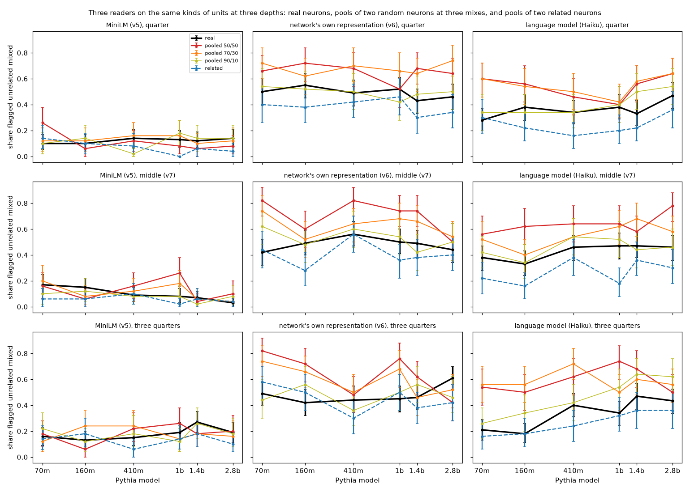

| Depth | Reader | Power (models of 6) | 50/50 pools over real, over all models (95% interval) | Real flagged, 70M → 2.8B | Scale verdict (Spearman) | Full-sample verdict (v5, v6), 70M → 2.8B |
|---|---|---|---|---|---|---|
| quarter | MiniLM | 0 | -1 (-6 to +3) | 10% → 14% | no clear trend (+0.68) | no clear trend, 13.1% → 10.4% |
| | network | 1 | +16 (+9 to +23) | 50% → 46% | no clear trend (-0.66) | **fits the essay, 50.8% → 40.6%** |
| | Haiku | 1 | +17 (+11 to +24) | 28% → 47% | no clear trend (+0.55) | |
| middle (v7) | MiniLM | 0 | +3 (-1 to +8) | 17% → 3% | fits the essay (-1.00) | fits the essay, 16.0% → 6.9% |
| | network | 4 | +22 (+16 to +29) | 42% → 44% | no clear trend (+0.12) | no clear trend, 44.5% → 44.0% |
| | Haiku | 2 | +21 (+14 to +28) | 38% → 46% | no clear trend (+0.68) | |
| three quarters | MiniLM | 0 | 0 (-5 to +6) | 16% → 19% | no clear trend (+0.72) | against the essay, 13.6% → 18.7% |
| | network | 3 | +16 (+9 to +23) | 49% → 61% | no clear trend (+0.43) | no clear trend, 43.7% → 46.6% |
| | Haiku | 3 | +26 (+19 to +33) | **21% → 43%** | **against the essay (+0.83)** | |

The first six columns are v11's units: 100 real neurons and 50 pools of each kind per model. v11's MiniLM and network flags on real neurons are exactly v5's and v6's, so the last column gives the same readers' verdicts on v5's full samples of about 2,048 neurons per model. Haiku has no full sample. The middle rows are v7's flags, with the interval redrawn under v11's seed (v7 reported +16 to +28 and +14 to +27).

Points 2 to 6 include exploratory checks. The verdicts without 70M, the pools' own flag-rate trend and Haiku's "one job" shares were added after seeing the results. The comparison with the full-sample verdicts was added after an independent review of them.

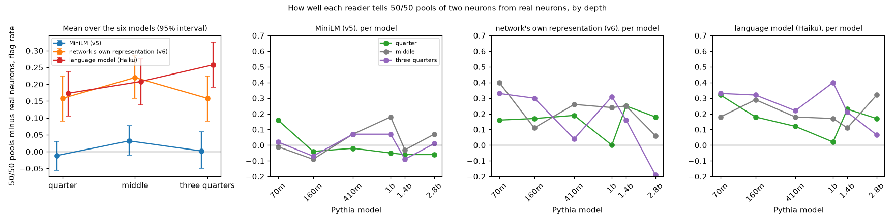

1. **No change in power with depth was detected.** Over all models, the network reader separates 50/50 pools from real neurons by +16, +22 and +16 points at the quarter, middle and three-quarters depths, and Haiku by +17, +21 and +26. MiniLM doesn't separate them at any depth (-1, +3 and 0). None of the nine depth differences has an interval that excludes zero:

   | Reader | quarter minus middle | three quarters minus middle | quarter minus three quarters |
   |---|---|---|---|
   | MiniLM | -4 (-11 to +1) | -3 (-10 to +4) | -1 (-8 to +5) |
   | network | -6 (-15 to +3) | -6 (-16 to +2) | 0 (-9 to +9) |
   | Haiku | -4 (-13 to +6) | +5 (-5 to +15) | -8 (-18 to +1) |

   But the sensitive readers' intervals reach 15 to 18 points from zero, against effects of only 16 to 26 points, so sizable changes can't be ruled out. The closest to a difference is Haiku, 8 points weaker at a quarter than at three quarters.
2. **At three quarters, only Haiku's rate passes the trend test, and the network reader's full sample doesn't back it.** Haiku's share of real neurons flagged rises from 21% to 43%, which the rule calls "against the essay". On v11's 100 neurons per model, MiniLM (Spearman +0.72) and the network reader (+0.43) also rise without passing. On their full samples, MiniLM rises ("against the essay") and the network reader is flat (Spearman +0.26). Its apparent rise here comes from 61% at 2.8B, against 46.6% in the full sample. So the two readers that detect pooling disagree: Haiku rises and the network reader doesn't. By the pre-registered rule this depth is "reader-dependent", the same outcome as the middle layer. Without 70M, Haiku's Spearman is exactly 0.8 and its intervals separate, so it passes by exact arithmetic, though the code's floating-point value lands a hair under and calls it no clear trend.
3. **At a quarter, no reader shows a trend on v11's neurons, and on the full samples the two sensitive readers point opposite ways.** All three verdicts here are "no clear trend". But the network reader, which detects pooling at this depth (+16), falls with size on its full sample ("fits the essay"). On v11's 100 neurons per model it only goes from 50% to 46%, and MiniLM even moves the other way from its full sample (10% to 14%, against 13.1% to 10.4%). So 100 neurons per model can't resolve declines of this size. Haiku rises instead (28% to 47%, Spearman +0.55). It fails the test mainly because the rise is uneven: its 70M and 2.8B intervals touch (20 to 37% and 37 to 57%).
4. **Haiku flags more real neurons in bigger models at every depth.** Its Spearman with size is +0.55 at a quarter, +0.68 at the middle and +0.83 at three quarters. Its share of "one job" labels on real neurons falls at every depth, from 70M to 2.8B: 59% to 41%, 53% to 42%, and 64% to 39%. So its three-quarters verdict is the strongest case of a general tendency, not something specific to deep layers. With the full-sample verdicts for MiniLM and the network reader, the pre-registered rule calls every depth reader-dependent, the quarter included.
5. **At three quarters, both sensitive readers' power may fall with size, but this is descriptive and thin.** Per model, the network reader's excess falls from +33 at 70M to -19 at 2.8B (Spearman -0.71), and Haiku's from +33 to +7 (-0.66). The rubric reports this without a test. With six models, a Spearman correlation needs about ±0.89 to stand out from noise, and the network reader's middle depth already reaches -0.60. Its -19 at 2.8B is also inflated by the subsample's high real rate: against the full sample's 46.6%, it would be about -5. v6's larger check of the network reader (500 pools) gave a fall from 40 points to 9 at this depth.
6. **For Haiku, that fall comes from real neurons, not pools.** Haiku's flag rate on 50/50 pools at three quarters stays between 50% and 74% with no trend (Spearman +0.15), while its rate on real neurons rises toward it. The network reader's pool rate falls instead (82% to 42%, Spearman -0.71), which looks more like lost sensitivity. In the examples shown in [`results/v11_models.md`](results/v11_models.md), Haiku's "unrelated" calls on 2.8B's deep neurons name genres. For neuron 1935 it lists a UK travel guide, arithmetic problems, software license text, court filings and news. So Haiku's deep-layer rise has two readings that v11 can't tell apart. Big models' deep neurons may really be about as mixed as two random neurons pooled. Or their strongest examples span genres in a way this reader takes for mixing.
7. **The other v7 results repeat at both depths.**
   - **Specificity:** Haiku flags related pools at least 20 points less than 50/50 pools in 6 of 6 models at a quarter and 5 of 6 at three quarters, so it passes at both. The network reader passes at a quarter (5 of 6) and fails at three quarters (4 of 6). MiniLM fails at both (0 of 6). v7's post-review checks repeat too: related pools again often share a window (39% and 49% of them, against 14% and 17% of random 50/50 pools). Haiku flags those less (19% against 28% at a quarter, 20% against 34% at three quarters). So this control is still easier than intended.
   - **Agreement on real neurons:** kappa between Haiku and the network reader is 0.24 to 0.45 per model at a quarter and -0.02 to 0.33 at three quarters (lowest at 2.8B). MiniLM's kappas with either reader stay between -0.02 and 0.19. As in v7's post-review check, MiniLM's flags pick out a more mixed subset. Haiku flags 49% of the neurons MiniLM flags at a quarter and 35% of the rest, and 45% against 31% at three quarters.
   - **Retest:** read a second time, 70% of units get the same label and 80% the same flag at a quarter (kappa 0.59, interval 0.39 to 0.78), and 63% and 73% at three quarters (kappa 0.47, 0.23 to 0.67). That is a little steadier than v7's middle layer (kappa 0.37), with overlapping intervals.
   - **Labels:** Haiku calls 52 to 55% of real neurons one job and 34 to 36% unrelated jobs, against 47% and 43% at the middle layer. It rarely says "related jobs" at any depth (10 to 12%).

### What this does and doesn't show

- **v5's depth pattern comes from a reader with no measured power at any depth.** v5's MiniLM fall at the middle layer and rise at three quarters came from a reader that separates two pooled neurons from one by -1 to +3 points at every depth. v7 showed this at the middle layer, and v11 shows the same at the other two depths.
- **The readers that detect pooling do so at every depth, by 16 to 26 points on average.** No depth difference was detected, but differences of up to about 15 points can't be ruled out. Within the deepest layer their power may fall with size (point 5), so a deep-layer trend is hard to read in either direction.
- **The two readers that detect pooling never agree on a scale trend.** The network reader's full-sample verdicts are a fall at a quarter and nothing at the middle or three quarters. Haiku's rate rises at every depth, passing the test only at three quarters. So it isn't just the middle layer: at every depth the trend depends on the reader, and no depth has a trend that both sensitive readers share. Neither "bigger models have cleaner neurons" nor "messier neurons" holds up across readers at any depth.
- **Haiku's rise doesn't show that bigger models' neurons are more mixed.** It appears at every depth (point 4). At three quarters it comes with Haiku telling real neurons from random pools less well at larger sizes (point 6). It may reflect how this reader handles more varied examples rather than more mixing.
- **It doesn't test the essay's method,** for the same reasons as v7: Haiku reads a fixed set of snippets once and runs no experiments.

### What's still shaky

- **Small samples.** 100 real neurons and 50 pools per model per depth. The subsample differs from v5's and v6's full samples by up to 14 points (the network reader at 2.8B's three-quarters layer: 61% against 46.6%). It can't reproduce v6's full-sample fall at a quarter (point 3), and it makes the network reader look as if it rises at three quarters (point 2). For MiniLM and the network reader the full-sample verdicts are the better guide. Haiku has no full sample, so its verdicts are weak tests.
- **Haiku's deep-layer verdict is borderline.** It rests on one noisy reading per unit (retest kappa 0.47 at that depth), on a Spearman of +0.83 against a 0.8 threshold, and without 70M on exactly the threshold.
- **Several scale tests, one pass.** v11 adds six scale tests (three readers at two depths). For a reader whose rates have no real trend, the Spearman condition alone is met in 42 of 720 orderings of six sizes (5.8%, either direction). Across six tests that's about a 30% chance of at least one, before the interval condition, which makes it rarer. One pass, just over the line, is weak evidence.
- **The hidden context differs from v7's.** The `claude` CLI adds its own text to each call: the working-directory path, platform, date and an account notice. v11 ran from a git worktree, which adds a fixed paragraph of about 250 tokens that v7's readings, run from the main checkout, didn't have. The date also differs (v7 ran on 2026-10-19; v11 ran from 23:04 that night to 01:33 on 2026-10-20). Nothing in this text can tell Haiku which units are pooled, so blinding holds within each run. But comparisons with v7's middle layer aren't exactly like for like.
- **The power measure counts the real rate.** A falling excess can mean the reader lost sensitivity or that real neurons became more mixed. Point 6 separates these only by looking at the pools' own rate, which is exploratory.
- **One refused reading.** Haiku's filter refused one real 2.8B neuron at three quarters. Flagged or not, it would move that model's real rate by at most 0.6 points.
- **The analysis code came during the run.** The rules (`908adce`) were committed before any reading. The analysis code (`a77e87f`) was committed 3 minutes after the first reading, while the run was going and before any result was looked at.
- **The related control is still easier than intended,** and pools still use only each neuron's strongest 25 to 45 examples (as in v7).
- **Scope:** Pythia 70M to 2.8B, three depths, one small language-model reader with one prompt.

### v11 files and reproduce

| Path | What it is |
|---|---|
| [`recgen/rubric_v11.py`](recgen/rubric_v11.py) | Pre-registered depths, over-all-models excess, depth comparison and reader dependence |
| [`recgen/units_v11.py`](recgen/units_v11.py), [`recgen/llm_reader_v11.py`](recgen/llm_reader_v11.py) | v7's units at any depth; v7's cached reader on them |
| [`recgen/analyze_v11.py`](recgen/analyze_v11.py), [`recgen/plots_v11.py`](recgen/plots_v11.py) | Three readers' flags and v7's tests at each depth, the depth comparison, checks; the figures |
| [`results/v11_llm_answers.json`](results/v11_llm_answers.json) | Every Haiku reading by depth: label, stated patterns, tokens, and the prompt's SHA-256 |
| [`results/classification_v11.json`](results/classification_v11.json) | Per-depth and per-model rates with intervals, verdicts, excess, depth comparison, kappas, retest, checks, per-unit flags |
| [`results/v11_models.md`](results/v11_models.md) | Per model and depth: rates by reader and unit type, and units where the readers disagree, with Haiku's patterns |
| [`results/figures/`](results/figures/) `v11_*.png` | Flag rates at three depths, and each reader's power by depth and size |
| `tests/test_rubric_v11.py`, `tests/test_units_v11.py`, `tests/test_llm_reader_v11.py`, `tests/test_analyze_v11.py` | Tests for the rules, the units (skipped without `data/v6/`), the reader and the analysis |

```bash
./run_v11.sh
```

`run_v11.sh` needs v6's `data/v6/` recordings, v5's MiniLM embeddings, `results/classification_v6.json` and `results/classification_v7.json`, and the `claude` CLI signed in. Haiku's answers are cached in `data/v11/` (not committed) and collected in `results/v11_llm_answers.json`. With the cache, it makes no model calls and reruns in about 4 minutes. From scratch, the 3,720 readings took about 2.5 hours, four at a time, and their labels will differ somewhat because Haiku isn't deterministic.

## v12 results

v9 found, after looking at the middle layer, that neurons with a larger peak activation are flagged unrelated mixed less often. v12 is a confirmatory test of that finding on data it didn't use. The rules are in [`recgen/rubric_v12.py`](recgen/rubric_v12.py), committed (`49e15c4`) before any held-out data was examined. They were amended once (`d102a67`), after the first analysis run crashed and before any result was computed. No earlier file or result changed.

An independent review of v9 ran while v12's rules were being written. Its report, which included magnitude numbers at the other depths, was read after the rules were committed. Its main finding, that strong neurons' top 50 examples are more alike, became v12's exploratory point 5.

### v12 method

1. **Held-out data.**
   - The network reader's (v6) and MiniLM's (v5) flags at the quarter and three-quarters depths of all six sizes. They were computed for every sampled neuron in earlier versions but never examined for magnitude.
   - Fresh Haiku readings at the middle layer: 25 sampled neurons from each peak quartile per model (600 in all), none of them among v7's 100, read with v7's prompt and CLI. All 600 returned a valid label.
   - v11's Haiku readings of real neurons (v7's design at the other depths, branch `v11`), added if they existed at analysis time. The first write-up of v12 wrongly said no v11 readings existed and left them out; v12's independent review caught that. By then the quarter depth was complete (100 real neurons per model, 600 in all), and the three-quarters depth was added when v11 finished reading it (599 of 600 with a valid label).
2. **Peak** is log(peak / median peak of the layer's sampled neurons). The normalization doesn't affect any test, since quartiles and correlations are taken within models and the regression has a fixed effect per model.
3. **H1 (primary), per reader and depth.** The top peak quartile's flag rate minus the other three quartiles' must be below zero, with a bootstrap interval entirely below zero. Peak's Spearman correlation with the flag must also be negative in at least 5 of the 6 models.
4. **H2 (controls).** A logistic regression of the flag on standardized log peak, peakedness (peak over the 50th-ranked window maximum), density (share of windows at or above half the peak) and token purity, with a fixed effect per model. It holds if log peak's coefficient has a bootstrap interval entirely below zero.
5. **Amendment.** One neuron (70M, quarter depth) fires in only 16 windows, so its peakedness is undefined. It stays in H1 and is left out of H2.

The middle-layer network and MiniLM results are where the effect was found. They're reported as "discovery", apart from the held-out tests. Haiku's fresh neurons are new neurons, but at the discovery depth.

### What v12 found

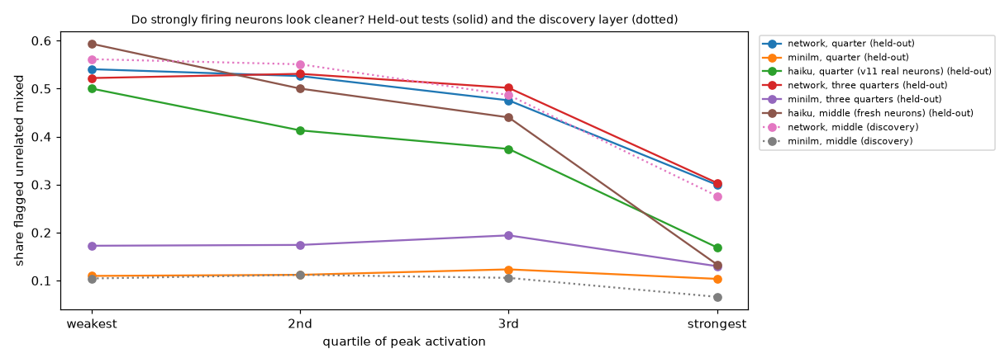

| Reader, depth | Neurons | Flagged, by peak quartile (weakest to strongest) | Top minus rest (points), models negative | Log-peak coefficient with controls | H1 / H2 |
|---|---|---|---|---|---|
| **Held out** | | | | | |
| network, quarter | 12,242 | 54% / 53% / 48% / 30% | -21 (-23.5 to -19.5), 6/6 | -0.58 (-0.64 to -0.52) | yes / yes |
| network, three quarters | 11,786 | 52% / 53% / 50% / 30% | -21 (-23.4 to -19.4), 6/6 | -0.56 (-0.62 to -0.51) | yes / yes |
| Haiku, quarter (v11's real neurons) | 600 | 50% / 41% / 37% / 17% | -25 (-33.0 to -17.6), 6/6 | -0.85 (-1.19 to -0.59) | yes / yes |
| Haiku, three quarters (v11's real neurons) | 599 | 44% / 41% / 32% / 20% | -20 (-27.7 to -12.0), 6/6 | -0.81 (-1.13 to -0.54) | yes / yes |
| Haiku, middle (fresh neurons) | 600 | 59% / 50% / 44% / 13% | -38 (-44.9 to -30.5), 6/6 | -0.94 (-1.37 to -0.60) | yes / yes |
| MiniLM, quarter | 12,242 | 11% / 11% / 12% / 10% | -1 (-2.4 to +0.1), 4/6 | -0.22 (-0.31 to -0.14) | no / yes |
| MiniLM, three quarters | 11,786 | 17% / 17% / 19% / 13% | -5 (-6.4 to -3.5), 6/6 | -0.28 (-0.35 to -0.21) | yes / yes |
| **Discovery** | | | | | |
| network, middle | 11,801 | 56% / 55% / 49% / 28% | -26 (-27.6 to -23.9), 6/6 | -0.57 (-0.62 to -0.51) | yes / yes |
| MiniLM, middle | 11,801 | 10% / 11% / 11% / 7% | -4 (-5.2 to -3.1), 5/6 | -0.35 (-0.44 to -0.26) | yes / yes |

Points 4 and 5 are exploratory. Point 5 was added after v9's review; point 4, the correlations in point 5 and its paired interval were added after v12's review. Their numbers are under `exploratory_with_coherence` and `exploratory_after_v12_review` in the results.

1. **The effect replicates on every held-out test for the network reader and Haiku, in all six models.**
   - Network reader: at both held-out depths, the strongest quarter of neurons is flagged 21 points less than the rest. It's mostly a step at the top quartile (54%, 53%, 48%, then 30%), with Spearman correlations of only -0.08 to -0.30 by model.
   - Haiku: 25 and 20 points less on about 600 real neurons at each held-out depth, and 38 points less on 600 fresh neurons at the middle depth. Haiku's decline is more graded (59%, 50%, 44%, 13% at the middle depth).
2. **The pre-registered controls don't explain it.** With peakedness, density and token purity in the regression, log peak's coefficient stays clearly negative in every test (H2).
3. **MiniLM shows the same direction at a much smaller scale:** 1 to 5 points, and its quarter-depth H1 fails. Its H2 holds, but its flag rate is only 10% to 19%.
4. **The effect doesn't depend on using the single peak, or on neurons Haiku had already seen.**
   - With quartiles of the mean of a neuron's 50 strongest window maxima (the level of the examples the readers see) instead of its single largest, the top quartile is flagged 23 to 27 points less by the network reader and 22 to 32 less by Haiku, in all six models.
   - 84 of Haiku's 600 fresh neurons are part of v9's Haiku-read unions, so Haiku had in effect seen some of their examples. Without them, H1 is -38 points (-46 to -30) and H2's coefficient is -1.08 (-1.53 to -0.73).
5. **Strong neurons' top examples are more alike inside the network, and that similarity accounts for much of Haiku's effect.** v6's top-pair percentile measures how alike a neuron's 50 strongest examples are in the network's representation: their median pairwise similarity, ranked against random positions. It correlates 0.50 to 0.60 with log peak. Adding it to H2's regression:
   - **Haiku**, which never sees that representation: similarity's coefficient is -0.93 (-1.28 to -0.69) at the middle depth, -0.81 at the quarter depth and -0.85 at three quarters. Log peak's coefficient shrinks by 0.58 (0.42 to 0.77, paired bootstrap) at the middle depth, from -0.94 to -0.37 (-0.81 to -0.03); by 0.52 at the quarter depth; and by 0.60 at three quarters, where its interval then includes 0 (-0.56 to +0.10).
   - **MiniLM:** the same pattern, smaller. Similarity's coefficient is -0.17 to -0.39, and log peak's shrinks by 0.10 to 0.25; at three quarters its interval then includes 0.
   - **Network reader:** similarity takes over (-1.4 to -1.5), and log peak's coefficient turns positive (+0.18 to +0.27). This says little. The flag and the similarity are computed from the same similarity matrix of the same examples, against the same null, so this is close to controlling for the outcome. The positive sign is a suppression effect of that, not evidence that stronger neurons are flagged more at fixed similarity.

### What this does and doesn't show

- **A pre-registered, replicated regularity.**
  - The network reader confirms it at two held-out depths of six Pythia sizes.
  - Haiku confirms it on real neurons at both held-out depths and on fresh neurons at the middle depth.
  - It holds with the mean of the top 50 in place of the single peak.
- **Its source is shared with how alike a neuron's strongest examples are.** That similarity is a continuous version of what the readers judge, so point 5 describes the effect rather than explaining it. Even so, it's notable that Haiku, which reads only text, tracks a similarity measured inside the network.
- **It doesn't say weak neurons are more polysemantic.** Two readings fit the data, and both predict lower similarity for weak neurons:
  - Mixing could really concentrate in weakly firing neurons.
  - Weak neurons could be tuned more broadly, so their strongest examples are more diffuse without being two jobs.
  - The toy model of superposition predicts something related within single neurons: the largest activations are clean and smaller ones more polysemantic ([Elhage et al. 2022, "Toy Models of Superposition"](https://transformer-circuits.pub/2022/toy_model/index.html), section "Computation in Superposition", subsection "Superposition vs Sparsity"). Here, though, a weak neuron's top 50 doesn't reach further down its own range. The median 50th example sits at 0.76 to 0.80 of the peak in the weakest quartile and 0.64 to 0.76 in the strongest, by model and depth (`rank_50_fraction_of_peak`).
  - Telling the two readings apart needs examples from a fixed band of each neuron's own range, or a causal test of whether a weak neuron's groups of examples have different effects downstream.
- **It's partly known.** A link between strong, rare, heavy-tailed activation and cleaner units has been reported for SAE features, suggested for GPT-2's universal neurons ([Gurnee et al. 2024](https://arxiv.org/abs/2401.12181), section 4.2) and seen in toy models. Peak activation predicting how mixed a raw neuron's top examples look, across a model family and confirmed by two readers, appears to be a modest extension.

### What's still shaky

- **The flag is a property of the top-50 sample, not of the neuron.** Any selection that makes strong neurons' top 50 more alike would give this pattern.
- **Point 5 is close to circular for the network reader** (same similarity matrix and null), and post hoc for all readers.
- **Haiku's labels are noisy.** v7's retest gave kappa 0.37 on real neurons, and v12 didn't retest.
- **Token purity** is computed with a stable sort, so in about 10% of neurons one of its 50 windows differs from the readers' 50 at a float16 tie (purity changes by at most 0.02).
- **Haiku runs through the `claude` CLI,** which adds a little hidden context: the working directory, the platform, the date and an account notice. It includes no git branch, commit or file contents.
- **Scope:** Pythia 70M to 2.8B, three depths, the 50 strongest examples per neuron. v5's eligibility filter drops near-dead and very dense neurons, so the weakest quartile isn't the models' weakest neurons.

### v12 files and reproduce

| Path | What it is |
|---|---|
| [`recgen/rubric_v12.py`](recgen/rubric_v12.py) | Pre-registered held-out data, H1 and H2, with the amendment |
| [`recgen/read_v12.py`](recgen/read_v12.py) | Fresh middle-layer neurons per peak quartile; Haiku readings through v7's cached reader |
| [`recgen/analyze_v12.py`](recgen/analyze_v12.py), [`recgen/plots_v12.py`](recgen/plots_v12.py) | Covariates, both hypotheses per reader and depth (with v11's readings), the exploratory checks; the figure |
| [`results/classification_v12.json`](results/classification_v12.json), [`results/v12_llm_answers.json`](results/v12_llm_answers.json) | Results and every fresh-neuron Haiku reading |

```bash
./run_v12.sh
```

`run_v12.sh` needs v5's and v6's caches and results, and reads v11's cached readings in `data/v11/llm/` if they're there. With v12's cached Haiku answers in `data/v12/`, it makes no model calls and reruns in about four minutes.

## v13 results

v1 to v4 tested recursive generalization on 40 neurons of Pythia-410m layer 12 that the sentence model (MiniLM) called mixed, with MiniLM's facets. v7 and v9 then showed that MiniLM barely sees mixing, so those neurons may not have been mixed in the network's own terms. v13 reruns v4's formation-time test on 40 neurons the network-native reader (v6) calls unrelated mixed, with the facets that reader finds. The rules are in [`recgen/rubric_v13.py`](recgen/rubric_v13.py), committed (`8b80902`) before any v13 recording. v4's attribution helpers gained an optional output path, with their defaults and tests unchanged. No earlier result changed.

### v13 method

1. **Neurons and facets.** 40 neurons, drawn with a fixed seed from the 1,109 of v6's 2,048 sampled neurons at 410M layer 12 that v6 flags unrelated mixed. Facets are v6's clusters (5 or more examples) of each neuron's 50 strongest examples in the network's own representation: 2 to 5 per neuron, 142 in all (median 8 examples, against 6 for v4's).
2. **Recording.** v4's attribution (direct terms from every upstream MLP neuron and attention head, with the LayerNorm scale frozen) at v4's 14 checkpoints from step 128 to 143k, on every facet example and v4's background text. The terms add back up within 6.3e-5 at every checkpoint.
3. **Tests, as in v4:** each facet's formation window; adjacency at formation against the null of other neurons' facets read through this neuron's weights (window maximum, 95th percentile); MLP drivers primary, head drivers beside them; labels; and "branched then separated" (adjacent at formation, not at the end) counted against its chance expectation. Two changes, both pre-registered: a facet's emergence time is the start of its formation window, and adjacency at the end is v2's rule computed from v13's own final checkpoint.

### What v13 found

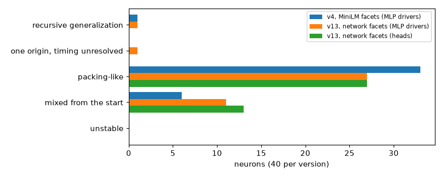

| | v4 (MiniLM facets) | v13 (network facets), MLP drivers | v13, head drivers |
|---|---|---|---|
| recursive generalization | 1 (0.9 by chance) | 1 (0.2) | 0 (0.0) |
| one origin, timing unresolved | 0 | 1 (0.1) | 0 (0.0) |
| packing-like | 33 | 27 (26.3) | 27 (26.2) |
| mixed from the start | 6 | 11 (13.5) | 13 (13.8) |
| unrelated pairs branched then separated | 0 of 68 (3.1 by chance) | **10 of 144 (6.4)** | 3 of 144 (2.7) |
| related pairs adjacent at formation (positive control) | 17 of 18 | **26 of 55** | 8 of 55 |

As in v4, "unrelated" and "related" here mean not adjacent and adjacent at the end by v2's driver test, not by any reader's judgment of the examples. The v4 and v13 label columns aren't like for like: v4 timed each facet's emergence by v1's response threshold, and v13 by the start of its formation window.

Points 3 to 6 are exploratory. Point 3 was added after seeing the counts; points 4 to 6 and the token-sharing split in point 3 were added after an independent review. Their numbers are under `exploratory_same_token` and `exploratory_after_review` in the results.

1. **Labels match chance, but that says little.** One neuron is labeled recursive generalization by MLP drivers (0.2 expected) and none by head drivers. But own facet pairs are adjacent at formation far more often than chance (36 of 199 against 8.7 expected), so the labels are driven mostly by timing: 70 of 142 formation windows start at step 1k or 2k. The one recursive-generalization neuron, 1726, has 8 of its 10 pairs adjacent at the end. That looks like lasting sharing, as v4 found for 4010.
2. **More unrelated pairs branched then separated than in v4, but within chance.** 10 of 144 by MLP drivers, against 6.4 expected from each pair's null; 3 of 144 by head drivers, against 2.7. If each pair crossed its threshold only at its own null's false-positive rate, independently, 10 or more would happen with probability 0.11 (0.52 for 3 or more by heads).
3. **The direct test of unrelated jobs is exactly at chance.** v13's neurons were picked because the network reader calls two of their facets unrelated, but "unrelated" above means unrelated by drivers. Splitting by the reader's own judgment:
   - Of the 101 pairs the reader calls unrelated, only 1 is adjacent at the end by drivers. Of the other 100, 5 branched then separated, against 4.4 expected (probability 0.46).
   - The other 5 branched pairs are pairs the reader calls related, though drivers call them unrelated at the end: 5 of 44, against 1.9 expected (probability 0.04).

   So what excess there is comes from facets the reader sees as related.
4. **Token sharing goes with shared drivers early in training.** Facet pairs that share at least one activating token overlap more at steps 128 to 512 than pairs that share none: median 0.10 against 0.04 (13 and 186 pairs). Of the 144 unrelated pairs:
   - 9 share a token, and 3 of those branched then separated, against 0.4 expected (probability 0.006);
   - the other 135 give 7 against 6.0 (probability 0.39).

   The clearest case is one of the three. Neuron 769's facets 0 and 2 share 92% of their top 100 upstream MLP drivers at step 128, still 13% to 18% from step 2k to 34k (the null's 95th percentile is about 0.06), and 7% at the end. Both fire on a hyphen: one in number ranges and scores ("41-44", "4-3"), the other inside web addresses and class names. The reader calls this pair related.

   Whether this counts against recursive generalization is ambiguous. Upstream drivers that respond to the token are shared circuitry, so this could be a hyphen detector that later split by context (branching at the level of a token) or one job that the reader split in two.
5. **The positive control is weaker than v4's because these related pairs share less.** v13's related pairs sit just above the end threshold (median final overlap 0.12, median threshold 0.07); v4's overlapped far more (median 0.44). So the 26 of 55 is roughly the detection rate for sharing just above threshold. At a 5% false-positive rate, several of the 55 may also be adjacent at the end by chance. 29 related pairs are adjacent at the end but not at formation.
6. **Half of the separations are marginal.** Only 5 of the 10 branched pairs end at least 0.02 below their end threshold, and 5 sit at or below the null's 95th percentile at each of the last three checkpoints. Two are adjacent at formation and only fall below the end threshold at the last checkpoint:
   - 2379 (facets 0 and 2) overlaps 0.11 to 0.18 from step 128 to 8k and again at 55k and 89k, then ties the end threshold;
   - 3017 (facets 2 and 3) stays near 0.10 through step 89k and drops to 0.06 at the end.

   Both look like lasting sharing with a dip at the end, not branching.

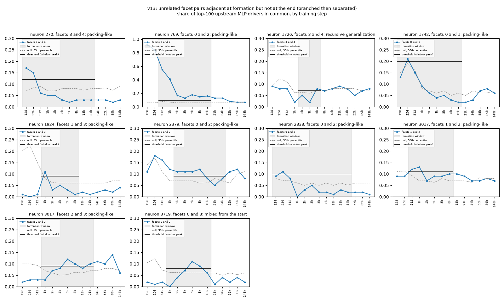

### What this does and doesn't show

- **v13 doesn't find recursive generalization with the network reader's neurons and facets either.** Among the facet pairs the reader itself calls unrelated, branching is at chance (point 3).
- **It's weak evidence against it.**
  - With 4.4 expected among those 100 pairs, at least 9 would be needed for a probability below 0.05.
  - The test catches roughly half of near-threshold sharing (point 5). So branching in fewer than about a tenth of those pairs could go unseen.
  - The control also covers sharing that lasts, not a brief shared phase.
  - Different neurons were tested than in v4, so this doesn't settle whether MiniLM's facets hid anything in v4's neurons.
- **The chance model is generous to branching.** It treats a neuron's own facet pairs like null pairs, but own pairs share drivers far more often (point 1). So lasting sharing just below the end threshold inflates the branched count. An excess wouldn't by itself mean branching.
- **Shared tokens complicate formation-time tests.** Facets that fire on the same token share drivers early (point 4). A future test should hold the token fixed, or decide in advance whether token-level branching counts. Word form is a known confound for polysemanticity metrics more generally ([Ait Hou and Hwa 2026](https://arxiv.org/abs/2604.00443)).

### What's still shaky

- **The rules weren't written blind to v4,** whose design and results they reuse. Every split in points 3 to 6 is post hoc.
- **Adjacency at the end uses only the final checkpoint,** so a dip there turns lasting sharing into "branched then separated" (point 6). Four of the ten pairs are within 0.01 of the end threshold.
- **Pairs aren't independent:** they share facets and null sets, so the chance probabilities are approximate.
- **Everything else from v4 still applies:** top-100 overlap is coarse, head drivers are a blunt probe, early checkpoints are noisy (37 of the 144 unrelated pairs have windows opening at step 128, and their thresholds run from 0.10 to 0.24, median 0.14), the grid is log-spaced, and facets are defined by their final examples.
- **Scope:** one layer of one model, 40 neurons.

### v13 files and reproduce

| Path | What it is |
|---|---|
| [`recgen/rubric_v13.py`](recgen/rubric_v13.py) | Pre-registered neurons, facets and tests |
| [`recgen/candidates_v13.py`](recgen/candidates_v13.py), [`recgen/record_v13.py`](recgen/record_v13.py) | The 40 neurons and their network-native facets; v4's recording at 14 checkpoints |
| [`recgen/analyze_v13.py`](recgen/analyze_v13.py), [`recgen/plots_v13.py`](recgen/plots_v13.py) | v4's tests on v13's recordings, the exploratory checks; the figures |
| [`results/candidates_v13.json`](results/candidates_v13.json), [`results/classification_v13.json`](results/classification_v13.json) | Neurons and facet examples; labels, pairs, windows, overlap series, null thresholds |

```bash
./run_v13.sh
```

`run_v13.sh` needs v6's `data/v6/` recordings and results, and v4's results. From scratch it takes about 70 minutes on an M1 Pro: it downloads 14 checkpoints one at a time, deletes each after use, and caches 4.5 GB in `data/v13/`. With that cache, the analysis reruns in about 15 minutes.

## v14 results

v8's best investigating agent, Sonnet, flagged 50/50 pools of two neurons 25 points more often than real neurons and called 20% of real neurons one job. The Haiku agent managed 11 points and called 66% one job. The essay's "about 90% one main job" comes from preliminary audits of Qwen3-32B whose method the essay doesn't describe. v14 asks whether the strongest available auditor, an Opus agent, detects pools better than the Sonnet agent, and what one-job share it gives real neurons. Everything but the model is v8's: the prompt, tools, budget, units and retest set.

The rules are in [`recgen/rubric_v14.py`](recgen/rubric_v14.py), committed (`eb8ed70`) before any v14 reading. A pilot of two readings on pythia-160m units outside the sample came next (`d7e25e9`). It found nothing broken, so the rules weren't amended. In the pilot, the Opus agent called both units one job, the real neuron and the 50/50 pool (v8's Sonnet agent had called that pool unrelated jobs, and its Haiku agent one job). The analysis code was committed (`92d136d`) while the readings ran. By then 34 of the 330 readings, all of 70M real neurons, were already cached, and the run's log prints each label as it lands, so the commit doesn't show that no v14 label had been seen (post hoc, from the cache's file times, added after an independent review). The tests it applies are the rubric's, committed before any reading. v8's analysis and figure code now take the set of readers as an argument; rerunning them leaves v8's results and figure byte-identical. No earlier result changed.

### v14 method

1. **Agent.** `claude-opus-5-5` through the `claude` CLI (2.1.296), by its full id (the `opus` alias resolved to the same model). It runs through v8's runner code: the same CLI flags, system prompt, instructions, two tools, 8 tool calls (at least 4 asked for), activation scale, turn cap, $1 cap per attempt and 3 attempts. No effort flag was passed and no effort override was set, so the CLI used its default effort, as in v8. Two run details differ from v8's own readings, because a fix (`06ea143`) landed after v8's run and before v14's:
   - **Working folder.** v8's agents ran the CLI in an empty folder inside the repo (`data/v8/workdir`), so the CLI told them their folder was a git repository (v8 checked: no branch name or commits). The Opus agent's empty folder was outside the repo, so it got no such note.
   - **Rank cap.** In v8, a pool showing two examples from one window had a ranked list a few ranks longer than 4,096; it's now cut at 4,096. No reading reached it: the deepest rank the Opus agent asked for was 3,014, and v8's agents 1,019 (post hoc).
2. **Units:** v8's 300 (per size, 40 real neurons, 40 50/50 pools of random neurons and 20 pools of related neurons, at the middle layer of 70M, 410M and 2.8B) and v8's 30 retest units. All 300 prompts are byte-identical to the ones v8's agents saw (checked by hash). The other five readers aren't read again: their labels are v7's and v8's.
3. **Pre-registered tests:**
   - **Primary:** the Opus agent's pooling detection (50/50 pools' flag rate minus real neurons', flag = C, averaged over the three sizes) minus the Sonnet agent's, with v8's paired bootstrap on the same units and v8's verdict rule: "much better" if at least 15 points with the interval above 0, "better" if only the interval is above 0.
   - **Secondary:** the same gain over one-shot Haiku (v7) and over the Haiku agent (v8); every reader's detection with B or C as the flag; label AUC; one-job shares of real neurons and pools; retest; kappa with the other readers on real neurons; tool use; the related pools; rates by size (descriptive).
4. **Run rules:** six readings at a time, a spend guard of $150 of CLI-reported cost (pilot included), and readings that failed for an infrastructure reason (a CLI error, a usage limit, a timeout) read again on a later run. None did.

All 330 readings returned a valid label on the first attempt. The CLI reported $36.60 of quota for them ($0.11 a reading, about 3.6 times the Sonnet agent's $0.03, for no gain in C-flag detection), $0.22 for the two pilot readings and $0.03 for two one-word checks of the model id, so the guard never came close. Every tool call, its answer and the agent's messages are in [`results/v14_agent_answers.json`](results/v14_agent_answers.json).

### What v14 found

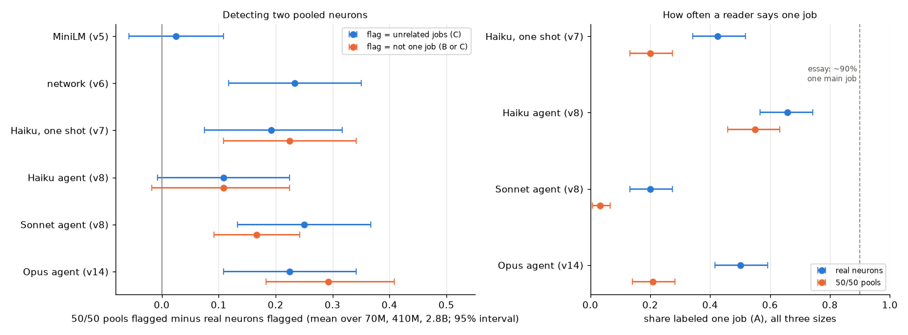

| Reader (same 240 real and pooled units) | 50/50 pools flagged over real neurons, C (95% interval) | Same, B or C | Label AUC | Real neurons called one job | 50/50 pools called one job | Retest kappa | Mean tool calls |
|---|---|---|---|---|---|---|---|
| MiniLM (v5) | +2.5 (-6 to +11) | | 0.51 | | | | |
| network (v6) | +23 (+12 to +35) | | 0.62 | | | | |
| Haiku, one shot (v7) | +19 (+7.5 to +32) | +22.5 (+11 to +34) | 0.62 | 42.5% | 20% | 0.37 (v7's 60 units) | |
| Haiku agent (v8) | +11 (-1 to +22.5) | +11 (-2 to +22.5) | 0.56 | 66% | 55% | 0.56 | 2.8 |
| Sonnet agent (v8) | +25 (+13 to +37) | +17 (+9 to +24) | 0.64 | 20% | 3% | 0.77 | 2.9 |
| **Opus agent (v14)** | **+22.5 (+11 to +34)** | +29 (+18 to +41) | 0.66 | 50% | 21% | 0.57 | 5.6 |

| Pre-registered gain | C flag, points (95% interval) | Verdict | B or C flag, points | Verdict |
|---|---|---|---|---|
| **Opus agent over Sonnet agent (primary)** | **-2.5 (-15 to +9)** | **no clear difference** | +12.5 (+2.5 to +23) | better |
| Opus agent over one-shot Haiku | +3.3 (-11 to +16) | no clear difference | +6.7 (-6 to +19) | no clear difference |
| Opus agent over Haiku agent | +12 (-1 to +23) | no clear difference | +18 (+7 to +30) | much better |

The other readers' numbers are recomputed from v7's and v8's answers with v14's bootstrap seed, so a few intervals differ from v8's table by a point. Two checks were added after seeing the results and are post hoc: how Opus's labels map onto the Sonnet agent's (point 2) and the share of readings that used all 8 tool calls (point 4). An independent review then added more, also post hoc and kept apart in the results file: each reader's label shares and B-or-C ceiling, the paired AUC difference and the overlap of the two agents' C labels (points 2 and 3), the deepest rank asked for (method point 1), output tokens and cost per reading, and the count of readings cached before the analysis commit. Reading the essay's definition as A or B (point 3) is exploratory too. Everything else was listed in the rubric. Details are in [`results/classification_v14.json`](results/classification_v14.json).

1. **The Opus agent detects pools no better than the Sonnet agent.** It flags 50/50 pools 22.5 points more often than real neurons, against the Sonnet agent's 25 on the same units (gain -2.5, interval -15 to +9). That rules out the pre-registered "much better" (at least 15 points), and the Opus agent is close to the network reader (+23) and one-shot Haiku (+19) too. Its gain over the Haiku agent (+12, -1 to +23) isn't clear either.
2. **It draws the line differently: fewer C answers, more B.** It flags 29% of real neurons and 52% of pools, where the Sonnet agent flags 56% and 81%. Of the 67 real neurons the Sonnet agent called unrelated jobs, the Opus agent called 19 related jobs (B) and 16 one job; of its 97 such pools, 23 B and 13 one job (post hoc). Its C labels are nearly a subset of the Sonnet agent's: 93 of its 97 C labels on real neurons and pools are Sonnet C labels too (post hoc).
   - **The B-or-C gains are mostly about the other agents.** With B or C as the flag, the Opus agent has the largest point estimate (+29, interval +18 to +41), but the intervals overlap, and that column has only the four language-model readers (MiniLM and the network reader have one flag each, in the C column). Two of the five secondary gains have intervals above 0, both on B or C. Over the Sonnet agent (+12.5, +2.5 to +23, "better"), it's mostly a ceiling: the Sonnet agent calls 77.5 to 85% of real neurons B or C (by size) and 95 to 97.5% of pools, so its B-or-C detection can't exceed 20 points, where the Opus agent, calling half of real neurons one job, has room for 50 (post hoc). Over the Haiku agent (+18, +7 to +30, "much better"), it isn't a ceiling (the Haiku agent calls 34% of real neurons B or C): the Haiku agent is the weakest reader here, calling 55% of pools one job, with +11 points on either flag and an AUC of 0.56. The Opus agent is ahead of it on C too, though not clearly (+12, -1 to +23).
   - **On the measure that ignores the line, it isn't measurably better than the Sonnet agent.** Its label AUC, which doesn't depend on where a reader draws the line, is 0.66 (0.60 to 0.72), the highest of the six but overlapping the Sonnet agent (0.64), the network reader and one-shot Haiku (both 0.62). Paired on the same units, it's 0.02 above the Sonnet agent's (-0.04 to +0.08, post hoc).
3. **The strongest auditor calls half of real neurons one job, and a fifth of known pools.** The Opus agent calls 50% of real neurons one job (42 to 59%; 55%, 52.5% and 42.5% from 70M to 2.8B), 30 points more than the Sonnet agent (+22.5 to +38) and 16 fewer than the Haiku agent. It calls 21% of the 50/50 pools one job (14 to 28%). Many of those answers name a broad pattern that can cover two unrelated neurons, such as "tokens that are highly predictable continuations of fixed phrases, known names, words split into pieces or standard formats" (70M pool 1282-1388, which the Sonnet agent split into five unrelated jobs). By v8's crude keyword count, 48% of its 25 one-job answers on pools use such a word, against 37% of its 60 on real neurons. Counting A or B as "one main job" (exploratory) adds nothing new: A or B is 1 minus the C share, so it restates the C-flag result. It's 71% of real neurons and 48% of pools for the Opus agent, 76% and 65% for the Haiku agent, 56% and 37% for one-shot Haiku, and 44% and 19% for the Sonnet agent (post hoc).
4. **It investigated about twice as much, and the budget still didn't bind.** It used 5.6 of its 8 tool calls on average (the v8 agents 2.8 and 2.9), met the minimum of 4 in 299 of 300 readings, read examples past rank 50 in every reading and wrote 17.3 test texts per reading (the v8 agents 5.8 and 7.8). Only 1 of 300 readings used all 8 calls (post hoc). So the Opus agent investigated clearly more than v8's agents, yet its C-flag detection didn't rise.
5. **Its consistency can't be told apart from either v8 agent's on 30 units.** Read a second time, 30 units (10 of them real neurons) get the same flag 80% of the time (kappa 0.57, interval 0.26 to 0.86), against the Haiku agent's 0.56 and the Sonnet agent's 0.77 on the same units. They get the same label only 67% of the time, the lowest of the three (Haiku agent 83%, Sonnet agent 70%). On real neurons it agrees most with the Haiku agent (kappa 0.53), then the Sonnet agent (0.40), the network reader (0.32), one-shot Haiku (0.23) and MiniLM (0.19).
6. **The related control again says little.** The Opus agent flags related pools 32 points less than 50/50 pools (+18 to +44) and 9 points less than real neurons (-22 to +3). Among related pools without a shared window, the difference from real neurons is +3 (-14 to +21).
7. **By size (descriptive):** its detection is +12.5, +42.5 and +12.5 points at 70M, 410M and 2.8B, and its share of real neurons flagged is 20%, 22.5% and 45%. With 40 real neurons and 40 pools per size, these per-size numbers are noisy.

### What this does and doesn't show

- **Only the pools have a known answer, and even theirs isn't exact.** On the 120 known pools, the Opus agent calls 79% not one job and 52% unrelated jobs, against the Sonnet agent's 97% and 81%. Two random neurons can still have clearly related jobs, so C isn't strictly the true label for every pool. Real neurons have no ground truth. If a share p of them are genuinely mixed, even a perfect reader, flagging exactly the mixed units, would show a detection of 1 - p and an AUC of 1 - p/2, not 1. So as long as a reader flags mixed real neurons at least as often as clean ones, its detection is a lower bound on its power (its flag rate on pools minus its rate on clean neurons), and understates it by more the larger the unknown p.
- **A stronger auditor that investigates more didn't measurably improve pooling detection.** Holding the prompt, tools, budget and units fixed, swapping Sonnet for Opus changed the C-flag detection by -2.5 points (-15 to +9) and the label AUC by +0.02 (-0.04 to +0.08). Across the six readers, the best detection stays around +19 to +25 points and the best AUCs around 0.62 to 0.66. The methods point from v6 to v8 still holds with the strongest auditor available here: its power on known mixtures is moderate, and should be measured before its cleanliness numbers are read.
- **The one-job share still measures the auditor.** Three agents with identical instructions and tools give 66%, 50% and 20% on the same real neurons, and the agent with the highest share also calls the most known pools one job (55%, 21% and 3%). Opus sits in the middle on both. A high one-job share from any of them isn't evidence of clean neurons on its own.
- **It doesn't refute the essay's ~90%.** The essay audits Qwen3-32B, not Pythia, likely with deeper investigation and its own rubric. Its "one main job, often with small related offshoots" doesn't map onto A or B here: B means two or more clearly related patterns, and A or B only restates the C share (71% of real neurons and 48% of known pools for the Opus agent). Under this rubric even the strongest auditor available here separates pools from real neurons only moderately.

### What's still shaky

- **"Only the model changed" covers how the model uses the budget.** The Opus agent wrote three times as many test texts as the Sonnet agent (17.3 against 5.8). The comparison is Opus as the CLI runs it by default, with its own investigation style, not Opus doing the same investigation as Sonnet. No effort flag was passed, and the CLI's default effort may differ by model: the Opus agent wrote about 1,680 output tokens per reading against the Sonnet agent's 620 (and the Haiku agent's 1,090, so output length doesn't simply track model size; post hoc). A higher effort setting or a larger budget could change the result. Two run details also differ from v8's arms, the CLI's git-repository note and the rank cap (method point 1), though no reading reached the cap.
- **One reading per unit from a noisy reader.** The Opus agent's retest kappa is 0.57, so label noise widens every interval. The gain intervals are about ±12 points: a true gain smaller than that couldn't be seen.
- **The B-or-C gains don't show better separation.** Two of the five secondary gains have intervals above 0, both on B or C (point 2). The one over the Sonnet agent is mostly its ceiling: calling 80% of real neurons B or C leaves it at most 20 points of B-or-C detection. The one over the Haiku agent reflects that agent calling most pools one job. The paired AUC difference from the Sonnet agent, which doesn't depend on the line, is +0.02 (-0.04 to +0.08).
- **Shared machine and account.** The Opus readings ran about an hour after v8's, with CLI 2.1.296 (installed since Oct 9, so most likely v8's version too; v8 didn't record its version or environment). Other jobs, including another Opus reader on the same account and other Pythia jobs, ran at the same time; they could slow readings but not change the tool answers.
- **v8's caveats all carry over:** pools mix two neurons' strongest examples, the easiest kind of mixing to detect; test texts are short and their first token is marked; the A definition allows broad patterns; one prompt and rubric, one model family, the middle layer of three Pythia sizes.

### v14 files and reproduce

| Path | What it is |
|---|---|
| [`recgen/rubric_v14.py`](recgen/rubric_v14.py) | Pre-registered arm, units, tests and run rules |
| [`recgen/agent_v14.py`](recgen/agent_v14.py) | Runs the Opus agent through v8's runner, with the spend guard, the cache and the rerun of infrastructure failures |
| [`recgen/analyze_v14.py`](recgen/analyze_v14.py), [`recgen/plots_v14.py`](recgen/plots_v14.py) | v8's analysis and figure with six readers: gains, detection, AUC, one-job shares, retest, agreement, tool use, related pools, post-hoc checks |
| [`results/v14_agent_answers.json`](results/v14_agent_answers.json) | Every Opus reading: label, patterns, confidence, tool calls with their answers, messages, tokens and cost |
| [`results/classification_v14.json`](results/classification_v14.json) | All statistics, and every unit's labels and flags from all six readers |
| [`results/v14_pilot_answers.json`](results/v14_pilot_answers.json) | The two pilot readings on pythia-160m |
| `tests/test_rubric_v14.py`, `tests/test_agent_v14.py`, `tests/test_analyze_v14.py` | Tests for the rules, the runner and the analysis |

```bash
./run_v14.sh
```

`run_v14.sh` needs v5's `data/v5/` window maxima, v6's `data/v6/` recordings, `results/classification_v7.json`, `results/v8_agent_answers.json`, and the `claude` CLI signed in. The readings are cached in `data/v14/` (not committed). With the cache, it loads no model, makes no CLI calls and reruns in about a minute. From scratch, the 330 readings took about 40 minutes, six at a time, while other jobs shared the machine. Labels will differ somewhat, because the agent isn't deterministic (point 5).

## v15 results

The readers compared in v8 (v5's MiniLM and v6's network detectors, v7's one-shot Haiku and v8's two agents) separate known two-neuron pools from real neurons poorly, with AUCs of 0.51 to 0.64, and the language-model readers' one-job share of real neurons swings from 20% to 66%. v8 suggested that a rubric asking whether a stated job predicts activations on new text might do better. The field's standard autointerp metric is that kind of rubric. An explainer writes an explanation from a unit's top examples, and a scorer uses only the explanation to judge held-out examples:

- In [Bills et al. 2023, "Language models can explain neurons in language models"](https://openaipublic.blob.core.windows.net/neuron-explainer/paper/index.html) (sections "Step 2: Simulation" and "Step 3: Scoring"), a simulator predicts the activations, and the score is their correlation with the true ones.
- In [Paulo et al. 2024, "Automatically Interpreting Millions of Features in Large Language Models"](https://arxiv.org/abs/2410.13928) (section 3.3.1, "Detection"), the scorer says which examples activate the unit at all.

v15 uses Bills et al.'s correlation as its main score and a detection-style AUC as a secondary one. It asks whether the score can tell v8's random 50/50 pools from real neurons. If pools score about as well, the score measures how predictable a unit is, not whether it has one job. v12, cited below, is on the `v12` branch.

The rules are in [`recgen/rubric_v15.py`](recgen/rubric_v15.py), committed (`6e395ed`) before any reading. A pilot of the whole pipeline on v8's six pilot units (pythia-160m, outside the sample) came next (`faed2cf`). Every reading parsed, two of them after a retry, so the rubric wasn't amended. The analysis code was committed (`3b40944`) about four minutes into the run, before any result was computed. After the run, one runner bug was fixed (`d9f32b8`): the flag marking retest units shared a key with the retest reading, which crashed the analysis. The answers were rebuilt from the cache, and no reading changed. An independent review of the first write-up (a fresh Claude session) found that one conclusion didn't follow (point 2) and prompted three more post hoc checks (`84b6c52`). No earlier file or result changed.

### v15 method

1. **Units:** exactly v8's 300. At the middle layer of Pythia 70M, 410M and 2.8B, per size, 40 real neurons, 40 50/50 pools of two random neurons and 20 pools of related neurons, on v8's 0-10 activation scale. No Pythia model is loaded: everything comes from v5's window maxima and v6's stored residuals, through v8's `UnitView`.
2. **Explainer:** `claude-sonnet-5-5` through the `claude` CLI, one shot, with no tools and v7's system prompt. It sees the unit's 50 shown examples (v7's: for a pool, 25 from each neuron), in v7's order with their activations, exactly as v8's agents saw them. It's asked for a concise explanation of what the unit responds to, in at most about 30 words. It isn't asked for a one-job or mixed label, nor told how it's scored.
3. **Held-out set, per unit, never shown to the explainer:** from the unit's ranked list of 4,096 windows (one example per window, at the unit's strongest token there), 20 windows from ranks 51 to 300, 20 from ranks 301 to 2,000 and 20 from the remaining ranks (2,001 to 4,096, the "random" stratum). The draw and the order (shuffled together) are seeded by the unit's id. The true value is the unit's 0-10 activation there.
4. **Simulators:** given only the explanation and the 60 held-out snippets (same format and marked token, no values), predict each snippet's activation from 0 to 10 as a strict JSON list. Two arms, `claude-sonnet-5-5` (primary) and `claude-haiku-5-5`, so that dependence on the simulator shows. A reply that doesn't parse is retried, up to three tries.
5. **Scores, per unit:** the simulation score is the Pearson correlation of predicted with true values over the 60 examples. Spearman and a detection AUC (top two strata against the random stratum) are secondary.
6. **Primary test:** pools minus real neurons' mean simulation score (Sonnet simulator), averaged over the three sizes, with a bootstrap interval resampling units within size and type, and the score's AUC for ranking real neurons above pools. The pre-registered verdict:
   - **"detects mixtures"** if the pools-minus-real interval is entirely below 0 and the AUC's interval entirely above 0.5;
   - otherwise **"doesn't detect mixtures"** if the pools-minus-real interval lies within ±0.10, so pools score about as well as real neurons;
   - otherwise "inconclusive".

   Also pre-registered, as descriptions: whether the AUC's interval clears v8's largest AUC (0.64), and whether the AUC reaches 0.80, a level at which it would work as a screen.
7. **Secondary:** the same with the Haiku simulator; related pools; Spearman and detection AUC as the score; coverage of the two pooled neurons; disjunctive explanations (exploratory): a marker count (" or ", "either", "two", "both", ";", "also", "as well as") and a Haiku judge asking whether the explanation names two or more unrelated patterns; a retest of v8's 30 retest units (a new explanation, then both simulators, on the same held-out set); and real neurons' scores against v12's log peak (exploratory).

All 330 explanations, all 330 Sonnet simulations and all 300 judgments were valid; 23 Sonnet simulations needed a retry after a list of the wrong length. The Haiku simulator often miscounted the 60 snippets (most failed lists had 56 to 66 numbers): 146 of its 330 readings needed a retry, and 30 never gave a valid list. Those were 29 first readings (10 real neurons, 13 pools, 6 related pools) and 1 retest. As pre-registered, those units are left out of the Haiku arm. One Haiku prediction was constant, so it scored 0. The 1,290 readings took 37 minutes, six at a time, and the CLI reported $12.09 of quota: $5.05 for the explainer, $6.28 for the Sonnet simulator, $0.67 for the Haiku simulator and $0.09 for the judge, plus $0.23 for the pilot. Every explanation, prediction and judgment is in [`results/v15_answers.json`](results/v15_answers.json).

### What v15 found

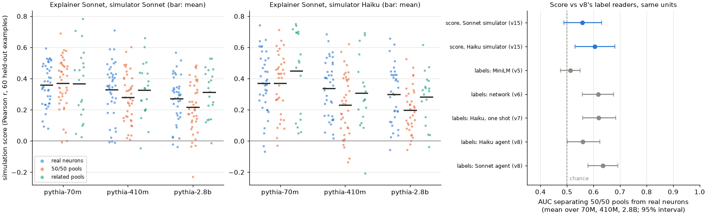

| Simulator | Real neurons | 50/50 pools | Related pools | Pools minus real (95% interval) | Score AUC, real over pools (95% interval) | Verdict |
|---|---|---|---|---|---|---|
| **Sonnet (primary)** | 0.32 | 0.29 | 0.34 | **-0.03 (-0.07 to +0.01)** | **0.56 (0.49 to 0.63)** | **doesn't detect mixtures** |
| Haiku | 0.34 | 0.27 | 0.35 | -0.07 (-0.12 to -0.02) | 0.60 (0.53 to 0.68) | detects mixtures |

Mean simulation scores over the three sizes. The Haiku row has 217 of the 240 real and pooled units.

| Size, Sonnet simulator | Real neurons | 50/50 pools | Related pools | Pools minus real |
|---|---|---|---|---|
| 70M | 0.36 | 0.37 | 0.37 | +0.01 |
| 410M | 0.33 | 0.28 | 0.33 | -0.05 |
| 2.8B | 0.27 | 0.22 | 0.31 | -0.05 |

| Reader (v8's 240 real and pooled units) | AUC separating pools from real neurons (95% interval) |
|---|---|
| MiniLM flag (v5) | 0.51 (0.48 to 0.55) |
| network flag (v6) | 0.62 (0.56 to 0.68) |
| Haiku labels, one shot (v7) | 0.62 (0.56 to 0.68) |
| Haiku agent labels (v8) | 0.56 (0.50 to 0.62) |
| Sonnet agent labels (v8) | 0.64 (0.58 to 0.69) |
| **Simulation score, Sonnet simulator (v15)** | **0.56 (0.49 to 0.63)** |
| Simulation score, Haiku simulator (v15, 217 units) | 0.60 (0.53 to 0.68) |

What's post hoc, added after seeing the results:
- the one-neuron oracle (point 3), the stratum means and the spread adjustment (point 4), and the choice of examples in point 2;
- added after the independent review: the tracked-neuron check (point 2), the paired comparison of the two simulators (point 1), and the spread by size (point 4).

Everything else was pre-registered or listed as exploratory in the rubric. Details are in [`results/classification_v15.json`](results/classification_v15.json).

1. **The simulation score barely tells a pool of two random neurons from a real neuron.** With the Sonnet simulator, pools score 0.03 below real neurons (interval -0.07 to +0.01), inside the pre-registered ±0.10, so the verdict is "doesn't detect mixtures". The score's AUC is 0.56 (0.49 to 0.63).
   - There's no gap at 70M (+0.01), and 0.05 at 410M and 2.8B.
   - With the Haiku simulator, the gap is -0.07 (-0.12 to -0.02) and the AUC 0.60 (0.53 to 0.68), which meets the rule's "detects mixtures", weakly. On the same 217 units, Haiku's gap is 0.05 larger than Sonnet's (interval 0.01 to 0.08), so the verdict depends on the simulator.
   - Spearman and detection AUC give the same picture (Sonnet simulator: AUCs 0.54 and 0.55).
   - Neither AUC's interval clears v8's largest AUC (0.64), and neither AUC is near 0.80. Both sit inside the range of v8's readers (0.51 to 0.64), so the standard score isn't detectably better at finding known mixtures than asking a reader for a label. No paired test against those readers was run.
2. **Pool predictions mostly track one of the two neurons.**
   - **The pre-registered test can't show this.** Each pool's held-out examples were split by which neuron drives them. The pool's majority neuron (the minority drives a median 40% of the top-strata examples) gets a detection AUC of 0.62, and the minority neuron 0.63 (difference -0.01, interval -0.04 to +0.02). But the explainer saw 25 examples of each neuron, and which one has the longer tail (the held-out majority) is unrelated to which one an explanation describes. So equal AUCs are what you'd see even if every explanation covered just one neuron, picked at random. The first write-up of v15 read this as "explanations cover both neurons", and the independent review caught it.
   - **Post hoc check.** Each pool's 60 held-out examples were split into two halves, balanced by stratum. On one half, I picked the neuron whose window maxima correlate better with the predictions. On the other half, I measured both neurons' correlations, so picking the tracked neuron can't inflate its own correlation. With the Sonnet simulator, predictions correlate 0.29 with the tracked neuron and 0.07 with the other (gap 0.22, interval 0.16 to 0.28). Haiku gives 0.29 and 0.06. Related pools, whose two neurons share inputs, show a smaller gap (0.08, interval 0.01 to 0.15).
   - **So most explanations, as the simulator uses them, capture one job.** Some still capture both. The two best-scoring pools (out of 120):
     - 70M neurons 1279 and 1631 (score 0.69): *Fires right after a subject or relative pronoun (we, I, which, who) on an adverb (really, specifically, closely) or on a mid-word verb stem fragment (recon-, constru-, observ-) where a verb continuation is expected.* It names two patterns, and the judge calls them unrelated. Its majority neuron's detection AUC is 0.86, and its minority neuron's only 0.56.
     - 410M neurons 687 and 3175 (score 0.60): *A predicate word or verb right after a subject (esp. "it is/was" or a plural subject) that predicts a following "to"/"that" clause: adjectives like normal, common, rare, fair, easy, or verbs like stop, sit, stand.* The judge calls it one pattern, and it predicts both neurons' examples (detection AUCs 0.79 and 0.99).
3. **Tracking one neuron costs a pool little, relative to how weakly real neurons are explained (post hoc).**
   - Pools' predictions correlate about as well with the pool's values (0.29) as with the tracked neuron's own maxima (0.29), and real neurons score 0.32. The neglected neuron's examples barely lower the score.
   - The score has room to penalize mixing. A prediction that tracked one pooled neuron's window maxima perfectly and ignored the other would score 0.70 on a pool for the better of the two neurons and 0.51 for the worse. A perfect prediction of a real neuron scores 1. With explanations that score 0.3, that room goes mostly unused.
   - Why the cost is so small isn't settled. Window maxima only approximate a neuron's value at the marked token, and the predictions may also follow features both neurons share.
4. **Part of the small gap may come from the values' spread (post hoc).** A pool takes the larger of two neurons, which lifts its weak windows. Its random stratum averages 3.5 on the 0-10 scale, against 2.6 for real neurons, and its held-out values spread less (mean SD 1.48 against 1.67). A narrower spread can lower correlations by itself.
   - In a least-squares fit with size fixed effects, adding that spread moves the pools' coefficient from -0.03 to +0.00 (-0.04 to +0.04) with the Sonnet simulator, and from -0.07 to -0.03 (-0.07 to +0.02) with Haiku. Its intervals resample units without stratifying.
   - But both adjusted intervals still include the unadjusted gaps. Spread also goes with higher scores among real neurons (Spearman 0.35), so it partly stands for how explainable a neuron is. At 70M, pools have the same spread deficit (1.55 against 1.74) and no score gap at all.
   - The data can't separate a spread effect from an explanation effect.
5. **Disjunctive explanations are everywhere (exploratory).** The explainer wrote about 30 words for every kind of unit (30.1 for real neurons, 31.1 for pools, 31.0 for related pools).
   - The marker count is useless: 83 to 87% of explanations of every type contain one, mostly "or".
   - The judge calls 76% of pool explanations unrelated patterns, but also 63% of real neurons' and 42% of related pools'. That's v7 and v8's finding again: readers call many real neurons mixed.
   - Among real neurons, explanations the judge calls unrelated score lower (0.30 against 0.36). Among pools, both kinds score 0.29, so there's no sign that a pool's disjunctive explanation is penalized. These are observational splits.
6. **The score is repeatable with the Sonnet simulator, on a fixed held-out set.** On v8's 30 retest units, a fresh explanation and simulation on the same 60 held-out examples give scores that correlate 0.84 (0.75 to 0.92) with the first run's, a mean absolute difference of 0.08. That leaves out the noise from drawing the held-out examples. With the Haiku simulator, the correlation is 0.44 (-0.04 to 0.82) on 27 units. The two simulators' scores correlate 0.72 across units. So the score is a fairly stable property of a unit, one that tracks mixing only weakly.
7. **Related pools score like real neurons** (Sonnet simulator: +0.02, interval -0.04 to +0.07; AUC 0.48), as in v7 and v8.
8. **Stronger real neurons are explained better (exploratory).** Real neurons' scores rise with v12's log peak: Spearman 0.25 (0.05 to 0.42) over all sizes, 0.42 at 410M and 2.8B, and -0.06 at 70M. That's the direction of v12's finding that strongly firing neurons look cleaner to the label readers.
9. **Scores fall with size (descriptive):** real neurons from 0.36 (70M) to 0.27 (2.8B), pools from 0.37 to 0.22, with the Sonnet simulator.

### What this does and doesn't show

- **On these units, the standard simulation score is at best a weak mixture detector.** With the primary simulator, a pool of two random, unrelated neurons scores 0.03 below a real neuron on average (up to 0.07 by the interval), and the score ranks real neurons above pools 56% of the time. With the Haiku simulator, it does a little better (0.60). Neither is detectably better than v8's readers, and neither is near a usable screen.
- **A high simulation score isn't evidence that a unit has one job.** It shows that an explanation predicts activations. On pools, the explanations mostly capture one of the two jobs (point 2), and the score barely notices (point 3).
- **It doesn't show the score is useless.** With the Sonnet simulator it's fairly repeatable (point 6), and it measures what it was built to measure: how predictable a unit's activations are from a short text. Reading it as monosemanticity needs a positive control like the pools, as v7 and v8 found for the labels.
- **It doesn't rule out a scorer that would catch pools.** Scoring every token of whole texts, as Bills et al. do, or including truly non-activating examples, as Paulo et al.'s detection does, would widen the range of true values. Explanations that predict real neurons much better than 0.3 would leave room for the one-neuron cap (0.51 to 0.70, point 3) to bite. A shorter explanation limit could push explanations either way. v15 tests one common setup, not all of them.
- **The pools are the easiest kind of mixing to detect** (v7): two unrelated neurons' strongest examples. A score that barely separates these is unlikely to catch subtler mixing within real neurons, though v15 doesn't test that directly.

### What's still shaky

- **The held-out examples are each window's strongest token,** so even the random stratum fires moderately (2.4 to 3.5 of 10 on average, by unit type). That compresses the range of true values, makes prediction harder than in token-level scoring, and keeps absolute scores (0.2 to 0.4) from being comparable with published ones. Real neurons and pools are scored the same way, but pools' values spread less (point 4).
- **The verdict depends on the simulator** (point 1). The Haiku arm also failed on 30 of 330 readings, which are left out (29 first readings and 1 retest), and its retest interval is wide.
- **Points 2 to 4 are post hoc.** The tracked-neuron check uses each neuron's window maxima, which only approximate its value at the marked token.
- **One explainer, one prompt, one sample of examples.** The prompts are mine, modeled on v8's, not Bills et al.'s or Paulo et al.'s exact prompts. The explainer used its full ~30 words almost every time (26 to 35 words, 10th to 90th percentile), and a shorter limit wasn't tested.
- **The judge and the marker count are crude** and exploratory. The marker count can't tell a list from an "or" inside one pattern.
- **The CLI adds a little hidden context** to each call (v12 found the working directory, the platform and the date), the same for every unit. It runs in an empty folder outside the repo, as in v8.
- **Scope:** the middle layer of Pythia 70M, 410M and 2.8B, 300 units, one reading each (plus 30 retests).

### v15 files and reproduce

| Path | What it is |
|---|---|
| [`recgen/rubric_v15.py`](recgen/rubric_v15.py) | Pre-registered held-out sampling, prompts, parsing, scores, tests and verdict rule |
| [`recgen/simulate_v15.py`](recgen/simulate_v15.py) | Builds each unit's explainer prompt and held-out set from v8's `UnitView`; runs the explainer, both simulators and the judge through the `claude` CLI, with retries, a $80 spend guard and a cache |
| [`recgen/analyze_v15.py`](recgen/analyze_v15.py), [`recgen/plots_v15.py`](recgen/plots_v15.py) | The mixture test, related pools, coverage, disjunction, retest, peak and post hoc checks; the figure |
| [`results/v15_answers.json`](results/v15_answers.json) | Every explanation, prediction and judgment, with each unit's held-out examples (snippet, rank, stratum, true value, each pooled neuron's value), every attempt's reply, tokens and cost |
| [`results/classification_v15.json`](results/classification_v15.json) | All statistics, and every unit's explanations and scores |
| [`results/v15_pilot_answers.json`](results/v15_pilot_answers.json) | The six pilot readings on pythia-160m |
| `tests/test_rubric_v15.py`, `tests/test_simulate_v15.py`, `tests/test_analyze_v15.py` | Tests for the rules, the runner and the analysis |

```bash
./run_v15.sh
```

`run_v15.sh` needs v5's `data/v5/` window maxima, v6's `data/v6/` recordings, `results/classification_v8.json`, and the `claude` CLI signed in. The readings are cached in `data/v15/` (not committed). With the cache, it loads no model, makes no CLI calls and reruns in about a minute and a half. From scratch, the 1,290 readings take about 40 minutes, six at a time, and about $12 of quota. Explanations and predictions will differ somewhat, because the models aren't deterministic (point 6).

## v16 results

v7's one-shot readers sorted units with v7's own scheme: A one job, B related jobs, C unrelated jobs. The essay counts with another. Its preliminary audit of Qwen3-32B neuron poles ("The Short Version" and footnote 1) finds roughly 90% with "one main job", often with "small related offshoots", about 7% with "two related jobs", and about 2 to 4% "not yet understood". The scheme has no category for two unrelated jobs, and the footnote says the numbers depend on how one sets the threshold for counting weak activations, "depth" (it doesn't say of what), the density of sub-circuits and what counts as "one thing". v16 gives that scheme to the same one-shot readers, on v7's units with known answers, and asks three things: does it push the one-main-job share of real neurons toward 90%, does it still tell known two-neuron pools from real neurons, and does an explicit "unrelated jobs" option change that?

So v16 tests how well the essay's categories separate known mixtures when a one-shot reader reads Pythia's top-50 snippets. It doesn't test the essay's number, which comes from preliminary audits of Qwen3-32B neuron poles (the essay does not say how they were run).

The rules are in [`recgen/rubric_v16.py`](recgen/rubric_v16.py), committed (`9bc4583`) before any reading. A pilot of 12 readings came next, on three pythia-160m units at the quarter depth, which aren't in v7's sample. All 12 replies parsed, so nothing was amended. (In it, Haiku under E3 called the 50/50 pool one main job while listing two unrelated patterns: mid-word fragments, and *of* in "of course".) The analysis code (`e62e9df`) was committed about 4.5 minutes into the main run, when 163 of its 7,440 readings were cached (all Haiku, 82 under E3 and 81 under E4, real neurons and 50/50 pools). The run's log (`data/v16/run.log`) shows only counts, and `results/v16_answers.json` is written only when a run ends, but those cached readings were on disk. No earlier result changed. Two earlier modules gained parameters whose defaults are v7's, so their behavior is unchanged: v7's reader (`recgen/llm_reader.py`) takes the prompt and the label parser, and v7's unit builder (`recgen/units_v7.py`) takes the depth.

After an independent review, a concurrent addendum (below) was pre-registered (`414aff6`) and run, and this section was corrected. The rubric file gained a dated note of clarifications; no rule changed.

### v16 method

1. **Units:** exactly v7's, at the middle layer of all six sizes: per size, 100 real neurons, 50 pools of two random neurons at each mix (50/50, 70/30, 90/10) and 50 pools of related neurons (1,800 units), plus v7's 60 retest units. Each is shown as v7 shows it: the same 50 snippets in the same seeded order, the firing token marked, no activation values. (Rebuilding v7's prompts from these units reproduces all 1,800 of v7's prompt hashes.)
2. **Two rubrics.** Only the decision paragraph of v7's prompt changes; the reply is still JSON with a label and a list of patterns.
   - **E3, the essay's scheme:**
     ```
     A) ONE MAIN JOB: one main job, often with small related offshoots. The main job may be broad or abstract, such as a grammatical role, a spelling fragment, or a kind of context.
     B) TWO RELATED JOBS: two jobs that are clearly related to each other.
     C) NOT YET UNDERSTOOD: no description of what the unit responds to that you are confident in.
     ```
   - **E4:** E3 plus `D) TWO OR MORE UNRELATED JOBS: two or more jobs with no clear relation to each other.`

   The letters mean different things from v7's rubric, where C is "unrelated jobs".
3. **Two readers,** through the `claude` CLI with v7's system prompt and flags: `claude-haiku-5-5` (v7's reader, the primary one) and `claude-sonnet-5-5` (v10's). That's four arms of 1,860 readings. Two settings differ from v7 and v10, the same for every unit. The CLI's prompt caching is off: each prompt is read once, and a check on a filler prompt, before any reading, showed the cache write doubles the reported cost. The model sees the same input either way. And every environment variable whose name contains `EFFORT` is removed from the CLI's environment, which in the session that ran v16 included `CLAUDE_EFFORT=xhigh`. That's broader than v10, which removed only `CLAUDE_CODE_EFFORT_LEVEL` and kept prompt caching on (whether v10's session set `CLAUDE_EFFORT` isn't recorded). The check that `CLAUDE_EFFORT=xhigh` doesn't matter was small: Haiku only, two readings of a filler prompt with it and two without (165 to 193 thinking tokens either way), from a script that wasn't committed; its four results are in `data/v16/precheck_caching.jsonl`. It wasn't checked for Sonnet.
4. **Baselines:** each reader under v7's rubric, on the same units. For Haiku, v7's readings. For Sonnet, v10's, which are complete; every cached reading was checked to be of v7's exact prompt.
5. **Flags:** "not one main job" (any label but A) is the primary flag in both rubrics; in E4, "unrelated jobs" (D) is a second one. The label AUC ranks labels A < B < C (< D).
6. **Pre-registered tests, per arm:**
   - the one-main-job share of real neurons, over sizes and per size, against the essay's ~90% and against the same reader's A share under v7's rubric;
   - pool detection: the 50/50 pools' flag rate minus the real neurons', and the label AUC for ranking 50/50 pools above real neurons;
   - the one-main-job share of 50/50, 70/30 and 90/10 pools;
   - retest agreement (kappa) on the 60 retest units.

   Everything "over sizes" is the mean over the six sizes, with a 95% bootstrap interval that resamples units within each size and unit type. Comparisons between rubrics are paired on the same units.
7. **Verdict rule (per reader and rubric, against v7's rubric):** with *rise_real* and *rise_pool* the rises in the one-main-job share of real neurons and of 50/50 pools, the rubric "inflates cleanliness without discrimination" if rise_real's interval is above 0 and the pools rise at least as much (the interval of rise_pool minus rise_real includes 0 or is above it). The alternatives: "raises cleanliness, less for known pools" (rise_real above 0, the difference below 0), "no clear rise" (rise_real's interval includes 0) and "lowers cleanliness" (below 0).

All 7,440 readings returned a valid label, 3 of them (Sonnet, E4) after one retry because the first reply had none; those first replies weren't kept. The CLI reported $1.30 (Haiku, E3), $1.47 (Haiku, E4), $20.58 (Sonnet, E3) and $20.37 (Sonnet, E4, with the retries), plus $0.06 for the pilot and $0.05 for the caching check: $43.84 in all, under the pre-registered $70 cap, which never stopped a reading. Every reading, with the reader's stated patterns and the prompt's SHA-256, is in [`results/v16_answers.json`](results/v16_answers.json).

### What v16 found

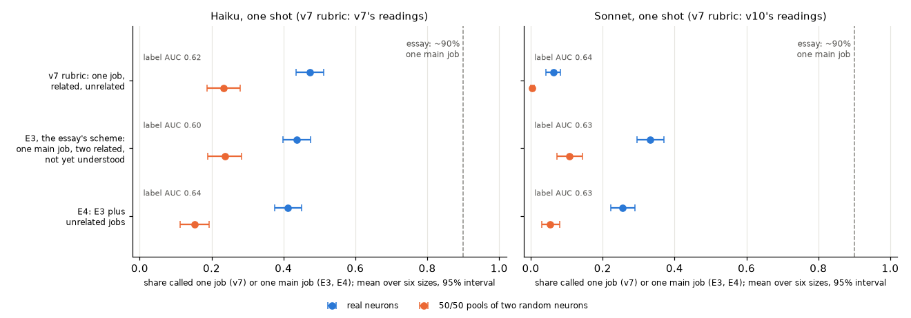

| Reader and rubric | Real neurons called one (main) job (95% interval) | 50/50 pools | 70/30 | 90/10 | Detection, not one (main) job, points | Label AUC | Retest kappa, not one (main) job |
|---|---|---|---|---|---|---|---|
| Haiku, v7 rubric (v7) | 47% (43.5 to 51) | 23% | 31% | 44% | +24 (+18 to +30) | 0.62 | 0.40 (0.14 to 0.62) |
| **Haiku, E3** | **44% (40 to 47.5)** | 24% | 26% | 41% | +20 (+14 to +26) | 0.60 | 0.89 (0.75 to 1.0) |
| Haiku, E4 | 41% (37.5 to 45) | 15% | 18% | 33% | +26 (+20 to +31) | 0.64 | 0.625 (0.38 to 0.84) |
| Sonnet, v7 rubric (v10) | 6% (4 to 8) | 0.3% | 1% | 4% | +6 (+4 to +8) | 0.64 | 0.65 (0.0 to 1.0) |
| **Sonnet, E3** | **33% (29.5 to 37)** | 11% | 12% | 33% | +22.5 (+18 to +27) | 0.63 | 0.61 (0.36 to 0.82) |
| Sonnet, E4 | 25.5% (22 to 29) | 5% | 7% | 19% | +20 (+16 to +24.5) | 0.63 | 0.44 (0.09 to 0.71) |

With "unrelated jobs" as the flag (C in v7's rubric, D in E4), detection is +21 (+14.5 to +27) for Haiku under v7's rubric and +22 (+15.5 to +29) under E4, and +26 (+19 to +32) for Sonnet under v7's rubric and +25 (+20 to +30) under E4.

| Pre-registered verdict | Rise in real neurons' one-main-job share, points | Rise in 50/50 pools' | Pools' rise minus real neurons' | Verdict |
|---|---|---|---|---|
| **Haiku, E3 (primary)** | **-3.7 (-7.5 to +0.3)** | +0.3 (-5.7 to +6.7) | +4.0 (-3.7 to +11) | **no clear rise in cleanliness** |
| Haiku, E4 | -6.2 (-9.7 to -2.5) | -8.0 (-13 to -3) | -1.8 (-8 to +4.3) | lowers cleanliness |
| **Sonnet, E3** | **+26.8 (+23.5 to +30.5)** | +10.3 (+7 to +14) | -16.5 (-21 to -12) | **raises cleanliness, less for known pools** |
| Sonnet, E4 | +19.2 (+16 to +22) | +5.0 (+2.7 to +7.7) | -14.2 (-18 to -10) | raises cleanliness, less for known pools |

Read in one run with v7's rubric (the concurrent addendum, below), Sonnet's verdict is reproduced, and Haiku's becomes "lowers cleanliness" (-6.5 points, -10.3 to -2.8). Sonnet's verdicts reflect where its line moved, not better discrimination. Under v7's rubric Sonnet called almost nothing one job (6% of real neurons and 0.3% of 50/50 pools, a floor), and E3 moves its cut point along a ranking that hardly changes (label AUC 0.639 under v7's rubric, 0.632 under E3; paired difference -0.008, -0.04 to +0.03). Moving a cut point up from a floor along an unchanged ranking adds more points to the group ranked closer to one job, here the real neurons (+27 against +10), even though in odds the pools rose far more: the odds of a one-main-job call rose about 36 times for 50/50 pools and 7.3 times for real neurons (post hoc; under E4, 17 and 5.1 times).

| E4 minus E3 (pre-registered) | Haiku, points | Sonnet, points |
|---|---|---|
| Real neurons called one main job | -2.5 (-5.8 to +0.5) | -7.7 (-10 to -5) |
| 50/50 pools called one main job | -8.3 (-13 to -3.3) | -5.3 (-8 to -2) |
| Detection, not one main job | +5.8 (-0.3 to +12) | -2.3 (-6.5 to +1.8) |
| E4's "unrelated jobs" detection minus v7 rubric's | +1.3 (-5.8 to +8.2) | -1.2 (-7.3 to +5) |

Points 2 and 6 and the label moves in point 3 are exploratory: they were in the analysis code before the results but aren't pre-registered tests. Added after seeing the results (post hoc): the paired AUC differences, the choice of each reader's better v7-rubric flag and the label-order check in point 4, the odds ratios in the note above, and the thinking split in point 9. All numbers are in [`results/classification_v16.json`](results/classification_v16.json).

1. **The essay's scheme doesn't bring either reader near 90%.** Under E3, Haiku calls 44% of real neurons one main job (33 to 52% by size) and Sonnet 33% (29 to 42%). Every interval, in every arm, is far below 90%. For Haiku that's no more than under v7's rubric (47%); for Sonnet it's 27 points more than its 6% under v7's rubric. Adding the "unrelated jobs" option lowers both: 41% and 25.5%.
2. **"Not yet understood" takes what the essay's scheme has no room for.** The essay's split is about 90 / 7 / 2 to 4%. Under E3, Haiku's split of real neurons is 44 / 0.7 / 56% and Sonnet's 33 / 28.5 / 38%. Known mixtures land there too: Haiku calls 75% of the 50/50 pools "not yet understood" and Sonnet 57%. So without an "unrelated" category, these readers file most known mixtures as not understood rather than as one main job.
3. **Where the labels went (exploratory).** Haiku moved most of its v7 "unrelated jobs" calls on real neurons to "not yet understood" (219 of 257), and also 83 of its 284 "one job" calls; it almost never says "two related jobs" (4 of 600). Sonnet moved 143 of its 324 v7 "related jobs" calls to one main job, which is where the scheme's "small related offshoots" helps, and most of its "unrelated jobs" calls to "not yet understood" (171 of 238). Given D in E4, both use it heavily: for 40% (Haiku) and 66% (Sonnet) of real neurons, and 62% and 91% of 50/50 pools.
4. **Against v7's rubric, the scheme moves the line, not the ranking.** Detection with the "not one main job" flag is +20 (Haiku, E3) and +22.5 (Sonnet, E3), about what each reader gets under v7's rubric with the better of its two flags, picked after seeing the results (+24 with "not one job" for Haiku, +26 with "unrelated jobs" for Sonnet). The label AUC is 0.60 to 0.64 in all six reader-rubric pairs, and the paired differences from v7's rubric are within noise (Haiku: E3 -0.025, -0.06 to +0.01; E4 +0.016, -0.02 to +0.05; Sonnet: E3 -0.008, -0.04 to +0.03; E4 -0.012, -0.04 to +0.02). Sonnet's verdict, "raises cleanliness, less for known pools", follows from this (see the note under the verdict table). Under v7's rubric it called 94% of real neurons related or unrelated jobs, so "not one job" barely separated anything (+6). The essay's scheme moves its line to where that flag works (+22.5), but its labels rank pools above real neurons no better than before. For Haiku, the concurrent addendum (below) qualifies this: read in one run, E3's AUC is 0.056 below v7's rubric's (-0.090 to -0.021), so for Haiku the scheme ranks pools a little worse. Between the two essay rubrics, the ranking does differ for Haiku: its E3 AUC is 0.040 below its E4 AUC (-0.074 to -0.006, paired, post hoc), so for Haiku, adding "unrelated jobs" ranks pools above real neurons a little better; for Sonnet the difference is +0.004 (-0.024 to +0.035). The AUCs also depend on the label order fixed in advance: ranking "not yet understood" below "two related jobs" (A < C < B, post hoc) gives Sonnet's E3 0.593 instead of 0.632, while Haiku's stays at 0.60, since it almost never says B.
5. **Known pools are still called one main job, and 90/10 pools about as often as real neurons.** Under E3, 24% (Haiku) and 11% (Sonnet) of 50/50 pools are one main job, against 44% and 33% of real neurons. From 50/50 to 70/30 the share is flat (24% and 26% for Haiku, 11% and 12% for Sonnet, each inside the other's interval); only the 90/10 pools differ (41% and 33%), about as clean as real neurons. Related pools look cleaner than real neurons for Sonnet (43%, 38 to 49, against 33%, 29.5 to 37), as in v7; for Haiku the intervals overlap (50%, 44 to 56, against 44%, 40 to 47.5).
6. **A one-main-job answer rarely names one pattern (exploratory).** 94 to 100% of one-main-job answers list two or more patterns, about 3 on average, for real neurons and pools alike. The reply asks for a list and the scheme allows offshoots, so "one main job" here means a main pattern plus others. For example, Sonnet (E3) called a 50/50 pool of two random 70M neurons one main job while listing seven patterns, from *as* after "data are represented" and *for* after "motion" to *much* in "Thank you very much".
7. **Haiku is more consistent under E3.** Read a second time, 95% of the 60 retest units get the same E3 label from Haiku (flag kappa 0.89, 0.75 to 1.0), against 60% under v7's rubric (0.40 with the same kind of flag). One possible reason: with "not yet understood" as a default, Haiku has less to decide. The other arms' kappas (0.44 to 0.65) have wide intervals from 60 units.
8. **Adding "unrelated jobs" (E4) lowers the pools' one-main-job share** (Haiku -8 points, Sonnet -5) and, for Sonnet, the real neurons' (-8). It doesn't clearly improve detection with either flag. Its D flag detects pools about as well as v7's C did (+1.3 and -1.2 points).
9. **Sonnet's thinking differs between sessions, and so do its labels (post hoc).** Haiku thought on every reading in every session (a mean of 677 tokens per first reading under v7's rubric in v7, 482 under E3 and 634 under E4). Sonnet read with no thinking at all on 49% of v10's first readings (v7's rubric) but on 12% of v16's (E3 and E4), and its mean was 98 tokens in v10 against 198 (E3) and 162 (E4). Within v16, readings without thinking got very different labels: under E3, Sonnet called 81% of the 108 real neurons it read without thinking one main job, against 23% of the 492 it thought about (E4: 69% against 16%). Under v7's rubric in v10, it was 7% against 5%. The units read without thinking may just be easier ones, so this split doesn't show that thinking changes the label. But it means part of Sonnet's rise from v7's rubric to E3 could come from the session rather than the rubric, which the concurrent addendum below tests.

### Concurrent addendum: both rubrics in one run

The main comparison sets each reader's E3 readings against its v7-rubric readings from an earlier session the same night: Haiku's from v7 (read 21:21 to 22:07) and Sonnet's from v10 (23:07 to 00:05), about 2.5 to 5 hours before v16 read the same reader (Haiku 00:54 to 02:26, Sonnet 02:26 to 04:02). Those sessions also had different settings (method, point 3), and Sonnet's thinking differed (point 9). So a rise from v7's rubric to E3 could mix the rubric with the session. After the review, an addendum read both rubrics side by side.

Its rules are in [`recgen/rubric_v16_addendum.py`](recgen/rubric_v16_addendum.py), committed (`414aff6`) before any addendum reading. Both readers re-read v7's 600 real neurons and 300 50/50 pools under v7's exact prompt and under E3 (byte for byte the main run's E3 prompt): 3,600 readings in one seeded random order, both readers and both rubrics mixed, six at a time, with the main run's CLI flags and settings (prompt caching off, `EFFORT` variables removed, the CLI run in the repo folder), from 04:41 to 06:12 the same night, in another session (CLI 2.1.296). The analysis block (`7c8e4db`) was committed about 5 minutes into the run, with 202 readings cached; only counts had been looked at. All 3,600 readings got a valid label, one (Sonnet, E3) after a retry. The CLI reported $20.46 ($0.74 and $0.63 for Haiku under v7's rubric and E3, $9.16 and $9.92 for Sonnet), under the pre-registered $40 cap. The tests and the verdict rule are v16's, paired by unit.

| Read in one run | Real neurons called one (main) job, v7 rubric, E3 | Rise, real, points | 50/50 pools, v7 rubric, E3 | Rise, pools | Pools' rise minus real neurons' | Verdict | Label AUC, v7 rubric, E3 (paired difference) | No thinking, v7 rubric, E3 |
|---|---|---|---|---|---|---|---|---|
| **Haiku** | 49%, 43% | **-6.5 (-10.3 to -2.8)** | 21%, 22% | +1.3 (-4 to +6.7) | +7.8 (+1.3 to +14) | **lowers cleanliness** | 0.66, 0.60 (-0.056, -0.090 to -0.021) | 0%, 0% |
| **Sonnet** | 7%, 32% | **+25.2 (+21.8 to +28.5)** | 0.7%, 9% | +8.3 (+5 to +11.7) | -16.8 (-21.8 to -11.8) | **raises cleanliness, less for known pools** | 0.64, 0.65 (+0.015, -0.018 to +0.048) | 52% (49 to 55), 13% (10 to 15) |

| Drift, paired by unit, points | Haiku | Sonnet |
|---|---|---|
| v7 rubric: this run minus the earlier session (real neurons; 50/50 pools) | +2.0 (-1.3 to +5.5); -2.3 (-7.7 to +3.3) | +0.8 (-0.8 to +2.5); +0.3 (0 to +1.0) |
| E3: this run minus v16's main run (real; pools) | -0.8 (-3.7 to +2.0); -1.3 (-6.3 to +3.3) | -0.8 (-3.2 to +1.5); -1.7 (-4.7 to +1.3) |
| The main comparison's rise minus this run's (real; pools) | +2.8 (-1.8 to +7.5); -1.0 (-8 to +6) | +1.7 (-1.2 to +4.3); +2.0 (-1.3 to +5.3) |
| Pre-registered answer | verdict not reproduced; the rise doesn't depend on the session | verdict reproduced; the rise doesn't depend on the session |

1. **The session doesn't explain the main comparison.** Read in one run, each rubric gives about the same shares as in the earlier sessions: every paired difference between sessions is within about 2 points and its interval includes 0. The main comparison's rise in real neurons differs from this run's by +2.8 points (Haiku) and +1.7 (Sonnet), neither interval excluding 0, so by the pre-registered rule neither reader's rise depends on the session.
2. **Sonnet's verdict is reproduced, and it is still a threshold move.** In one run, Sonnet's real neurons rise 25 points and its pools 8, the same verdict as in the main run, while its label AUC doesn't change (+0.015, -0.018 to +0.048).
3. **Haiku's verdict changes, by the pre-registered rule, from "no clear rise" to "lowers cleanliness".** The direction is the same as in the main run (-3.7, -7.5 to +0.3, against -6.5 now), and the gap between the two is within noise; the main run's interval just reached 0. In this run E3 also makes Haiku worse at telling pools from real neurons: detection with "not one main job" falls (the pools' rise minus the real neurons' is +7.8, +1.3 to +14), and so does the label AUC (-0.056, -0.090 to -0.021). In the main comparison, that AUC difference was -0.025 (-0.063 to +0.013). So for Haiku, read in the same session, the essay's scheme ranks known pools above real neurons a little worse than v7's rubric, not just the same.
4. **The thinking difference comes with the prompt, not the session.** In one run, Sonnet read with no thinking on 52% of its v7-rubric readings and 13% of its E3 readings, close to v10's 49% and v16's 12%; Haiku always thought. Sonnet's mean thinking was 92 tokens under v7's rubric and 195 under E3 (Haiku's 737 and 479). The split of labels by thinking repeats as well (described, not tested): under E3, Sonnet called 79% of the 103 real neurons it read without thinking one main job, against 23% of the 497 it thought about; under v7's rubric, 8% against 6%. So the thinking rates of v10 and v16 differ with the prompt; the session and the settings don't explain them. Why E3 makes Sonnet think more often isn't known.

### What this does and doesn't show

- **The category scheme alone doesn't produce the essay's ~90%.** With one-shot readers on Pythia's top-50 snippets, the essay's categories give 33 to 44% one main job, and most of the rest goes to "not yet understood", which the essay's audit puts at 2 to 4%. So, with these readers, the wording alone doesn't get close to 90%. The essay's footnote names other factors: the threshold for counting weak activations, "depth", the density of sub-circuits and what counts as "one thing".
- **These readers call far more real neurons mixtures than the essay's closer look.** v16 shows each neuron's strongest 50 examples. For strong activations, the essay's footnote 1 says that in the sets the author looked at more closely, it's "closer to 97% non-arbitrary mixtures" (on relatively small samples), so about 3% arbitrary. Given the option (E4), these readers call 40% (Haiku) and 66% (Sonnet) of real neurons two or more unrelated jobs. A one-shot reader's "unrelated jobs" isn't the same judgment as an arbitrary mixture after close examination (the footnote's own example is an "unrelated job" that, looked at closely, was detecting the next token), so this doesn't contradict the essay. Either these readers call jobs unrelated where a closer look would find a relation, or Pythia's neurons are much less clean than Qwen3-32B's; v16 can't tell which.
- **The scheme changes the threshold, not the discrimination.** Sonnet's pre-registered verdict, "raises cleanliness, less for known pools", reflects where its line moved, not a scheme that favors real neurons: from a floor under v7's rubric, a higher cut point on an unchanged ranking (AUC 0.639, then 0.632) adds more points to real neurons, while in odds the pools rose more (post hoc, see the note under the verdict table). So the verdict isn't evidence that the scheme is selective. Nor does the scheme improve how well labels rank known pools above real neurons for either reader (AUC 0.60 to 0.64 under every rubric); read in the same run as v7's rubric, it ranks them a little worse for Haiku (concurrent addendum). Reading both rubrics in one run changes none of this for Sonnet, so it isn't an artifact of the baselines' sessions. A reader's one-main-job share moves with the rubric (Sonnet: 6% under v7's, 33% under E3), so as in v8, the share describes the reader and rubric as much as the neurons. And under E3, 11 to 24% of known 50/50 pools are still called one main job, so that label from these readers doesn't certify a unit as clean.
- **"Not yet understood" carries the weight, and my wording of E3 shapes it.** Under the essay's scheme, these readers put 57 to 75% of known 50/50 pools and 38 to 56% of real neurons in that bucket. An audit in which that bucket is only 2 to 4% has resolved almost every unit into one main job or two related jobs. Whether that audit resolves known mixtures that way too is what a positive control like v7's pools would show. Three choices in E3, not taken from the essay, set where the line between A and C falls. Two loosen A: it keeps v7's clause that the job "may be broad or abstract, such as a grammatical role, a spelling fragment, or a kind of context", which isn't essay text, and it drops v7's requirement that "all or nearly all snippets" share the pattern. The third widens C: it turns what in the essay is the outcome of an audit ("not yet understood") into a one-shot reader's confidence ("no description of what the unit responds to that you are confident in"), which a cautious reader can give for almost any unit.
- **It doesn't test the essay's audit.** The essay reports preliminary audits of Qwen3-32B neuron poles without describing the method; v16 reads the strongest 50 examples of Pythia neurons (closest to a neuron's positive pole) once, without activations or experiments. v8 found that light investigation didn't help Haiku detect pools, but the essay's audit may look far more closely, and a larger model's neurons may be cleaner.

### What's still shaky

- **The main comparison's baselines come from earlier sessions.** v7's Haiku readings (21:21 to 22:07) and v10's Sonnet readings (23:07 to 00:05) were made the same night, with the same model ids, about 2.5 to 5 hours before v16 read the same reader, in separate sessions with different settings (method, point 3). The concurrent addendum read v7's rubric and E3 in one run with v16's settings and found the same shares within about 2 points, and the same thinking rates, so drift doesn't explain the main comparison. But it covers only real neurons and 50/50 pools under v7's rubric and E3: not E4, the 70/30, 90/10 and related pools, or the retests. And it ran in yet another session.
- **One wording per scheme.** "One main job, often with small related offshoots" is the essay's phrase; the rest of each option is my paraphrase. "TWO RELATED JOBS" says two, so a unit with three related jobs has no exact fit. Another wording, or a reply format that asked for one pattern, could move the shares.
- **The verdict rule is about one flag.** Sonnet's "raises cleanliness, less for known pools" rests on the "not one main job" flag, which under v7's rubric was nearly always on, so it measures a move of the threshold (see the note under the verdict table). The threshold-free AUC (point 4) is the better summary of discrimination, but in the main run it was added after seeing the results (the addendum pre-registered it), and it depends on the label order fixed in advance.
- **60 retest units** give kappa intervals about 0.5 wide.
- **Pools are the easiest kind of mixture** (v7): two random neurons' strongest examples, side by side. And the related control is easier than intended, because related pools can share a window (v7, point 2).
- **The CLI adds its own text** to each call, the same for every unit, and runs in the repo folder, as in v7 and v10.
- **Scope:** the middle layer of six Pythia sizes, two models of one family, one-shot reading of 50 snippets without activations.

### v16 files and reproduce

| Path | What it is |
|---|---|
| [`recgen/rubric_v16.py`](recgen/rubric_v16.py) | Pre-registered question, units, rubrics, readers, flags, reading order, spend guard, tests and verdict rule |
| [`recgen/llm_reader_v16.py`](recgen/llm_reader_v16.py) | Runs the four arms and the pilot through the `claude` CLI with v7's reader, a cache, the spend guard and a spend log |
| [`recgen/rubric_v16_addendum.py`](recgen/rubric_v16_addendum.py) | Pre-registered rules of the concurrent addendum: units, arms, reading order, spend guard, tests and the answer to the drift confound |
| [`recgen/llm_reader_v16_addendum.py`](recgen/llm_reader_v16_addendum.py) | Runs the addendum's 3,600 readings with v16's reader, CLI settings, cache and spend guard |
| [`recgen/analyze_v16.py`](recgen/analyze_v16.py), [`recgen/plots_v16.py`](recgen/plots_v16.py) | Shares, detection, label AUC, verdicts, E4 against E3, retest, exploratory and post-hoc checks, the concurrent addendum block; the figure |
| [`results/v16_answers.json`](results/v16_answers.json) | Every v16 reading, the pilot's included: label, reply with the stated patterns, model id, tokens, cost and the prompt's SHA-256 |
| [`results/v16_concurrent_answers.json`](results/v16_concurrent_answers.json) | Every addendum reading: label, reply, model id, tokens (thinking included), cost and the prompt's SHA-256 |
| [`results/classification_v16.json`](results/classification_v16.json) | All statistics (the addendum's under `concurrent_addendum`), and every unit's labels in the four arms and both readers' v7-rubric baselines |
| `tests/test_rubric_v16.py`, `tests/test_llm_reader_v16.py`, `tests/test_analyze_v16.py`, `tests/test_rubric_v16_addendum.py`, `tests/test_llm_reader_v16_addendum.py` | Tests for the rules, the runners and the analysis |

```bash
./run_v16.sh
```

`run_v16.sh` needs v6's `data/v6/` recordings, `results/v7_llm_answers.json`, v7's Haiku cache in `data/v7/llm/` (for the thinking split), v10's Sonnet cache in `data/v10/sonnet/` and the `claude` CLI signed in. The readings are cached in `data/v16/` (not committed), and every CLI call's reported cost is logged in `data/v16/spend.jsonl` (the addendum's in `data/v16/concurrent/`). With the cache, it makes no CLI calls and reruns in about 3.5 minutes, mostly the bootstraps. From scratch, the 7,440 readings took about 3 hours 15 minutes and the addendum's 3,600 about 1 hour 30 minutes, six at a time. Labels will differ somewhat, because the readers aren't deterministic (point 7).

## v17 results

v12 confirmed that neurons with a larger peak activation are flagged unrelated mixed much less, by the network reader and by Haiku, and that most of this is shared with coherence: how alike a neuron's 50 strongest examples are in the network's representation. Its review's main objection was that the flag and coherence describe the top-50 sample, not the neuron, and the decisive test, reading examples from a fixed band of each neuron's own range, wasn't run. v17 runs it at the middle layer of all six sizes and asks two things:

- **Across neurons:** at the same fraction of each neuron's own peak, do weak neurons still look more mixed and less coherent than strong ones?
- **Within a neuron:** do examples below the top 50 look more mixed than the top 50? The toy model of superposition predicts that a neuron's largest activations are clean and its smaller ones more polysemantic ([Elhage et al. 2022](https://transformer-circuits.pub/2022/toy_model/index.html), section "Computation in Superposition", subsection "Superposition vs Sparsity").

The rules are in [`recgen/rubric_v17.py`](recgen/rubric_v17.py), committed (`88b042e`) before any recording or reading, and not amended. No earlier file or result changed.

### v17 method

1. **Band.** A neuron's band windows are those whose window maximum is at least 0.40 and below 0.60 of its peak, leaving out its own top-50 windows so the two samples never share a window (the top 50 reached into the band in 12 to 77 neurons per model). Per neuron, 50 band windows are drawn uniformly without replacement (seed `[0, 17, 0, model index, neuron id]`), one example per window at the window's strongest position, as for the top 50. Neurons with fewer than 50 band windows are excluded: 27 of 11,801 (1 to 11 per model, all in the strongest peak quartile) and 2 of v12's 600 fresh neurons.
2. **Network reader.** The residual stream entering the layer at the band positions is recorded the way v6 recorded the top 50 (LayerNorm-normalized, float16) and read by v6's detector unchanged: v6's random-position mean and null, its thresholds, and the neuron's input direction projected out. Per neuron it gives a band flag and band coherence (v6's top-pair percentile: the median similarity of the 50 examples, ranked against the neuron's null of random positions). The same code recomputes every neuron's top-50 flag, facet count and coherence from v6's recordings, and they match v6's published values exactly (coherence to the four decimals v6 published). Activations rebuilt from the stored residuals match v5's window maxima within 0.0043 (median band activation 1.2 to 1.6).
3. **Haiku.** v12's 600 fresh neurons, each shown as its 50 band examples with v7's prompt and CLI (marked token, no activations, seeded order), so each has a top-50 reading (v12's) and a band reading (v17's). 30 band units were read a second time. As a drift check, the same 30 neurons' top-50 prompts, byte-identical to v12's, were read again.
4. **Tests, per reader and measure** (network flag, network coherence, Haiku flag):
   - **T1, within neuron:** band minus top 50, paired by neuron, each model's mean averaged over the six models, with a bootstrap interval.
   - **T2, magnitude in the band:** v12's H1 on band values (the strongest peak quartile minus the other three, interval below 0, Spearman negative in at least 5 of 6 models), sign reversed for coherence; and the same statistic on the same neurons' top 50, with a paired interval for the difference.
   - **Verdict:** "persists below the top" if T2 holds in the band; "top-50 specific" if the band statistic's interval includes 0 and the paired difference's excludes it; otherwise "unclear".
5. **Caveat, written into the rules before any result.** Up to half of all windows fall in a weak neuron's band, so its band examples approach random positions. Diffuse examples form fewer facets, and the network reader's flag needs two, so its flag could fall in the band even where the examples look more varied. Coherence is co-primary for that reason, and as a reference the detector also reads 50 of v6's random positions per neuron.
6. **Secondary, pre-registered, not in the verdict:** v12's H2 regression on band flags (S1), and its least-squares version on band coherence (S2), with v12's covariates (log peak, peakedness, density, and the band examples' token purity). They ask whether how wide the band is explains a band effect.

The optional second band (0.20 to 0.40 of peak) wasn't run: it would have added about 1.8 GB of residuals while the disk had 17 GB free and other runs were downloading models. The 658 Haiku readings all returned a valid label: 2.6M input tokens, which the CLI reported as $0.78. Recording took 87 minutes for the six models, one at a time, including downloads.

### What v17 found

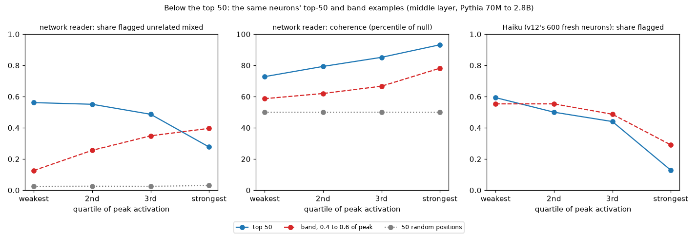

**T2, the magnitude effect** (strongest peak quartile minus the rest, in points; models in the expected direction):

| Reader, measure | Neurons | Top 50, by peak quartile | Band, by peak quartile | Strongest minus rest: top 50 | Band | Band minus top 50 | Verdict |
|---|---|---|---|---|---|---|---|
| network, flag | 11,774 | 56% / 55% / 49% / 28% | 13% / 26% / 35% / 40% | -25.6 (-27.5 to -23.6), 6/6 | +15.3 (+13.3 to +17.2), 0/6 | +40.8 (+38.2 to +43.4) | unclear |
| network, coherence | 11,774 | 72.8 / 79.3 / 85.2 / 93.2 | 58.7 / 62.0 / 66.7 / 78.2 | +14.1 (+13.7 to +14.5), 6/6 | +15.7 (+15.3 to +16.2), 6/6 | +1.6 (+1.2 to +2.1) | **persists below the top** |
| Haiku, flag | 598 | 59% / 50% / 44% / 13% | 55% / 55% / 49% / 29% | -38.3 (-45.9 to -31.1), 6/6 | -24.1 (-32.5 to -15.2), 6/6 | +14.2 (+5.6 to +22.9) | **persists below the top** |

**T1, within neuron** (band minus top 50, mean over models):

| Reader, measure | Band minus top 50 (95% interval) | By model | Reading |
|---|---|---|---|
| network, flag | -18.2 points (-19.4 to -17.1) | -5.7 to -31.1 | band looks less mixed |
| network, coherence | -16.2 percentile points (-16.4 to -16.1) | -15.5 to -18.3 | band looks more mixed |
| Haiku, flag | +5.5 points (+0.8 to +10.0) | 0 to +11 | band looks more mixed |

The rest of the numbers are in [`results/classification_v17.json`](results/classification_v17.json). Points 1 to 3, 5 and 6 report the pre-registered tests, checks and reference, with descriptive breakdowns by quartile. The facet counts in point 4 were added after a first look at 70M's band flags, and the flag among neurons with 2+ facets after seeing all results; both are exploratory.

1. **At the same fraction of their own peak, strong neurons' examples are still more alike.** The coherence gap between the strongest quartile and the rest is 15.7 percentile points in the band, slightly more than the top 50's 14.1 (where the strongest quartile, at 93.2, is near the ceiling, which may compress the top-50 gap), and log peak correlates with band coherence in every model (Spearman +0.61 to +0.73). Every quartile's band examples are less coherent than its top 50, and the weakest quartile's (58.7) come close to random positions (50.0).
2. **Haiku's effect persists below the top at about two thirds of its top-50 size.** On the same 598 neurons, Haiku flags the strongest quartile 24 points less than the rest in the band, against 38 in the top 50, and the Spearman correlation is negative in all six models in both (-0.11 to -0.27 in the band).
3. **Controlling for density doesn't remove either effect.** A weak neuron's band is much wider: the median neuron of the weakest quartile has 44 to 53% of all windows in its band, the strongest 15 to 25%. Band width isn't a covariate itself, but density (the share of windows at or above half the peak) tracks it closely. With density, peakedness and band token purity in the regression, log peak's coefficient stays clearly in the expected direction for Haiku (-0.58, -1.02 to -0.25; v12's top-50 H2 gave -0.94, not directly comparable, see below) and for coherence (+8.4 percentile points of band coherence per standard deviation of log peak, +8.1 to +8.7). For the network flag it is reversed (+0.22, +0.17 to +0.28), as in T2.
4. **The network flag can't be read below the top, as the rules warned.** Its band flag rate rises with peak (13% to 40%), the reverse of the top 50. That is consistent with weak neurons' band examples mostly forming fewer than the two facets the flag needs (exploratory): in the band, 39% of the weakest quartile's neurons have no facet, 39% one and 22% two or more, against 3%, 17% and 79% in the strongest quartile. 50 random positions per neuron get a flag 3% of the time. Among neurons whose band examples do form 2+ facets, the strongest quartile is flagged 9.8 points less than the rest (-12.5 to -7.3, 5 of 6 models), against 25.7 points less in the top 50 (exploratory; conditioning on the facet count selects neurons differently by quartile).
5. **Within a neuron, examples below the top look somewhat more mixed to coherence and Haiku** (the network flag says the opposite, see point 4). Band examples are 16 percentile points less coherent than the same neuron's top 50 in every model, and Haiku calls them unrelated jobs 5.5 points more often (+0.8 to +10.0), an effect small enough that drift in Haiku since v12's readings could account for part of it (point 6). Haiku's increase sits mostly in the strongest quartile (13% to 29%, +16 points); in the weakest it's -4 points (59% to 55%). Haiku calls 43% of band units one job, against 48% of the same neurons' top 50, sometimes naming a broad pattern such as "mid-sentence tokens in formal or technical prose" (24 of the 259 one-job band replies mention "mid-sentence").
6. **Haiku's checks.** Read a second time, 30 band units get the same label 73% of the time and the same flag 77% (kappa 0.51). The 30 re-read top-50 prompts agree with v12's readings on 83% of flags (kappa 0.67), with a flag rate of 47% then and 50% now, so there's no sign of large drift since v12, though 30 units can't rule out a few points.

### What this does and doesn't show

- **The magnitude effect isn't only a property of the top-50 sample.** For coherence and for Haiku, it holds at a fixed fraction of each neuron's own range, well below its top 50, in all six models. That partly answers v12's main objection for those two readers (the next point is why only partly).
- **It doesn't say weak neurons are more polysemantic.** The same fraction of the peak isn't the same selectivity: a weak neuron's band holds two to three times as many windows as a strong neuron's, and its examples sit close to random text. A neuron that is simply tuned more broadly would look exactly like this. Controlling for density leaves the effect (point 3), but density is one summary of the activation distribution, not a match on selectivity.
- **The toy-model prediction gets weak support.** Examples below the top are much less coherent than the top 50 and slightly more often called unrelated by Haiku, mostly for strong neurons. But lower coherence below the top would follow from any neuron becoming less selective at lower activations, polysemantic or not, so this doesn't single out superposition.
- **The network reader's flag is a top-of-range measure.** It needs groups of at least five similar examples, which diffuse samples don't form (point 4). Below the top, coherence is the usable network measure.

### What's still shaky

- **Fraction of peak isn't matched selectivity.** The peak is one window, and the band's width differs two- to threefold between the weakest and strongest quartiles. A band defined by rank (for example, each neuron's windows ranked 500 to 1,000) would match how selective the sample is instead; it wasn't run.
- **Haiku's within-neuron effect is small** (+5.5 points, interval from +0.8) next to its retest noise (kappa 0.51 on band units), and the top-50 readings come from v12, made earlier from another working directory with possibly another CLI version (both rounds resolved to `claude-haiku-5-5`). The drift check (+3 points on 30 neurons) can't rule out drift of that size.
- **Coherence is measured in the network's own representation,** against the same null for the top 50 and the band. For weak neurons' band examples it sits near the null, where small differences in the null matter more.
- **One depth and one band.** The middle layer only, the band 0.4 to 0.6 of peak, and the 598 fresh neurons for Haiku. The 27 excluded neurons are all in the strongest quartile, about 1% of it.
- **S1 and S2 use the band examples' token purity,** not the top 50's as v12's H2 did, so their coefficients aren't directly comparable with v12's.
- **Haiku runs through the `claude` CLI,** which adds a little hidden context: the working directory, the platform, the date and an account notice. It includes nothing that says whether a unit is a band or a top-50 sample.

### v17 files and reproduce

| Path | What it is |
|---|---|
| [`recgen/rubric_v17.py`](recgen/rubric_v17.py) | Pre-registered band, sampling, readers, T1, T2, verdict rule and secondary analyses |
| [`recgen/band_v17.py`](recgen/band_v17.py) | Band selection, deterministic from v5's window maxima and v6's top-50 examples |
| [`recgen/record_v17.py`](recgen/record_v17.py), [`recgen/read_v17.py`](recgen/read_v17.py) | Normalized residuals at the band positions, with the rebuild check; Haiku band readings, retests and the drift check through v7's cached reader, with a $25 spend guard |
| [`recgen/analyze_v17.py`](recgen/analyze_v17.py), [`recgen/plots_v17.py`](recgen/plots_v17.py) | Both readers on the top 50, band and random reference, the tests and checks; the figure |
| [`results/classification_v17.json`](results/classification_v17.json), [`results/v17_llm_answers.json`](results/v17_llm_answers.json) | Results with per-neuron band readings; every Haiku reading with its prompt hash and cost |
| `tests/test_rubric_v17.py`, `tests/test_band_v17.py`, `tests/test_read_v17.py`, `tests/test_analyze_v17.py` | Tests for the rules, the band, the spend guard and the analysis |

```bash
./run_v17.sh
```

`run_v17.sh` needs `data/corpus.npy`, v5's and v6's caches and results, and v12's Haiku answers. From scratch it records the six models one at a time (about 90 minutes on this laptop's MPS, including downloading about 12 GB, each deleted after use), caches 1.6 GB in `data/v17/`, and makes 658 Haiku readings (about 30 minutes, four at a time). With those caches, it makes no model calls, reruns in about five minutes and leaves `git status` clean.

## v18 results

v8's investigating agents and v14's Opus agent separate known pools of two neurons from real neurons only moderately (label AUCs 0.56 to 0.66), and they investigated lightly, with about 3 to 6 of their 8 tool calls. v15 found the field's standard simulation score no better (AUC 0.56), with explanations of pools that mostly capture one of the two neurons. v18 asks whether a stronger audit protocol passes this known-pool test. An Opus agent must state candidate jobs, then try to falsify them with predictions on text it writes and on examples below the top 50, with twice the tool budget. Two questions:

- Is its label better at separating pools from real neurons than v14's Opus agent (the same model, with v8's light protocol)?
- Is its final description a better predictor of held-out activations than v15's one-shot explanation, by v15's simulation score on the same held-out examples?

The rules are in [`recgen/rubric_v18.py`](recgen/rubric_v18.py), committed (`8e5608f`) before any reading. A pilot of two readings on pythia-160m units outside the sample came next (`d1d1b47`). Nothing was broken, so the rules weren't amended. The analysis code was committed (`ccf2293`) before the main run started. To reuse v8's runner, its backend and runner now take a view, a tool budget, tools, a CLI command and a parser as arguments (`d2b310d`); the defaults are v8's, and every earlier test still passes. One recording change came during the run (`cf28e23`): the CLI version is now kept with the cache, so a rerun from the cache writes the same answers file whatever CLI is installed; the answers were rebuilt from the cache after the run, and no reading changed. v14's per-unit labels aren't on this branch. They were read once, read-only, from the v14 worktree's `results/v14_agent_answers.json` into [`results/v14_opus_extract.json`](results/v14_opus_extract.json), with the source's commit (`5481296`) and SHA-256. An independent review of the first write-up (a fresh Claude session) found no wrong numbers, but it found an unsupported conclusion (point 3), a wrong description of the label moves (point 2) and unlabeled post hoc items, and it prompted more post hoc checks (`a3f3579`). No earlier file or result changed.

### v18 method

1. **Agent.** `claude-opus-5-5` through the `claude` CLI (2.1.296, as in v14), with v8's runner: the same system prompt, CLI flags, two tools (examples by rank, and activation on new text through Pythia), activation scale, 3 attempts and empty working folder outside the repo. No effort flag was passed, so the CLI used its default effort, as in v8 and v14. What changed from v14's arm:
   - **The prompt.** v8's prompt up to v7's A/B/C definitions (the same 50 snippets with their 0-10 activations, in v7's order), then a protocol: list one to three candidate descriptions; for each, write at least 3 texts predicted to activate the unit strongly and 2 predicted not to, and measure them; read examples from ranks 51 to 500 and say whether they fit; revise. The answer is the label (v7's definitions, unchanged), one final description of at most 30 words "that you would use to predict its activation on any text", and a confidence. The agent isn't told that some units are synthetic. v8's prompt, which v14 used, already asked the agent to test each pattern with texts that should and shouldn't activate the unit and to read weaker examples, so the change is from a light request to a structured protocol, not from no testing to testing.
   - **The budget.** 16 tool calls, at least 8 asked for (not enforced), enforced by v8's backend. The CLI's turn cap (34), cost cap per attempt ($2, v8's $1) and timeout (30 minutes) were raised to fit. None bound.
   - **Held-out windows are hidden.** v15 scores each unit on 60 held-out windows from ranks 51 to 4,096, and the protocol asks the agent to read ranks 51 to 500, where it could otherwise read some of them with their values. So the agent's examples tool reads the unit's ranked list with those 60 windows removed and the rest renumbered (4,036 windows; ranks 1 to 50 unchanged), and the tool's description gives that length.
2. **Units:** v8's 300 (per size, 40 real neurons, 40 50/50 pools of random neurons and 20 related pools, at the middle layer of 70M, 410M and 2.8B) and v8's 30 retest units. v14's labels and v15's scores are on the same units; neither was read again.
3. **Scoring the description:** v15's primary simulator (`claude-sonnet-5-5`, v15's prompt) predicts the unit's activation on v15's exact 60 held-out snippets from the description alone. The simulation score is the Pearson correlation with the true values, as in v15. It's compared per unit with the score of v15's explanation (a Sonnet explainer, one shot, from the top 50 examples) on the same snippets with the same simulator, from v15's own run.
4. **Pre-registered tests:**
   - **Primary:** the label AUC (A < B < C) for ranking 50/50 pools above real neurons, averaged over the three sizes, the v18 agent minus v14's Opus agent, with v8's paired bootstrap (units resampled within size and unit type, both readers together). Verdict: "much better" if the difference is at least +0.10 with its interval above 0, "better" if only the interval is above 0.
   - **Secondary:** v8's detection (the pools' flag rate minus the real neurons', with C and with B or C as the flag); one-job shares of real neurons and pools; the simulation score's pools-minus-real gap and AUC, beside v15's 0.56; the paired score difference from v15's explanation, on real neurons and pools separately; retest; tool use; cost.
   - **Exploratory:** v15's tracked-neuron check and judge on the v18 descriptions; scores by label; description length, and the score difference restricted to descriptions of at most 35 words; the retest descriptions' scores; rates by size.
5. **Run rules:** first readings size by size, units interleaved across types; then their simulations and v15's judge; then the retests and their simulations. Six at a time, with a $120 guard on CLI-reported cost (pilot included), agent readings stopping at $112 to leave room for simulations, and readings that failed for an infrastructure reason read again on a later run.

All 330 agent readings returned a valid answer on the first attempt. All 330 simulations and 300 judgments were valid; 24 simulations needed a retry after a list of the wrong length (58 to 64 numbers). The run took about 80 minutes (02:26 to 03:46; its log, `data/v18/run.log`, isn't committed), six at a time, while other jobs shared the machine. The CLI reported $63.08 of quota for all v18 readings: $52.04 for the first readings ($0.17 a reading, against v14's $0.11 on the same units), $4.26 for the retests, $6.31 for the simulations, $0.08 for the judge and $0.39 for the pilot. The guard never came close. Every reading, tool call, description, prediction and judgment is in [`results/v18_agent_answers.json`](results/v18_agent_answers.json).

### What v18 found

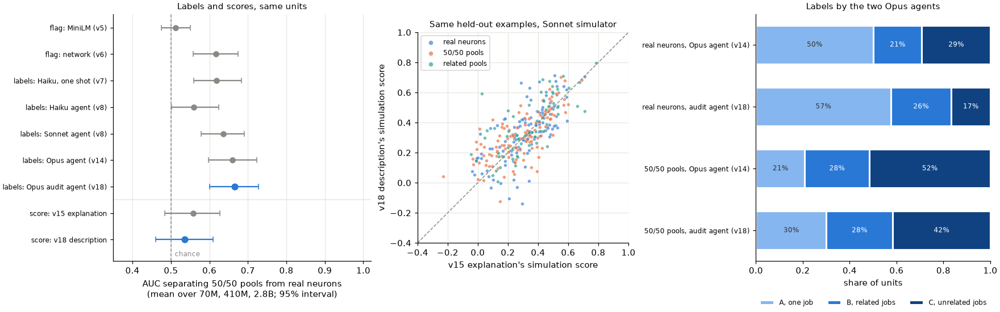

| Reader (same 240 real and pooled units) | Label AUC, pools over real (95% interval) | 50/50 pools flagged C over real neurons, points | Same, B or C | Real neurons called one job | 50/50 pools called one job | Retest kappa (same 30 units) | Mean tool calls |
|---|---|---|---|---|---|---|---|
| Opus agent (v14) | 0.659 (0.60 to 0.72) | +22.5 (+11 to +34) | +29 (+17.5 to +40) | 50% | 21% | 0.57 | 5.6 |
| **Opus audit agent (v18)** | **0.665 (0.60 to 0.73)** | +25 (+14 to +36) | +27.5 (+15 to +39) | 57.5% | 30% | 0.59 | 9.7 |

| Pre-registered comparison, v18 minus v14 | Difference (95% interval) | Verdict |
|---|---|---|
| **Label AUC (primary)** | **+0.006 (-0.043 to +0.054)** | **no clear difference** |
| Detection, C flag | +2.5 points (-8 to +14) | no clear difference |
| Detection, B or C flag | -1.7 points (-12 to +7.5) | no clear difference |

| Simulation score, Sonnet simulator, same 60 held-out examples | v15 explanation | v18 description | v18 minus v15, paired (95% interval) |
|---|---|---|---|
| Real neurons | 0.320 | 0.335 | +0.015 (-0.009 to +0.038) |
| 50/50 pools | 0.288 | 0.315 | +0.027 (+0.006 to +0.050) |
| Related pools | 0.336 | 0.377 | +0.042 (+0.009 to +0.077) |
| Pools minus real | -0.032 (-0.072 to +0.009) | -0.020 (-0.060 to +0.021) | +0.012 (-0.021 to +0.044), post hoc |
| **Score AUC, real over pools** | 0.558 (0.48 to 0.63) | **0.535 (0.46 to 0.61)** | -0.023 (-0.083 to +0.036) |

Mean scores over the three sizes. v14's and v15's numbers are recomputed here from their answers on the same units, with v18's bootstrap seed, so a few intervals differ from their own tables by a point. The score comparisons aren't adjusted for multiple testing.

What's post hoc, added after seeing the results:
- the label moves from v14 to v18 and v8's catch-all count (point 2), the primary without the two readings that named a second model, and the detail of the duplicate texts (both under "What's still shaky");
- the example units quoted in points 2 and 4, picked by reading the results;
- added after the independent review: the paired changes in the C shares and in the pools' A share (point 2; the real neurons' paired A-share difference was pre-registered), the paired change in the pools-minus-real gap (point 3), the paired judge differences (point 4), and the traces of the protocol in the logs (point 5).

Everything else was pre-registered or listed as exploratory in the rubric. Details are in [`results/classification_v18.json`](results/classification_v18.json).

1. **The audit protocol didn't make the label a better pool detector.** The audit agent's label AUC is 0.665, against 0.659 for v14's Opus agent on the same units (difference +0.006, interval -0.043 to +0.054). The interval's upper end is below the pre-registered "much better" margin (+0.10). By size, the AUCs are 0.58, 0.78 and 0.64 from 70M to 2.8B (v14: 0.60, 0.78 and 0.61). The flag-rate detections don't move either: +25 points with C as the flag (v14 +22.5) and +27.5 with B or C (v14 +29).
2. **It moved where the agent draws the line, away from unrelated jobs, on real neurons and pools alike.** Paired on the same units, its C share is 12.5 points lower than v14's on real neurons (interval -20 to -7) and 10 points lower on pools (-18 to -2), and its A share is 9 points higher on pools (+3 to +16; 30% against 21%), all post hoc. On real neurons, its A share is 7.5 points higher (57.5% against 50%; pre-registered), with an interval that reaches 0 (0 to +15).
   - Most labels that left C went to B: 14 of 17 real neurons and 14 of 20 pools (post hoc). But the net gain differs by type. On pools, A gains 11 units, B 1, and C loses 12; on real neurons, A gains 9, mostly from B (12 moves from B to A), and B gains 6.
   - Since real neurons and pools moved together, the separation stayed where it was.
   - Its one-job descriptions of pools are often broad catch-alls, as v14's patterns were. For 70M neurons 543 and 1306 (unit `70m:pooled:50/50:424-1001`), a pool v14 called C: *Words that start a fixed phrase or template and set up the next slot: 'thank'/'grateful to', 'Due to', 'chose/used to', '#include', '->prepare(', French l', possessive 's, math '/' before the next number.* By v8's crude keyword count, 44% of its 36 one-job descriptions of pools use such a word, against 33% of its 69 on real neurons (post hoc). v14's README reports 48% of 25 and 37% of 60 for v14's patterns, but those are lists of short patterns, not one 30-word description, so the rates aren't like for like.
3. **Its descriptions predict held-out activations a little better than v15's explanations on pools, but the score separates pools no better.** With the same simulator on the same 60 held-out examples per unit, the description scores +0.027 above v15's explanation on 50/50 pools (interval +0.006 to +0.050), +0.042 on related pools (+0.009 to +0.077) and +0.015 on real neurons, where the interval includes 0 (-0.009 to +0.038).
   - The gains on pools and on real neurons can't be told apart: the pools-minus-real gap moves by +0.012 (-0.021 to +0.044, post hoc). Pools still score about as well as real neurons, 0.020 below them (-0.060 to +0.021), as they did with v15's explanations (0.032 below).
   - The score's AUC for ranking real neurons above pools is 0.535 (0.46 to 0.61), against v15's 0.558 on the same units (paired difference -0.023, -0.083 to +0.036). v15's verdict rule gives "doesn't detect mixtures" for both.
   - The description was asked to be at most 30 words and wasn't held to it: 35 to 40% run over (25 to 35 words, 10th to 90th percentile; v15's explanations were 26 to 35). Restricted to descriptions of at most 35 words, the gains are the same (+0.017 on real neurons, +0.030 on pools; exploratory).
4. **Descriptions of pools still mostly capture one neuron (exploratory).** With v15's tracked-neuron check, the audit agent's predictions on pools correlate 0.31 with the neuron they track and 0.08 with the other (gap 0.23, interval 0.17 to 0.29), about the same as v15's explanations (0.29 and 0.07, gap 0.22, interval 0.16 to 0.28); no paired test was run. On related pools, its gap is 0.15 (0.09 to 0.22) against v15's 0.08 (0.01 to 0.15), also untested.
   - That's although v15's judge more often says the pool descriptions name unrelated patterns: 84%, against 76% for v15's explanations (paired +8 points, interval +1 to +17, post hoc). On real neurons (65% against 63%) and related pools (45% against 42%), the differences are within noise.
   - The best-scoring pool is one the agent called unrelated jobs: 70M neurons 1227 and 485 (unit `70m:pooled:50/50:934-374`), score 0.70: *Two unrelated facets: (1) in code, '=' after typed variable/pointer declarations plus ternary ':', argument commas, '+'; (2) in prose, public sentiment/political faction words (outrage, protests, supporters, right-wing, opposition).* v15's explanation of the same pool already named both facets and scored 0.55.
   - Among pools, descriptions labeled C score 0.325, B 0.32 and A 0.30; among real neurons, A scores 0.37, B 0.285 and C 0.29. These are observational splits pooled over sizes, and both labels and scores vary by size (the agent calls 50% of pools one job at 70M and 20% at 410M and 2.8B), so size confounds them.
5. **It investigated more, and the budget still didn't bind.** It used 9.7 of 16 tool calls on average (v14: 5.6 of 8), met the minimum of 8 in 94% of readings, and never used more than 14. It wrote 30.1 test texts per reading (v14: 17.3), and every reading read examples within ranks 51 to 500.
   - It read less deep: the median reading's deepest rank was 490 (v14: 1,014), and 294 of 300 readings asked for no rank past 500 of the agent's own list (post hoc), so it stayed inside the range the protocol named.
   - The logs show the protocol's actions, not its order. Every first reading began with a test of text the agent wrote (post hoc). But the runner keeps the agent's visible text and tool calls, not its reasoning, and the visible text mentions candidates before the first tool call in only 12 of 300 readings, and anywhere, the final reply included, in 68 (post hoc).
6. **Retest consistency can't be told apart from v14's.** On the 30 retest units (10 of them real neurons), the audit agent gives the same label 80% of the time (v14: 67%) and the same C flag 83% (kappa 0.59, interval 0.19 to 0.89; v14 0.57). The description's simulation score repeats well: it correlates 0.90 between the two readings across the 30 units (mean absolute difference 0.07; exploratory).
7. **Related pools look like real neurons again**, as in v7 to v15: they're flagged C 1.7 points less than real neurons (-12.5 to +9), and they score highest of the three types (0.377).
8. **By size (descriptive):** the audit agent flags 10%, 10% and 30% of real neurons C from 70M to 2.8B (v14: 20%, 22.5% and 45%), and 25%, 55% and 45% of 50/50 pools (v14: 32.5%, 65% and 57.5%).

### What this does and doesn't show

- **A structured falsification protocol, as specified here, didn't help Opus tell known pools from real neurons.** With the model (at the CLI's default effort), units and tools fixed, asking for candidates, predictions on new text, a look below the top 50 and twice the budget left the label AUC at 0.665 (v14: 0.659), with an upper bound (+0.054) below the pre-registered +0.10. No reader in this repo has a label AUC above 0.665.
- **What changed was the line, not the separation.** The protocol as run here, including its single-description answer format, moved labels away from C on real neurons and pools alike (paired, -12.5 and -10 points, post hoc). Its one-job share of real neurons rose from 50% to 57.5%, though that interval reaches 0. So an audit that sounds more rigorous may raise an auditor's one-job share without making it better evidence of clean neurons: the same auditor calls 30% of known pools one job.
- **Better descriptions didn't make pools stand out.** The descriptions predict held-out activations a little better than v15's explanations, with intervals just above 0 on pools and related pools, but the gains on pools and real neurons can't be told apart, and the score separates pools no better (AUC 0.535). The pool descriptions still track one of the two neurons about as much as v15's did. That's v15's finding again, with a stronger explainer that saw more: with the Sonnet simulator, the simulation score measures how predictable a unit is, not whether it has one job.
- **It doesn't show that no audit could pass.** The budget never bound, the agent stopped around 10 calls, and nothing in the protocol asked whether two candidates could be independent jobs (for example by testing each candidate's texts against the other's, or by scoring each candidate's predictions separately). The A definition, unchanged from v7, still allows a broad pattern. A protocol built around those questions might do better; v18 tests one reasonable version.
- **It doesn't refute the essay's ~90%.** As in v8 and v14, the essay audits a different model with its own, undescribed method. What v18 adds is that a more rigorous-sounding audit, on known mixtures, still calls a sizable share of them one job.

### What's still shaky

- **Several things changed at once from v14's arm:** the protocol, the answer format (one description "to predict its activation" instead of a list of patterns, which may itself push toward A), twice the tool budget, the CLI's caps, and 60 of 4,096 windows hidden from the examples tool. "The protocol" here means all of these. The hidden windows are 8% of ranks 51 to 300 and about 5% of ranks 51 to 500 (computed post hoc from the held-out ranks), the range the protocol sends the agent to, so it read a slightly thinner sample there than v14 could.
- **The comparison with v15 isn't only the protocol.** The audit agent is Opus where v15's explainer is Sonnet; it saw more (examples past rank 50 and its own test texts); and it was asked for a description to predict activations, which matches the scoring task, where v15's explainer was asked what the unit responds to. v15's scores come from v15's own simulator run, so per-unit noise is paired out but any drift between runs isn't. Only the Sonnet simulator was used: v15 found its verdict depends on the simulator (Haiku gave an AUC of 0.60 and "detects mixtures"). And the gains are small, 0.015 to 0.042 in correlation, against v15's retest difference of 0.08 per unit.
- **The protocol's steps aren't verified one by one** (point 5). Whether the agent stated candidates and predictions before measuring is known only from its tool use.
- **Two readings named a second model.** Both at 410M (a 50/50 pool and a related pool, both labeled A), the CLI reported part of their usage under `claude-opus-5` as well as `claude-opus-5-5`; the runner doesn't keep a per-model breakdown. They were also the two most expensive readings ($0.38 and $0.34; the next was $0.25; post hoc). Without them, the primary difference is +0.011 (-0.039 to +0.063, post hoc). v14's 330 readings reported only `claude-opus-5-5` (checked in v14's answers file, which isn't on this branch).
- **Three held-out texts reappeared elsewhere.** The exact text of three held-out snippets (license boilerplate, Go code, a repeated article) also sits in another window the agent read, at a different rank with a similar value (post hoc detail). The held-out windows themselves were never shown. Three of 18,000 held-out examples can't move the scores.
- **One reading per unit from a noisy reader.** The retest kappa is 0.59, and the paired AUC interval is about ±0.05, so a smaller true gain couldn't be seen.
- **Shared machine and account.** Other jobs, including other CLI readers and Pythia recordings, ran at the same time; they could slow readings but not change the tool answers.
- **v8's caveats all carry over:** pools mix two neurons' strongest examples, the easiest kind of mixing to detect; test texts are short and their first token is marked; one prompt and rubric, one model family, the middle layer of three Pythia sizes. v15's caveats carry over to the scores: held-out examples are each window's strongest token, which compresses the range of true values.

### v18 files and reproduce

| Path | What it is |
|---|---|
| [`recgen/rubric_v18.py`](recgen/rubric_v18.py) | Pre-registered protocol, prompt, tools, budget, held-out masking, tests and run rules |
| [`recgen/agent_v18.py`](recgen/agent_v18.py) | Runs the audit agent through v8's runner with the held-out windows hidden, then v15's simulator and judge on its descriptions, with the spend guard, the cache and the rerun of infrastructure failures |
| [`recgen/analyze_v18.py`](recgen/analyze_v18.py), [`recgen/plots_v18.py`](recgen/plots_v18.py) | The paired label AUC, detection, one-job shares, scores against v15's, retest, tool use, cost, exploratory and post hoc checks; the figure |
| [`results/v18_agent_answers.json`](results/v18_agent_answers.json) | Every reading: label, description, confidence, tool calls with their answers, messages, tokens and cost; each description's simulation and judgment |
| [`results/classification_v18.json`](results/classification_v18.json) | All statistics, and every unit's labels (v18 and v14), scores (v18 and v15) and tool use |
| [`results/v14_opus_extract.json`](results/v14_opus_extract.json) | v14's Opus labels, tool use and cost per unit, extracted read-only from the v14 branch |
| [`results/v18_pilot_answers.json`](results/v18_pilot_answers.json) | The two pilot readings on pythia-160m, with their simulations |
| `tests/test_rubric_v18.py`, `tests/test_agent_v18.py`, `tests/test_analyze_v18.py` | Tests for the rules, the runner and the analysis |

```bash
./run_v18.sh
```

`run_v18.sh` needs v5's `data/v5/` window maxima, v6's `data/v6/` recordings, `results/v15_answers.json`, `results/classification_v8.json`, `results/v14_opus_extract.json` and the `claude` CLI signed in. The readings are cached in `data/v18/` (not committed). With the cache, it loads no model, makes no CLI calls and reruns in about a minute and a half. From scratch, the 330 readings and their simulations took about 80 minutes, six at a time, with each Pythia model downloaded, kept in memory while its units are read, and deleted (twice per size, since the retests run last), and about $63 of quota. Labels and descriptions will differ somewhat, because the agent isn't deterministic (point 6).

## v19 results

Every result so far comes from one model family. Pythia's blocks are GPT-NeoX's, where attention and the MLP read the same residual stream in parallel. v19 asks whether the repo's two methods findings hold in a family with a sequential residual, GPT-2, whose MLP reads the residual stream after its own block's attention:

- **(a)** MiniLM barely tells two pooled neurons from one, while the network reader and Haiku do (v7).
- **(b)** Neurons with a larger peak activation are flagged unrelated mixed less often (v12).

It's a pre-registered replication, not a new method. The rules are in [`recgen/rubric_v19.py`](recgen/rubric_v19.py), committed (`87deb48`) before any GPT-2 activation was recorded or any unit was read. Before that, the only GPT-2 component run was its tokenizer, on 512 corpus windows, to size the corpus problem in method point 2. Two earlier modules changed without changing any output: [`recgen/corpus.py`](recgen/corpus.py) now exposes v1's packed token stream (rebuilding `data/corpus.npy` from it gives the same array), and `analyze_v6.Layer` takes an optional path. No earlier result changed, and no rule was amended.

### v19 method

1. **Models.** GPT-2 small, medium and large (124M, 355M and 774M parameters; XL was left out for disk space), in float16, at the middle layer: 6 of 12, 12 of 24 and 18 of 36.
2. **Corpus.** The same 4,096 Pile windows, re-tokenized. A 512-token Pythia window decodes to fewer than 512 GPT-2 tokens 29% of the time, so each GPT-2 window is the first 512 GPT-2 tokens of the text that starts where the Pythia window starts in v1's packed stream. Document separators carry over as GPT-2's end-of-text token.
3. **Neurons and readers, rules unchanged.** v5's eligibility rule and a sample of 2,048 neurons per model, with window maxima as in v5 (each window's first 32 positions ignored). The three readers are v7's:
   - **MiniLM:** 32 GPT-2 tokens of context up to the firing token, v1's clustering and v5's unrelated cutoff.
   - **network:** v6's detector, reading the residual stream where GPT-2's MLP reads it: entering `ln_2`, after the block's attention. It's LayerNorm-normalized and centered on 1,024 random positions, with the neuron's input direction (its `c_fc` column times `ln_2`'s gain) projected out. Each unit's thresholds are v6's percentiles of its own null of random positions, recomputed in each GPT-2 layer.
   - **Haiku:** v7's prompt, system prompt and CLI, with snippets of 24 GPT-2 tokens before the marked token and 4 after.
4. **Units,** as in v7, per model: 100 real neurons, 50 pools of two random neurons at each mix (50/50, 70/30, 90/10) and 50 related pools. 60 units in all were read twice.
5. **Pre-registered tests.**
   - **(a)** Per reader, the over-all-models excess: the 50/50 pools' flag rate minus real neurons', averaged over the three sizes, with a 95% bootstrap interval (v11's main measure, and v7's exploratory one). (a) replicates if MiniLM's interval includes 0 or stays below +10 points, and the network reader's and Haiku's intervals lie above 0.
   - **(b)** v12's H1 and H2, on the network reader for all 6,144 sampled neurons and on Haiku for the 300 real neurons. H1: the top peak quartile is flagged less than the other three, with an interval below zero, and peak's Spearman correlation with the flag is negative in all three models (v12 asked for 5 of 6). H2: log peak's coefficient stays below zero with peakedness, density and token purity controlled. (b) replicates if H1 holds for the network reader.

All 960 readings returned a valid label, from `claude-haiku-5-5` (the model v7 used): 3.7M input tokens, which the CLI reported as $1.13. Every answer is in [`results/v19_llm_answers.json`](results/v19_llm_answers.json).

### What v19 found

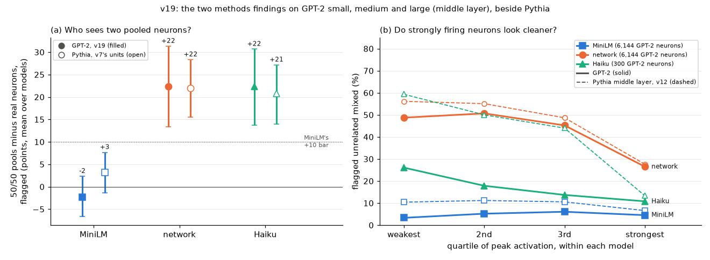

**(a) replicates.**

| Reader | GPT-2: 50/50 pools over real, mean of three sizes (95% interval) | small / medium / large | Pythia, same measure on v7's units (six sizes) | GPT-2 minus Pythia (three sizes against six) |
|---|---|---|---|---|
| MiniLM | **-2** (-7 to +2) | -5 / 0 / -2 | +3 (-1 to +8) | -5.5 (-12 to +1) |
| network | **+22** (+13 to +31) | +35 / +10 / +22 | +22 (+16 to +28) | 0 (-11 to +11) |
| Haiku | **+22** (+14 to +31) | +16 / +28 / +23 | +21 (+14 to +27) | +1.5 (-9 to +12) |

Post hoc, after review: with token position projected out of GPT-2's residual, the network reader's excess is +35 (+26 to +44; point 7).

**(b) replicates for the network reader; Haiku doesn't confirm it.**

| Reader | Neurons | Flagged, by peak quartile (weakest to strongest) | Top minus rest (points), models negative | Log-peak coefficient with controls | H1 / H2 | Pythia, middle layer (v12): top minus rest; coefficient |
|---|---|---|---|---|---|---|
| network | 6,144 | 49% / 51% / 45% / 27% | **-22** (-24.3 to -19.2), 3/3 | -0.34 (-0.41 to -0.28) | **yes** / yes | -26; -0.57 |
| Haiku (real neurons) | 300 | 26% / 18% / 14% / 11% | **-8** (-17.2 to +1.3), 3/3 | -0.40 (-0.89 to +0.01) | no / no | -38 (fresh neurons); -0.94 |
| MiniLM (secondary) | 6,144 | 3% / 5% / 6% / 5% | -0.3 (-1.6 to +0.8), 0/3 | +0.13 (-0.02 to +0.27) | no / no | -4; -0.35 |

Points 1 to 5 are pre-registered (1 and 2 the tests, 3 to 5 secondary). Point 6 is post hoc: it was noticed after seeing the results. Point 7 and the sentences that start "Added after review" are post hoc too, from an independent review of these results; their numbers are under `post_hoc_after_review` in the results, from [`recgen/position_v19.py`](recgen/position_v19.py) and [`recgen/review_v19.py`](recgen/review_v19.py). GPT-2's numbers are in [`results/classification_v19.json`](results/classification_v19.json), beside Pythia's for the two tests; point 6's Pythia figures come from v6's and v7's results.

1. **(a): MiniLM can't see pooling in GPT-2 either, and the other two readers see it at least as well as in Pythia.** MiniLM's excess is -2 points, with an interval that includes zero, and it's within 5 points of zero at every size. The network reader and Haiku both flag 50/50 pools 22 points more than real neurons, their low ends at +13 and +14. Each reader's GPT-2 excess is within 6 points of its Pythia excess, though those differences have wide intervals (about ±6 to ±11 points). Added after review: those differences set the mean over GPT-2's three sizes (124M to 774M) against the mean over Pythia's six (70M to 2.8B), so they don't compare matched sizes. And token position holds down the network reader's GPT-2 excess: with position projected out it's +35 (+26 to +44), so its 0-point difference from Pythia understates how well it sees pooling in GPT-2 (point 7).
2. **(b): the network reader flags the strongest quarter of neurons 22 points less than the rest,** in all three models (Spearman -0.27, -0.15 and -0.09), close to v12's held-out -21 on Pythia. Like Pythia's, it's mostly a step at the top quartile (49%, 51%, 45%, then 27%). Log peak's coefficient stays negative with the controls (H2), at about 60% of Pythia's (-0.34 against -0.56 to -0.58); one neuron with undefined peakedness is left out of H2, as v12's amendment requires. Haiku points the same way in every model (Spearman -0.21, -0.22 and -0.11) and declines steadily by quartile (26% to 11%), but its interval includes zero, so H1 and H2 don't hold for it. Added after review: with token position projected out, the network reader's top quartile is flagged 24 to 25 points less than the rest, in all three models (point 7).
3. **v7's per-model tests and agreement come out much as on Pythia.** The per-model power test (+20 points with separated intervals) passes for the network reader in 1 of 3 models, Haiku in 2 and MiniLM in none. Related pools are flagged less than 50/50 pools by 20 points or more for the network reader and Haiku in 2 of 3 models each. As in v7 that control is easy: 40 to 46% of related pools contain two examples from one window, against 12 to 22% of 50/50 pools and none of the real units. On real neurons, kappa between the network reader and Haiku is 0.11 to 0.36, and below 0.2 with MiniLM. In GPT-2 small, 0.22 is as high as the two readers' rates allow: the network reader flags all 8 of the real neurons Haiku flags.
4. **Haiku's second readings agree more on GPT-2's units:** a second reading of 60 units gives the same label 87% of the time and the same flag 95% (kappa 0.87, interval 0.71 to 1.00), against 0.37 on v7's Pythia units. Added after review: that more likely reflects which units were retested than a steadier reader. Haiku flagged 27% of them at the first reading, against 45% of v7's retested units, and only 17 of the 60 are real neurons (v7: 20). v11's retest of 120 Pythia units, read earlier the same night, gave kappa 0.53.
5. **As on Pythia, coherence carries Haiku's magnitude trend.** Adding v6's top-pair percentile (how alike a neuron's 50 strongest examples are inside the network) to H2's regression gives it a coefficient of -1.18 (-1.83 to -0.73) for Haiku, and log peak's coefficient rises by 0.80 (0.48 to 1.35), to +0.40 (-0.08 to +1.11). Log peak and coherence correlate at about 0.64. For the network reader this is near circular, as in v12 (coherence -1.51, log peak turning positive). For MiniLM coherence's coefficient is small (-0.14, -0.33 to +0.03), and log peak's turns positive, +0.21 (+0.03 to +0.39).
6. **Post hoc: Haiku calls far fewer GPT-2 neurons unrelated mixed than Pythia neurons.** It flags 8% (3 to 14%), 18% and 25% of real neurons from small to large, against 33 to 47% on Pythia, and calls 87%, 72% and 69% of them one job (Pythia: 42 to 57%). It flags fewer 50/50 pools too (24%, 46%, 48%; Pythia: 56 to 78%), so its excess is unchanged. The network reader's rates on real neurons (40 to 46%) are close to Pythia's. That suggests GPT-2's top examples aren't less varied in the network's own representation: their median top-pair percentile is 90, 83 and 84 by size, inside Pythia's range of 79 to 91 (v6). Both comparisons are made in the representation that token position distorts in GPT-2, though. With position projected out, the network reader flags 24 to 44% of GPT-2's real neurons instead of 40 to 46%, below Pythia's 42 to 56% (v7), and the top-pair percentile wasn't recomputed that way (point 7). So whether GPT-2's top examples are as varied as Pythia's in the network's own terms is open. Why Haiku reads them as cleaner isn't tested here. Haiku's low rate on GPT-2 small also leaves (b)'s Haiku test little room: 8 of its 100 real neurons are flagged.

   Added after review, three explanations the data rule out:
   - **Size.** At the Pythia sizes nearest GPT-2's (160M, 410M and 1B), v7's Haiku flagged 33%, 46% and 47% of real neurons, against GPT-2's 8%, 18% and 25%.
   - **A change in Haiku since v7.** Haiku read Pythia's real neurons earlier the same night (v11's readings ended about 1.5 hours, and v12's about 2.7 hours, before v19's began, by the cache files' times), and flagged 36% and 34% of them at a quarter and three quarters of depth (v11) and 42% of fresh middle-layer neurons (v12).
   - **Repeated contexts, one dominant token or shorter snippets.** In GPT-2's real units, 1.0 to 1.9% of examples share their 9-token context with another example in the unit (Pythia: 0.6 to 2.9%), the most common firing token makes up a median of 16 to 22% of a unit's examples (Pythia: 16 to 31%), and prompts average 6,850 to 7,030 characters (Pythia: 6,530 to 6,800).

   That leaves differences this design can't separate: the corpus (Pythia's training data, off-distribution for GPT-2), the tokenizer and the model family itself.
7. **Post hoc, after review: token position reaches the network reader in GPT-2, and projecting it out strengthens both of the reader's results.** GPT-2 adds a learned absolute position embedding to its residual stream; Pythia's rotary embeddings act inside attention and add nothing to it. So in GPT-2's centered middle-layer residual, two random positions look more alike the closer together they are: over the pairs of the 1,024 random positions, cosine similarity correlates -0.53, -0.56 and -0.52 with the gap between their positions by size, against -0.01 to -0.03 in Pythia's v6 recordings at the middle layer of all six sizes. Since the network reader groups a neuron's examples by similarity, judged against those random positions, position can make examples look alike or unrelated whatever the neuron does. [`recgen/position_v19.py`](recgen/position_v19.py) fixes a position subspace for each layer by one rule: regress every residual stored for the layer (the sampled neurons' 50 strongest examples and the random positions), centered, on ten smooth functions of its position p (as a fraction of 512), namely 1, p, p², log p and the sine and cosine of 2πhp for h = 1, 2 and 3, and take the top 2 or 6 right singular vectors of the fitted values. Position explains 10%, 7% and 5% of the residual's squared norm by size, and the top two directions carry 95 to 99.7% of that. With them projected out, the null's correlation with the position gap is -0.02 to 0.00. Projecting the subspace out of every example and null vector, beside the neurons' own directions, with the pre-registered tests' bootstrap draws:

   | Projected out | Network flags changed | Sampled neurons flagged: small / medium / large | (a) network excess | (b) top minus rest, models negative |
   |---|---|---|---|---|
   | nothing (pre-registered) | | 40.5% / 46.0% / 41.7% | +22 (+13 to +31) | -22 (-24.3 to -19.2), 3/3 |
   | position, 2 dims | 16.7% | 31.3% / 40.4% / 36.6% | **+35** (+26 to +44) | **-25** (-26.9 to -22.4), 3/3 |
   | position, 6 dims | 17.3% | 30.9% / 40.0% / 37.9% | **+36** (+27 to +45) | **-24** (-26.8 to -22.0), 3/3 |
   | 6 random directions (control) | 1.5% | 40.4% / 45.8% / 41.7% | +25 (+15 to +34) | -22 (-24.1 to -18.9), 3/3 |

   Removing position lowers the flag rate on real neurons (by 2 to 17 points by model) and raises it on 50/50 pools in medium and large, so the gap between them widens. Neither verdict changes, and the top quartile is flagged less in all three models (Spearman -0.31, -0.23 and -0.15 with 2 dimensions removed). Six random directions change 1.5% of flags. So position makes some GPT-2 neurons look mixed to the network reader, which hides part of its power on GPT-2; it doesn't create either result.

**Recording checks.**

- Activations rebuilt from the stored residuals match the recorded ones within 0.0038, against median peaks of 3.0 to 3.4.
- 2,896, 3,960 and 5,039 neurons are eligible (of 3,072, 4,096 and 5,120), and 2,048 are sampled in each model.
- MiniLM's null on GPT-2's contexts puts v1's merge level at the 98.3rd percentile and the unrelated cutoff at the 81.2nd, against the frozen 98.2 and 81.0.
- The residual's mean makes up 41%, 64% and 37% of its squared norm by size (Pythia's middle layers: 26 to 55%), which the centering removes.
- **The pre-registered float32 check failed for medium, and the check itself was at fault.** A float32 pass on the CPU matched the float16 window maxima within 0.013 for small and 0.009 for large, but only within 3.97 for medium. A post hoc check ([`recgen/precision_v19.py`](recgen/precision_v19.py), [`results/v19_precision_check.json`](results/v19_precision_check.json)) found that this Mac's CPU float32 path computes GPT-2 medium wrongly: its next-token loss on 4 windows is infinite, against 2.408 in float64 on the CPU, and it's already 11% off at the first block's output, which points to a fault in that path rather than to float32's precision. Float32 and float16 on MPS, the recording's device, match the float64 reference (loss 2.408 and 2.409; hidden states within 2e-6 and 1.3e-3). Those hidden-state differences are relative to each hidden state's largest absolute value, and GPT-2's residual has outsized dimensions, so they understate the error in a typical dimension. Added after review: in medium's middle layer, dimension 268 holds the normalized residual's largest value at 99.8% of the random positions, a median of 20 against 0.37 for a typical coordinate (small and large: dimensions 447 and 440, at 86% and 90%). Float32 on MPS matches the stored float16 window maxima within 0.027 over 64 windows. So the recording stands.
- Added after review: all 960 readings' prompt hashes match the prompts the committed code builds for their units.

### What this does and doesn't show

- **(a) holds across the change of architecture.** In GPT-2, as in Pythia, clustering top examples with this sentence model doesn't separate two pooled neurons from one, while the network's own representation and a language model reading the snippets do, by at least about 22 points in both families (the network reader's GPT-2 excess is +35 with token position projected out, point 7). The warning from v7 and v9, that MiniLM-based cleanliness numbers don't measure mixing, isn't specific to Pythia.
- **(b) holds for the network reader, which is the less independent test.** It gets stronger with token position projected out (point 7). The network reader's flag and the coherence that carries the effect come from the same representation (point 5). In Pythia, Haiku, which never sees that representation, confirmed the effect at three depths. In GPT-2 it points the same way in every model but doesn't pass: it flags few real neurons (point 6) and reads only 300. So in GPT-2 the magnitude effect is shown clearly by one reader and only suggested by the independent one.
- **Absolute "share mixed" numbers don't transfer between these setups.** Haiku's real-neuron rate drops from about 43% on Pythia to 17% on GPT-2 while its excess on pools stays the same. Model size, a change in Haiku, repeated contexts, a dominant token and snippet length don't explain the drop (point 6), but the corpus, the tokenizer and the size ranges change along with the family, so it isn't shown to be a property of GPT-2. A cleanliness figure from one reader in one setup says little about another.

### What's still shaky

- **The corpus is the Pile, Pythia's training data, not GPT-2's.** GPT-2 was trained on WebText, so code, LaTeX and other Pile text may be unusual inputs for it. That could change which examples top a neuron's ranking in ways that don't affect Pythia.
- **Re-tokenization changes what each reader sees.** GPT-2 windows end at different text than Pythia's, and 24 GPT-2 tokens of snippet cover different text than 24 Pythia tokens.
- **The network reader reads a different place in the block.** In GPT-2 the MLP's input includes its own block's attention output; in Pythia it doesn't. That's the right analog, but it means the two families' network readers aren't identical.
- **GPT-2's learned absolute position embedding reaches the network reader.** Positions close together in a window look alike in GPT-2's centered residual, and the pre-registered reader doesn't remove that. Projecting a fitted position subspace out changes about 17% of its flags and moves both of its results (point 7), so its GPT-2 flag rates, and comparisons of them with Pythia's, carry this confound. The subspace's rule was chosen after the review, and other rules could remove somewhat more or less. Projecting position out would also remove a real position-related job, if a neuron had one.
- **Haiku's (b) test is weak:** 300 neurons with a 17% flag rate, against v12's 600 per test with flag rates of 34 to 42%.
- **Three sizes, 124M to 774M, one layer each.** Per-model numbers rest on 50 pools and 100 real neurons per model.
- **Token purity** is computed with a stable sort, so in about 10% of neurons one of its 50 windows differs from the readers' 50 at a float16 tie (purity changes by at most 0.02), as in v12.
- **Why the CPU float32 path fails on GPT-2 medium isn't known** (PyTorch 2.14.1 on this M1 Pro). It doesn't affect the recording, which ran on MPS, but the pre-registered check didn't do its job for that model.
- **Haiku runs through the `claude` CLI,** which adds a little hidden context: the working directory, the platform, the date and an account notice. It includes no git branch, commit or file contents.

### v19 files and reproduce

| Path | What it is |
|---|---|
| [`recgen/rubric_v19.py`](recgen/rubric_v19.py) | Pre-registered models, corpus, readers, units and both tests |
| [`recgen/gpt2_v19.py`](recgen/gpt2_v19.py) | GPT-2's corpus and recording: window maxima, residuals entering `ln_2`, input weights |
| [`recgen/units_v19.py`](recgen/units_v19.py), [`recgen/read_v19.py`](recgen/read_v19.py) | v7's units on GPT-2; Haiku readings through v7's reader, with a $40 spend guard |
| [`recgen/analyze_v19.py`](recgen/analyze_v19.py), [`recgen/plots_v19.py`](recgen/plots_v19.py) | Three readers, tests (a) and (b), secondary results and checks; the figure |
| [`recgen/precision_v19.py`](recgen/precision_v19.py) | Post hoc device and precision check of GPT-2 medium |
| [`recgen/position_v19.py`](recgen/position_v19.py), [`recgen/review_v19.py`](recgen/review_v19.py) | Post hoc, after review: the network reader with token position projected out (point 7); the checks on Haiku's rates, its retests and the recording |
| [`results/classification_v19.json`](results/classification_v19.json), [`results/v19_llm_answers.json`](results/v19_llm_answers.json), [`results/v19_precision_check.json`](results/v19_precision_check.json) | Results with per-unit and per-neuron flags, and the post hoc checks under `post_hoc_after_review`; every Haiku reading with its prompt hash and cost; the precision check |
| `tests/test_rubric_v19.py`, `tests/test_gpt2_v19.py`, `tests/test_read_v19.py`, `tests/test_analyze_v19.py`, `tests/test_position_v19.py`, `tests/test_review_v19.py` | Tests for the rules, the GPT-2 recorder, the spend guard, the analysis and the post hoc checks |

```bash
./run_v19.sh
```

`run_v19.sh` needs `data/corpus.npy`, the `pile-10k` dataset (once, to rebuild v1's stream for GPT-2's corpus), `results/classification_v7.json` and `classification_v12.json`, and the `claude` CLI signed in. The post hoc checks also need v6's middle-layer recordings in `data/v6/` and `results/v7_llm_answers.json` and `v12_llm_answers.json`, and read v11's cached readings in `data/v11/` if they're there. From scratch it takes about 1.5 hours on an M1 Pro: recording takes 46 minutes, downloading the three models one at a time (5.3 GB in all) and deleting each after use; MiniLM embeddings take 5 minutes; the 960 readings take about 26 minutes of reading, six at a time. In this run they didn't come from one `read_v19` call. An ad hoc driver read GPT-2 small's 320 from 02:56 to 03:05, right after small was recorded and before medium and large were (03:12 and 03:38), and `read_v19` read the other 640 from 03:52 to 04:09, reusing small's cache: 72 minutes from the first reading to the last, by the cache files' times. That doesn't change what was read, since every reading's prompt hash matches the prompt the committed code builds. It caches 970 MB in `data/v19/`. With that cache, it makes no model calls and reruns in about 6 minutes. The precision check isn't part of it: `uv run python -m recgen.precision_v19 gpt2-medium` downloads medium again.

## Files

| Path | What it is |
|---|---|
| [`results/candidates.md`](results/candidates.md) | The 40 traced neurons and their facets at the final checkpoint |
| [`results/hand_picked.json`](results/hand_picked.json) | The 23 hand-picked neurons, with why each looks mixed |
| [`results/classification.json`](results/classification.json) | Labels, emergence steps, facet similarities, exploratory stats |
| [`results/trajectories.md`](results/trajectories.md) | Each hand-picked neuron's strongest examples at every checkpoint |
| [`results/figures/`](results/figures/) | Facet response curves (hand-picked and all traced) and label counts |

## Reproduce

```bash
uv sync
uv run pytest
./run.sh
```

`run.sh` takes about 2 hours on an M1 Pro. It downloads 15 checkpoints of about 1.6 GB each, one at a time, and deletes each after use. Recorded activations (about 2.5 GB) go to `data/`, which isn't committed.
